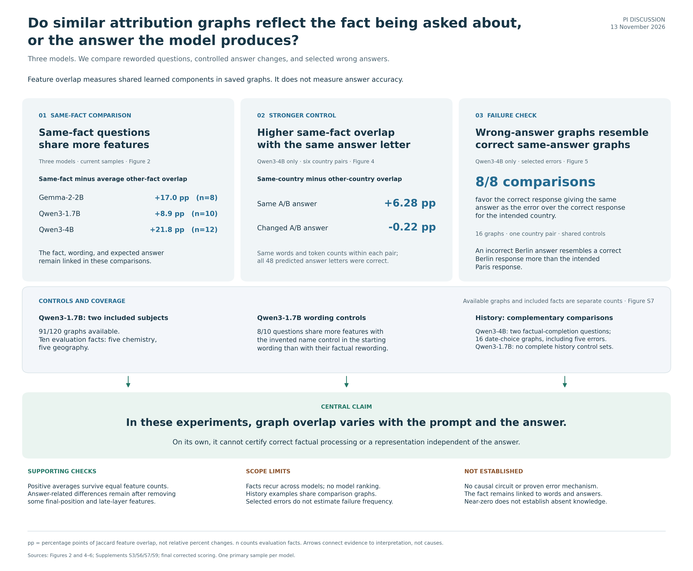

# Attribution graph paper review package

Review edition updated 13 November 2026 to express Jaccard overlap as a percentage and differences in percentage points. This changes presentation only, not the data, calculations, statistical tests, or conclusions. The manuscript includes the approved supporting sections A1–A8, descriptive figure legends, and final corrected scoring. The main comparison includes 8 Gemma-2-2B, 10 Qwen3-1.7B, and 12 Qwen3-4B evaluation facts. The sharing folder is maintained on the [GitHub main branch](https://github.com/J-Lawrence10/autocircuit/tree/main/neuronpedia_pipeline/paper_share). This is a working paper for PI and collaborator review, not a peer-reviewed publication or a submission-ready release. Different question designs retain their own samples within the same study. Earlier scoring decisions remain in provenance, not as alternative main results. See the [revision notes](manuscript/MANUSCRIPT_REVISION_NOTES.md).

Reviewed edition: the approved title is **Feature sharing in attribution graphs tracks predicted responses**. The Introduction states the comparison question explicitly; repeated discussion text and detailed reproduction history have been shortened or moved to Supporting analysis A8. Figures use the final 8/10/12 sample counts, a four-comparison overview, print-sized labels, and six main figures plus ten supplements. The descriptive question-version comparison is now Supplement S10. The approved Abstract now states the 8/10/12 evaluation-fact counts, clarifies the same-country overlap advantage, and identifies the five incorrect history predictions retained in the analysis.

## Research question

Do similar attribution graphs reflect the fact being asked about, or the answer the model produces?

Same-fact questions share more features across the three analyzed models. In the stronger Qwen3-4B comparison, the same-country overlap difference is larger when the answer letter stays the same. Selected wrong-answer graphs also favor correct predictions giving the same answer. These findings connect overlap to both the question relationship and predicted response, rather than correctness alone.

## Start here

1. [Claims map](claims/paper_claims_map.png): the final three-model findings and their connection to the answer-letter, error, and history comparisons. [Editable SVG](claims/paper_claims_map.svg).
2. [Findings and interpretation](manuscript/FINAL_FINDINGS_SUMMARY.md): the results and what they support.
3. [Integrated outline](manuscript/INTEGRATED_PAPER_OUTLINE.md): the paper's logical argument and section structure.
4. [Figure guide](figures/LEGENDS.md): six main figures and ten supplements with self-contained captions. [Open the figure gallery](figures/index.html) locally in a browser. [History comparisons (Figure 6)](figures/figure6_history_answers.png) includes exact prompts, correct answers, and errors. [Methods diagram (Figure S8)](figures/figureS8_feature_overlap_workflow.png) explains the primary feature-overlap calculation. [History factual completions (Figure S9)](figures/figureS9_answer_spelling.png) details the two history facts included in Figure 2.
5. [Working manuscript](manuscript/ATTRIBUTION_GRAPH_THREE_MODEL_DRAFT.md): current methods, results, discussion, and supporting analyses. A [browser-readable copy](manuscript/ATTRIBUTION_GRAPH_THREE_MODEL_DRAFT.html) is included.
6. [Questions included and excluded](manuscript/SAMPLE_ACCOUNTING.md): current graph counts, evaluation facts, and exclusion reasons, distinct from accuracy.

The [paper website](https://j-lawrence10.github.io/autocircuit/) provides the browser-readable manuscript and figure gallery. GitHub renders the Markdown and PNG files directly; the downloaded folder also works locally in a browser.

## Main findings and boundaries

- Mean same-fact minus other-fact overlap is 17.0 percentage points for Gemma-2-2B (8 evaluation facts), 8.9 for Qwen3-1.7B (10), and 21.8 for Qwen3-4B (12; descriptive 95% interval 15.0–30.7 percentage points). All included facts have positive differences. Repeated facts and different subject coverage prevent a model ranking.
- The two Qwen3-4B history facts have differences of 60.1 and 39.5 percentage points, both positive with equal feature counts. They are each other's comparison partners, so the result describes those questions rather than independent replications across history.
- In Qwen3-1.7B, eight of ten evaluation questions share more features with the same-pattern invented name control than with their factual rewording. All ten favor the factual rewording over the reworded control. Matching broad next-token categories gives differences of -1.09 percentage points (n=9) and +10.59 percentage points (n=10). The controls do not isolate factual meaning from wording and the expected answer.
- In the stronger Qwen3-4B study, the same-country overlap difference is 6.28 percentage points with the same A/B answer and -0.22 percentage points with a changed answer. All 48 predictions across six country pairs are correct. Near zero does not establish absent factual knowledge.
- All eight selected error comparisons favor the correct response giving the same answer over the correct response for the intended country. These dependent cases do not estimate general failure frequency or prove an error mechanism.
- In 16 historical-date graphs, swapping the dates assigned to A/B produced five comparisons retaining the letter but selecting different years (feature overlap 79.5–91.1%) and three changing the letter to retain the same correct year (51.2–53.2%). All 11 correct and five incorrect predictions remain included. These are descriptive comparisons from two event pairs; the full required-letter pattern is not uniformly reproduced.
- Average feature-sharing differences remain positive after equalizing feature counts. The Qwen3-4B answer-related differences also remain after the specified graph-location filters. The coarser Qwen3-1.7B edge-flow comparison is inconclusive, so the result does not cover every graph property.

## Data coverage

The four-version question design contains 120/120 graphs for Gemma-2-2B, 91/120 for Qwen3-1.7B, and 120/120 for Qwen3-4B. Gemma and Qwen3-4B each have another 27 fact-by-wording graphs, giving 385 graphs across these two designs. The separate Qwen3-4B answer-letter and selected-error studies contain 48 and 16 graphs, respectively.

Qwen3-1.7B has all 40 chemistry and 40 geography graphs. Its 11/40 history graphs provide no complete four-version sets after 29 input-length rejections. These are collection failures, not wrong answers. Qwen3-4B has all 147 planned graphs and twelve included evaluation facts, including Columbus's flagship and Franz Ferdinand. All four invented name controls for those history facts predict commas, so the output-type-matched control comparison uses ten facts. Its historical-date pilot passed 15/20 checks against a 20/20 gate, leaving the planned 160 evaluation graphs uncollected. Figure 6 includes all 16 historical prompts from that preliminary check, including incorrect predictions. Gemma contributes three history facts to the primary comparison.

No shortened history prompts were generated or substituted. The proposal is deferred from this paper.

## Interpretation and future research

The observed answer-associated overlap could reflect shared model activity, answer-dependent selection of features into the exported graph, or both. Discussion Section 4.3 explains this unresolved distinction and proposes future fixed-activity attribution comparisons, activation-based measurements, and controlled interventions. Those studies have not been performed or initiated.

The main figures consistently use the current Qwen3-1.7B sample of 91 graphs and ten included evaluation facts, with comparison-specific subsets where required. The fact-by-wording, answer-letter, selected-error, and graph-location studies retain their own samples. Figure S7 distinguishes collection counts from included facts; missing groups are unavailable, not zero effects.

## What is in the folder

| Folder | Contents |
|---|---|
| `claims/` | Core three-model/geography claims map and a Figure 1 layout reference, PNG and editable SVG |
| `figures/` | Six main figures, ten supplements, captions, and local browser gallery |
| `tables/` | Current figure source tables and question-inclusion audit |
| `manuscript/` | Working draft, integrated outline, findings summary, and sample accounting |
| `methods/` | Relevant frozen protocols and supporting analysis notes |
| `code/` | Selected analysis, figure, validation, and test source snapshots; dependency pins |
| `provenance/` | File checksums, source mapping, analysis records, and archived verification evidence |

The [Figure 1 option C file](claims/figure1_option_c.png) is retained as a design reference, not as a substitute for the current Figure 1 in the figure gallery.

## Reproducibility and exclusions

Feature overlap is 100 times Jaccard similarity; differences are percentage points, not relative percent changes. Source CSV and JSON files retain native, unscaled measurements for reproducibility. Cosine similarities, probabilities, and p-values are not multiplied by 100.

The code snapshots preserve project-relative paths. They are for method inspection and use with the full authorized research archive; this compact folder does **not** reproduce the complete raw-data analysis by itself. The included CSV and derived JSON files support inspection of reported values, but do not replace raw-data access.

The current Qwen3-1.7B analysis was specified after earlier findings were known, using unchanged prompts, expected answers, and inclusion rules. Earlier subset results remain in the audit archive, not as extra observations or an independent replication. Methods Section 2.8 preserves the distinction between those analyses and later retrospective display audits. Input hashes, representation checks, and reconstruction of archived results are recorded alongside the current analysis.

Automated reproduction and review records are not independent scientific validation. The package manifest records the included file hashes, and the link audit checks local references. To verify the downloaded files and headline arithmetic without installing additional packages, run `python code/verify_package.py` from this folder. This checks hashes and included tables, not excluded raw graphs.

The bounded recovery made exactly two authorized hosted generation requests; both succeeded. No local model inference or further experiment was run. The figures use saved data. Excluded materials include raw Neuronpedia exports, tokenizer/model files, private API configuration, credentials, downloaded reference PDFs, environments, caches, unrelated changes, and the large local release archive. Their redistribution permissions are not established. The earlier compiled PDF is omitted because it predates the current figures and captions. Links to the writing-reference papers appear in [the reference guide](methods/WRITING_REFERENCES.md); their PDFs are not bundled.

Independent scientific review, author approval, reference verification, and venue formatting remain outstanding. This package makes no new license grant for third-party materials and does not authorize redistribution of the excluded archive.
