# Figures and legends

Six main figures and ten supplements present the final results. The main comparison includes 8 Gemma-2-2B, 10 Qwen3-1.7B, and 12 Qwen3-4B evaluation facts. Figure S9 details the included Qwen3-4B history facts. Figure 6 shows the historical-date A/B comparisons. Supplement S10 contains the descriptive question-version comparison. The panels retain their own samples; the history comparisons reuse 16 graphs from two event pairs.

Feature overlap is Jaccard similarity multiplied by 100: shared features divided by the distinct features present in either graph, expressed as a percentage. Zero percent means none are shared and 100% means the feature sets are identical. Differences in overlap are expressed in percentage points, not relative percentage changes. Word-set Jaccard uses the same convention; cosine similarities retain their native units. The source tables retain the original unscaled values. Missing comparisons are unavailable, not zero effects. Source filenames retain their archived numbers; the links below map each current figure to its source tables. All figures are 180 mm wide with text of at least 7 points at that size.

## Figure 1: Four comparisons connect feature sharing, responses, and correctness

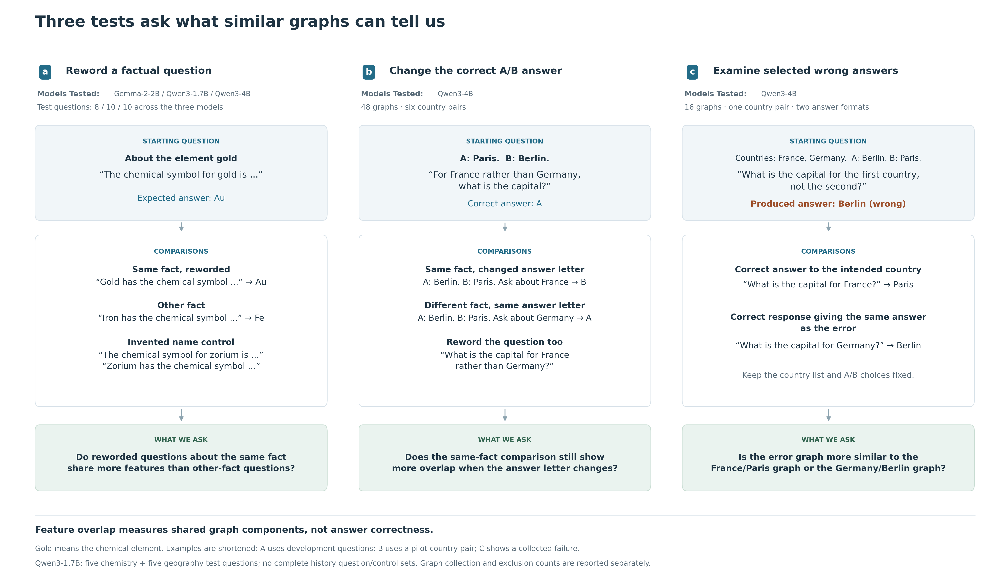

A, Comparisons of a starting factual question with its rewording, questions about other facts in the same subject, and invented name controls. Included evaluation facts: eight for Gemma-2-2B, ten for Qwen3-1.7B, and twelve for Qwen3-4B. B, Qwen3-4B comparisons varying the queried country, the A/B letter assigned to the correct capital, and question wording. Word and token counts are held constant within each country pair; six country pairs contribute 48 graphs. C, Each selected error graph is compared with two correct-answer graphs: one for the intended country and one producing the same response as the error. The Qwen3-4B dataset contains 16 graphs from one country pair, using A/B and capital-name responses; some comparisons share control graphs. D, Historical-date questions with swapped A/B date assignments or reversed question/context order. The Qwen3-4B dataset contains 16 graphs from two event pairs, including 11 correct and five incorrect predictions. Prompts are abridged. Panels A and B show development or pilot examples excluded from their evaluation sets; panels C and D show recorded predictions. “Zorium” is an invented name. Answers denote highest-probability next tokens, and arrows connect compared conditions.

[Editable SVG](figure1_design_and_coverage.svg)

Source tables: [figure1_coverage.csv](../tables/figure1_coverage.csv)

## Figure 2: Reworded questions about the same fact share more features in the analyzed samples

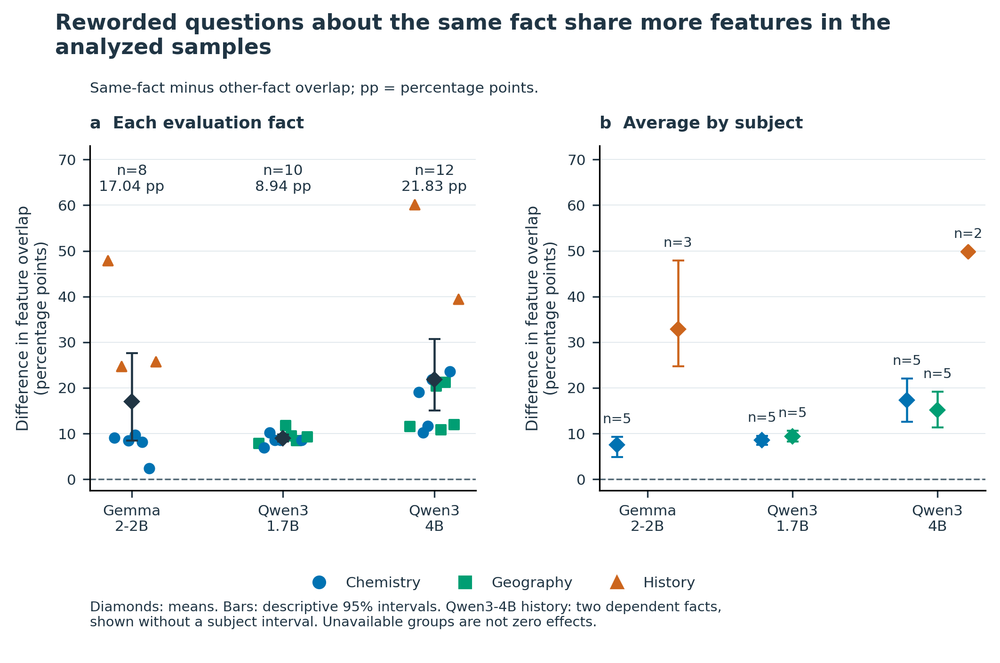

A, Individual evaluation facts for Gemma-2-2B (n=8), Qwen3-1.7B (n=10), and Qwen3-4B (n=12). Each value is the starting question’s Jaccard overlap with its factual rewording minus its mean overlap with other-fact rewordings in the same model, subject, and evaluation set, multiplied by 100 and expressed in percentage points (pp). Blue circles, green squares, and orange triangles denote chemistry, geography, and history, respectively; black diamonds show model means. B, Means within each model and subject, shown as diamonds using the same subject colors. Bars in both panels are descriptive 95% percentile bootstrap intervals from 10,000 fact-level resamples. The two Qwen3-4B history facts use each other as comparators; their subject mean is shown without an interval. n counts evaluation facts. Dashed lines mark zero difference. Model–subject groups without an estimate are not plotted.

[Editable SVG](figure2_fact_signal.svg)

Source tables: [figure2_domain_summary.csv](../tables/figure2_domain_summary.csv), [figure2_fact_level.csv](../tables/figure2_fact_level.csv), [figure2_summary.csv](../tables/figure2_summary.csv)

## Figure 3: The invented name comparison changes the observed overlap difference

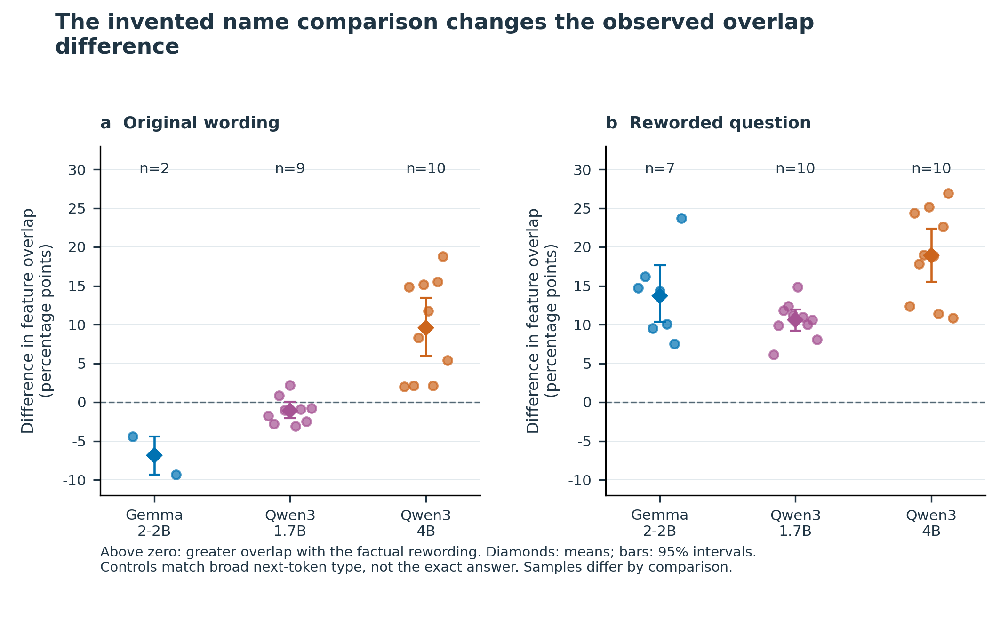

A, Invented name controls retaining the starting question’s wording. B, Reworded invented name controls. Each point is the starting question’s Jaccard overlap with its factual rewording minus its overlap with the indicated control, expressed in percentage points (100 times the native difference). Controls are included when their predicted next token and the starting question’s predicted token share a broad category: letters/numbers, whitespace, or punctuation/symbols. Blue, purple, and orange denote Gemma-2-2B, Qwen3-1.7B, and Qwen3-4B, respectively. Circles represent evaluation facts, diamonds are means, and bars are descriptive 95% fact-bootstrap intervals. Sample sizes in model order are n=2, 9, and 10 in A and n=7, 10, and 10 in B. Dashed lines mark equal overlap with the factual rewording and control.

[Editable SVG](figure3_control_comparisons.svg)

Source tables: [figure2_fact_level.csv](../tables/figure2_fact_level.csv), [figure4_controls.csv](../tables/figure4_controls.csv)

## Figure 4: Same-fact overlap is higher when the answer letter stays the same

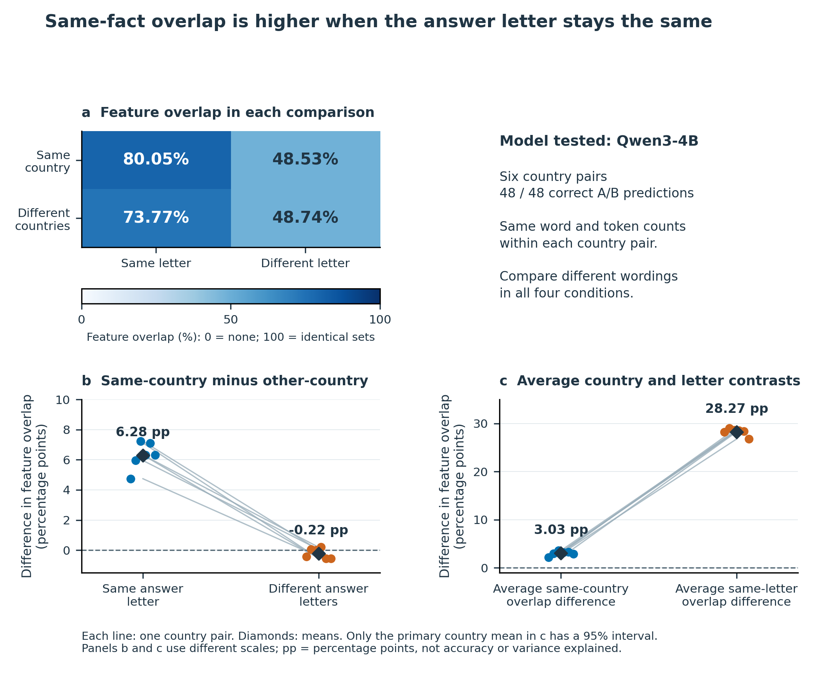

Qwen3-4B comparisons from six country pairs and 48 graphs. A, Mean Jaccard overlap for questions about the same or different countries with the same or different correct A/B answer letters. Numbers and color intensity give overlap as a percentage (100 times Jaccard), from 0% for no shared features to 100% for identical feature sets. B, Same-country minus different-country overlap, calculated separately for matching and changed answer letters. C, The average country contrast, obtained by averaging the two conditions in B, and the average letter contrast, obtained by averaging same-letter minus different-letter overlap across country relationships. B and C express differences in percentage points (pp), not relative percentage increases. In B and C, circles represent country pairs, lines connect estimates from the same pair, and black diamonds show means. Blue and orange identify the labeled conditions. The bar on the primary country contrast in C is a 95% block-bootstrap interval, resampling country pairs (n=6); no interval is plotted for the descriptive letter contrast. Dashed lines mark zero. Panels B and C have different vertical scales.

[Editable SVG](figure4_matched_choice.svg)

Source tables: [figure5_block_contrasts.csv](../tables/figure5_block_contrasts.csv), [matched_choice_primary.json](../tables/matched_choice_primary.json)

## Figure 5: Error graphs share more features with correct predictions giving the same response

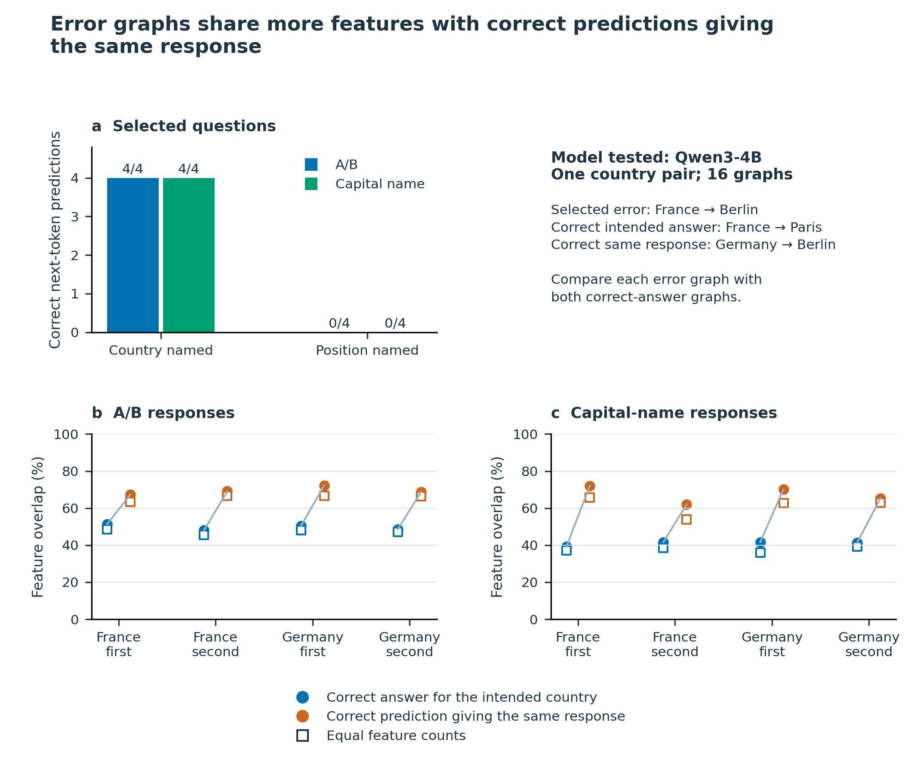

Qwen3-4B selected cases from one country pair, with 16 graphs and eight selected error cases using shared controls. A, Correct next-token counts for questions naming the country directly or referring to its list position. Blue and green bars denote A/B and capital-name responses; labels give correct predictions out of four prompts per condition. B–C, Jaccard overlap, expressed as a percentage, of each error graph with a correct-answer graph for the intended country (blue) or a correct-answer graph producing the same response as the error (orange), for A/B responses (B) and capital names (C). List order and answer mapping are held fixed within each comparison. Filled circles use all retained features; open squares average 200 equal-feature-count subsamples. Lines connect the two controls for the same error. The comparisons are descriptive; no confidence intervals or hypothesis tests are plotted.

[Editable SVG](figure5_failure_cases.svg)

Source tables: [figure6_behavior.csv](../tables/figure6_behavior.csv), [figure6_comparisons.csv](../tables/figure6_comparisons.csv)

## Figure 6: History: similar graphs can accompany different selected years

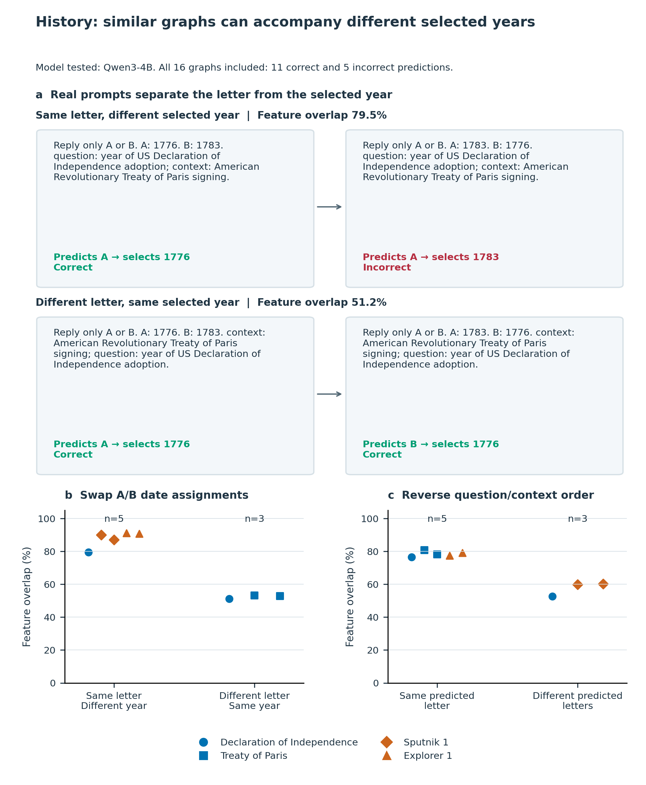

Qwen3-4B historical-date comparisons using 16 graphs from two event pairs, including 11 correct and five incorrect next-token predictions. A, Recorded prompts for the Declaration of Independence example, with the A/B date assignments swapped within each row. Displayed responses identify the predicted letter, selected year, and correctness; overlap is labeled above each pair. Prompt text is exact apart from added line breaks; the chat wrapper is omitted. B, Eight graph pairs differing in A/B date assignment while event and question/context order remain fixed. C, Eight graph pairs differing in question/context order while event and A/B date assignment remain fixed. Each point is one graph pair; n counts pairs in each response category. Blue circles and squares denote the Declaration of Independence and Treaty of Paris; orange diamonds and triangles denote Sputnik 1 and Explorer 1. Jaccard overlap ranges from 0% (no shared features) to 100% (identical feature sets), using 100 times the native Jaccard score. Panels B and C reuse the same 16 graphs; no inferential intervals or tests are plotted.

[Editable SVG](figure6_history_answers.svg)

Source tables: [figure7_history_answers_source.csv](../tables/figure7_history_answers_source.csv)

## Supplement S1: Graph files have two separate limits: ID conflicts and approximation error

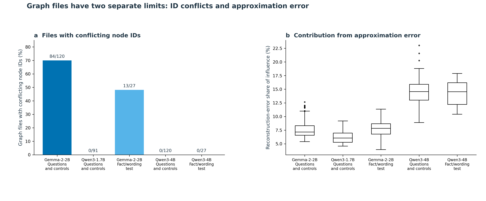

A, Percentage of graph files containing a node ID assigned to conflicting node identities. Bar labels show affected files divided by files checked. “Controls” includes factual questions and invented name controls; “Versions” denotes the question-version experiment. B, Reconstruction-error influence as a percentage of absolute nonterminal-node influence in the same graph sets. Boxes span the 25th–75th percentiles; center lines are medians, whiskers extend to the most extreme values within 1.5 interquartile ranges, and dots show values beyond the whiskers. Each observation is a graph; sample sizes are 120, 91, 27, 120, and 27 from left to right in both panels. Gemma and Qwen3-1.7B values use raw-file audits; Qwen3-4B values use converted graphs. The plotted percentage measures reconstruction-error influence, not the frequency of incorrect answers.

[Editable SVG](figureS1_export_and_error.svg)

Source tables: [figureS1_influence_values.csv](../tables/figureS1_influence_values.csv), [figureS1_quality.csv](../tables/figureS1_quality.csv)

## Supplement S2: Average feature-overlap differences stay positive in the displayed checks

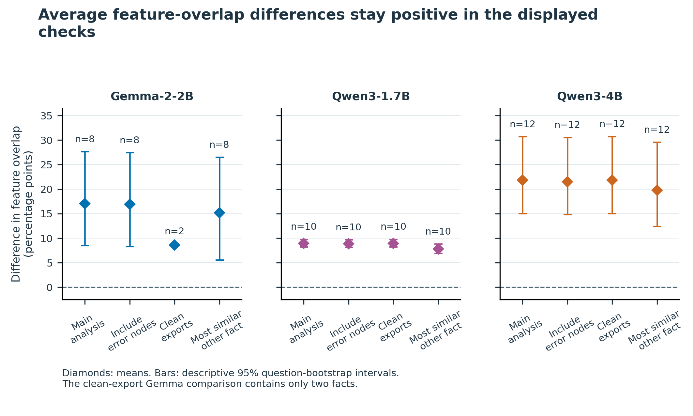

Mean same-fact minus other-fact Jaccard overlap, expressed in percentage points, under four analysis settings, shown separately for each model. The settings are the main analysis, inclusion of reconstruction-error nodes, restriction to starting-question and factual-rewording exports without detected node-ID conflicts, and replacement of the average other-fact overlap with the largest other-fact overlap. Diamonds are means; bars are descriptive 95% bootstrap intervals resampling evaluation facts. Labels give n, the number of included facts after rebuilding comparison groups for each setting. Gemma-2-2B uses eight facts except in the clean-export setting (n=2); Qwen3-1.7B and Qwen3-4B use ten and twelve facts, respectively, in every setting. Dashed lines mark zero difference.

[Editable SVG](figureS2_robustness.svg)

Source tables: [figureS2_robustness.csv](../tables/figureS2_robustness.csv)

## Supplement S3: Average overlap differences stay positive with equal numbers of features

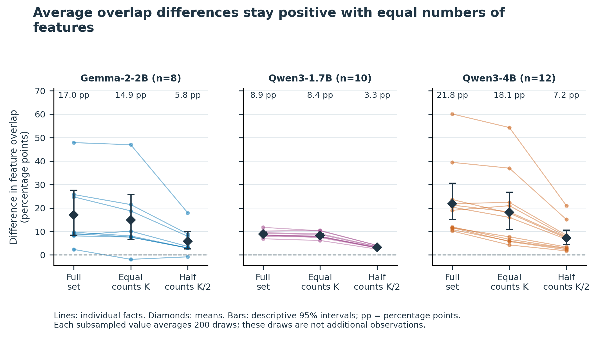

Same-fact minus average other-fact Jaccard overlap, expressed in percentage points (pp), using all retained features, equal feature counts K, or half that count (K/2, rounded down). Within each model, subject, and evaluation set, K is the smallest feature count among the included factual graphs. Features are sampled independently from each graph without replacement, with each sampled graph reused across comparisons within a repetition. Subsampled values average 200 repetitions. Lines connect values for individual facts; black diamonds are model means. Bars are descriptive 95% bootstrap intervals resampling facts, not the 200 repetitions. Sample sizes are eight Gemma-2-2B, ten Qwen3-1.7B, and twelve Qwen3-4B evaluation facts. Dashed lines mark zero difference.

[Editable SVG](figureS3_equal_feature_counts.svg)

Source tables: [figureS3_equal_counts.csv](../tables/figureS3_equal_counts.csv), [figureS3_per_fact.csv](../tables/figureS3_per_fact.csv)

## Supplement S4: Other-fact questions share fewer words, leaving a gap in the controls

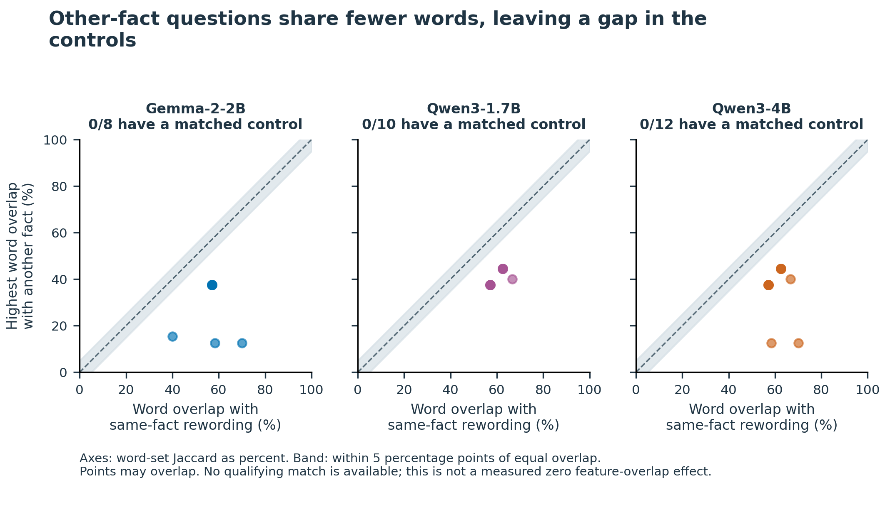

Each point represents an evaluation fact: n=8 for Gemma-2-2B, n=10 for Qwen3-1.7B, and n=12 for Qwen3-4B. The horizontal axis shows word overlap between the starting question and its factual rewording; the vertical axis shows the largest word overlap with an other-fact rewording in the same model, subject, and evaluation set. Overlap is Jaccard similarity between sets of letter/number words, expressed as a percentage, ignoring case and retaining common words. The dashed diagonal marks equal overlap; the shaded band spans ±5 percentage points around it, equivalent to ±0.05 on the native Jaccard scale. Panel labels give the number of facts with a qualifying matched control under the predefined rules, divided by the number evaluated. Points may overlap.

[Editable SVG](figureS4_lexical_support.svg)

Source tables: [figureS4_lexical_scatter.csv](../tables/figureS4_lexical_scatter.csv), [figureS4_lexical_support.csv](../tables/figureS4_lexical_support.csv)

## Supplement S5: A matching first token does not always verify the whole answer

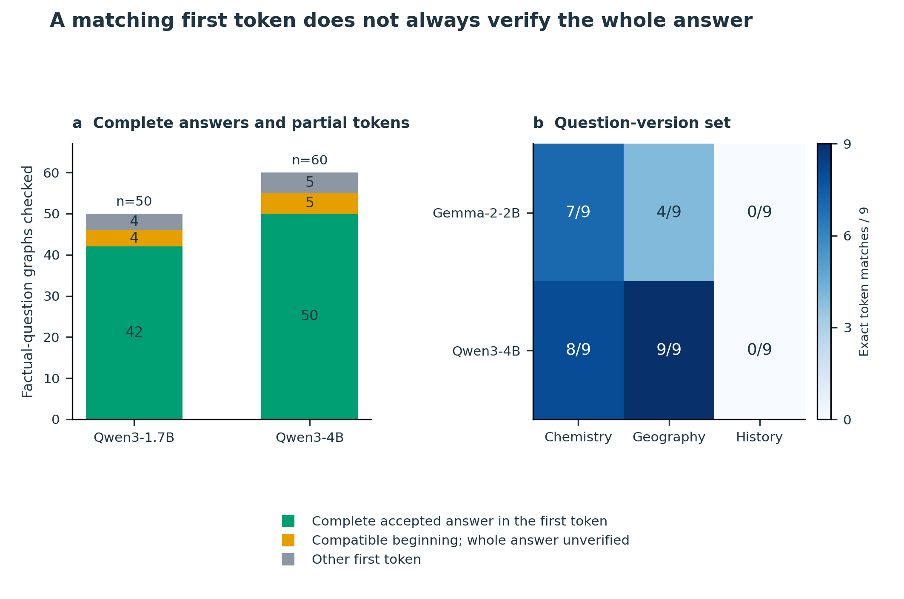

A, Counts of factual-prompt graphs classified by their predicted next token: complete accepted answer (green), partial beginning of an accepted answer (yellow), or another token (gray). Bar segments show counts; totals are n=50 for Qwen3-1.7B and n=60 for Qwen3-4B. These include development and evaluation prompts and incomplete Qwen3-1.7B history sets. Accepted spellings include Maria and María. B, Exact next-token matching in the fact/wording experiment. Each cell contains nine questions: three facts asked in three versions. Numbers show matches out of nine, and color intensity encodes the matching count from 0 to 9. Matching requires the predicted token text to equal the expected text after trimming leading and trailing whitespace. Panel A counts prompt graphs; panel B counts matches within model–subject groups.

[Editable SVG](figureS5_answer_audit.svg)

Source tables: [figureS5_answer_audit.csv](../tables/figureS5_answer_audit.csv), [figureS5_crossed_expected_tokens.csv](../tables/figureS5_crossed_expected_tokens.csv)

## Supplement S6: The answer-related differences remain after removing some graph features

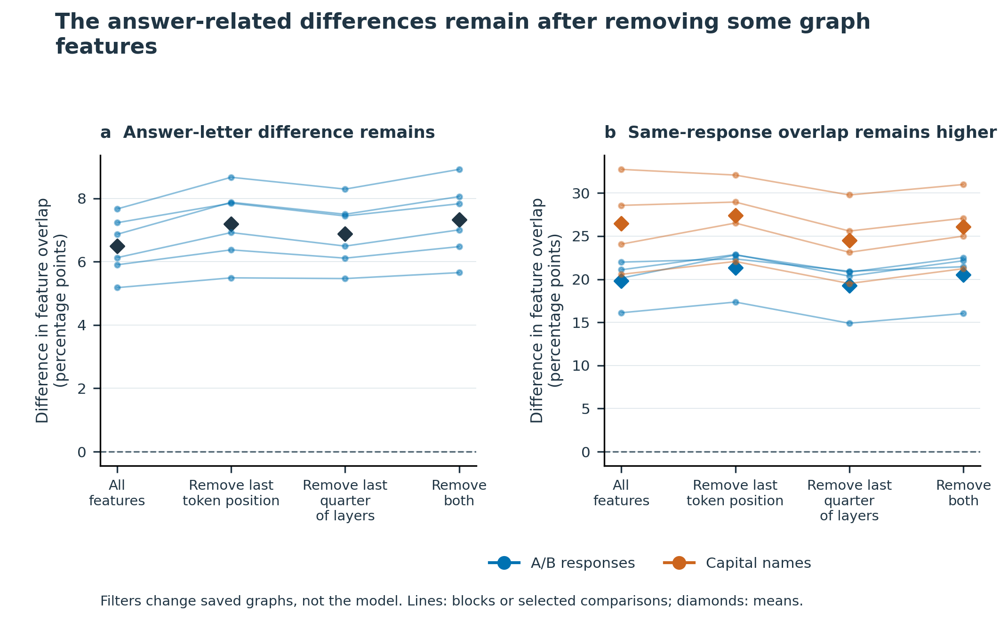

Qwen3-4B comparisons using all retained features or removing features at the final input-token position, in the last quarter of observed feature layers, or both. Filtering precedes collapsing feature identities across positions. A, The same-country minus other-country overlap contrast with matching answer letters, minus the corresponding contrast with changed letters. Each line is one country pair (n=6); black diamonds show means. B, Error-graph overlap with a correct same-response graph minus overlap with a correct intended-country graph. Lines show selected errors, with four A/B cases (blue) and four capital-name cases (orange); colored diamonds show format means. Error comparisons share control graphs. All differences use Jaccard overlap and are expressed in percentage points. Dashed lines mark zero; no confidence intervals or hypothesis tests are plotted.

[Editable SVG](figureS6_graph_location_sensitivity.svg)

Source tables: [failure_sensitivity.csv](../tables/failure_sensitivity.csv), [matched_choice_sensitivity.csv](../tables/matched_choice_sensitivity.csv), [statistics_audit.json](../tables/statistics_audit.json)

## Supplement S7: Qwen3-1.7B includes chemistry and geography; history sets are incomplete

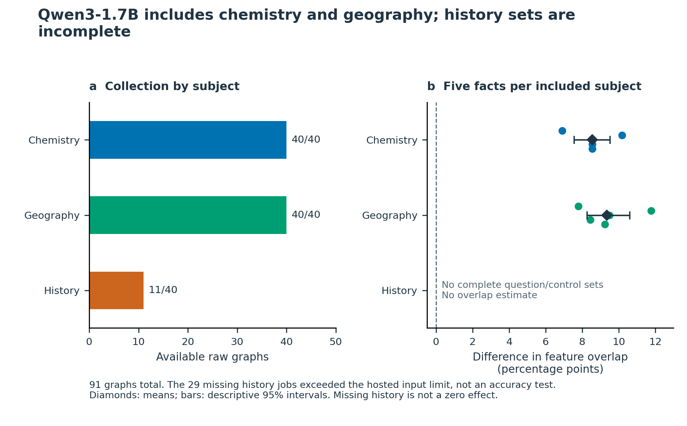

Qwen3-1.7B graph availability and evaluation-fact overlap by subject. A, Available graph counts; labels give available/planned graphs, including development and evaluation prompts (91 available in total). Blue, green, and orange denote chemistry, geography, and history. B, Each circle represents one evaluation fact: five chemistry and five geography facts. Values are same-fact rewording overlap minus mean other-fact rewording overlap within the same subject and evaluation set, expressed in percentage points. Diamonds show means; bars are descriptive 95% fact-bootstrap intervals. The dashed line marks zero difference. History has no complete four-prompt sets and therefore no overlap estimate in B; its 29 unavailable graph requests exceeded the hosted input limit.

[Editable SVG](figureS7_qwen17_completion.svg)

Source tables: [figureS7_collection.csv](../tables/figureS7_collection.csv), [figureS7_domain_summary.csv](../tables/figureS7_domain_summary.csv), [figureS7_per_fact.csv](../tables/figureS7_per_fact.csv)

## Supplement S8: How questions become a feature-overlap comparison

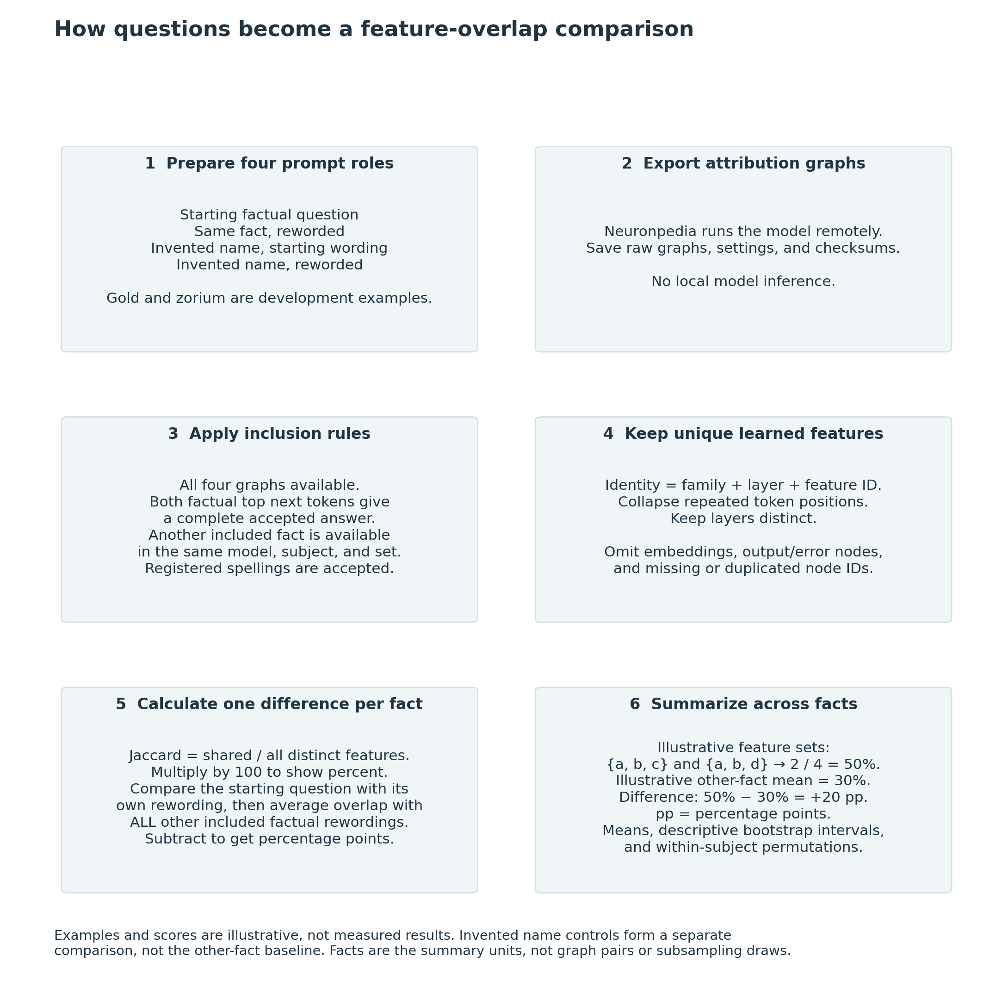

Schematic of the primary feature-overlap analysis for Gemma-2-2B, Qwen3-1.7B, and Qwen3-4B. Numbered stages show prompt preparation, hosted graph export, inclusion checks, feature extraction, overlap calculation, and summary across facts. Features are identified by family, layer, and feature ID, with repeated token positions collapsed. For each starting question, Jaccard overlap with its factual rewording is compared with mean overlap across all other included factual rewordings in the same model, subject, and evaluation set. Invented name controls form a separate comparison. Gold and zorium are development examples; the feature letters and the overlaps of 50% and 30%, and their difference of +20 percentage points (pp), are illustrative, not measured results. Percentages equal 100 times Jaccard; differences between them are percentage points, not relative percentage increases. Facts, rather than graph pairs or subsampling repetitions, are the summary units.

[Editable SVG](figureS8_feature_overlap_workflow.svg)

Source tables: Methods schematic; see manuscript Section 2.2. Example feature sets and scores are illustrative.

## Supplement S9: History rewordings share more features than questions about another fact

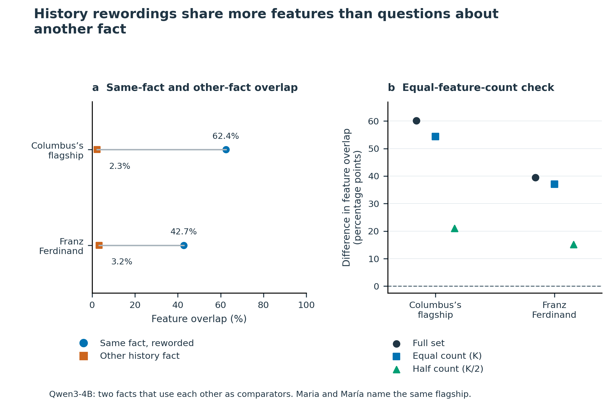

Qwen3-4B comparisons for the two history facts included in Figure 2. A, Jaccard overlap of each starting question with its own rewording (blue circles) or the other history fact’s rewording (orange squares). Lines connect the two comparisons for each fact, and labels give overlap as a percentage. B, Same-fact minus other-fact overlap, expressed in percentage points, using all features (black circles), equal counts K (blue squares), or half counts K/2, rounded down (green triangles). K is the smallest feature count among the included history factual graphs. Subsampled values average 200 repetitions; the dashed line marks zero. The two facts use each other as comparators, and no confidence intervals are plotted. Maria and María are accepted spellings of the same ship name.

[Editable SVG](figureS9_answer_spelling.svg)

Source tables: [figureS9_history_comparisons.csv](../tables/figureS9_history_comparisons.csv), [figureS9_history_equal_counts.csv](../tables/figureS9_history_equal_counts.csv)

## Supplement S10: Feature overlap varies across facts and question versions

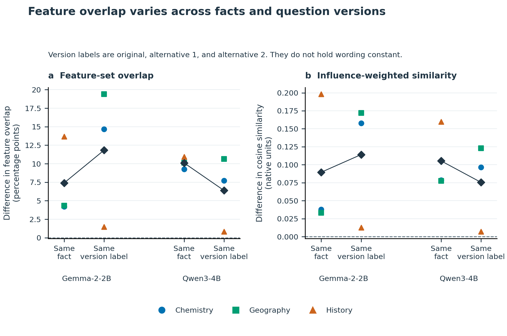

Question-version comparisons in Gemma-2-2B and Qwen3-4B, with 27 graphs per model: three facts, three versions per fact, and three subjects. A, Feature-set Jaccard overlap differences expressed in percentage points. B, Differences in cosine similarity between feature vectors weighted by exported influence, retained in native cosine units. Each value subtracts mean similarity for pairs differing in both fact and version from mean similarity for pairs sharing the indicated factor, within a subject. Version labels are original, alternative 1, and alternative 2; they do not specify identical wording across facts. Blue circles, green squares, and orange triangles are chemistry, geography, and history estimates. Black diamonds average the three subject estimates equally; lines connect those means, not confidence limits. Dashed lines mark zero difference. No confidence intervals or hypothesis tests are plotted.

[Editable SVG](figureS10_fact_and_wording.svg)

Source tables: [figure3_crossed_effects.csv](../tables/figure3_crossed_effects.csv)

## History study accounting

The original history study stopped after 15/20 preliminary checks against a 20/20 requirement; its 160 evaluation graphs remain uncollected. Figure 6 instead includes all 16 historical prompts from that check, including incorrect predictions. Supporting analysis A7 reports both records.

Figure 6 source data: [plotted pairs](../tables/figure7_history_answers_source.csv), [exact prompt examples](../provenance/history_prompt_examples.json), [all 56 comparisons](../tables/history_all_pairs.csv).

Run `scripts/build_reviewed_paper_figures.py` with the authorized saved-data archive for all current figures. Run `scripts/build_paper_claims_map.py` for the claims map. These presentation steps read saved results, without new model calls or statistical re-estimation. Then run `scripts/build_paper_share_package.py` to assemble this review gallery.
