**Working manuscript. Not peer reviewed.** Review edition updated 12 November 2026 using the final available samples, corrected answer scoring, and approved supporting sections.

## Abstract

Attribution graphs are used to investigate how language models produce predictions. We asked whether feature sharing between graphs reflects the fact being queried, the predicted answer, or both. We measured feature sharing using Jaccard overlap in Gemma-2-2B, Qwen3-1.7B, and Qwen3-4B, with 8, 10, and 12 included evaluation facts, respectively. Rewordings of the same fact had higher mean overlap than questions about other facts in all three analyzed samples, including after equalizing feature counts. To separate the requested fact from the response, we tested Qwen3-4B with questions about six country pairs. These questions used the same words and tokens within each pair while varying the queried country and which A/B letter represented the correct capital. All 48 predicted letters were correct. The prespecified mean difference between same-country and different-country overlap was 0.0303 (95% block-bootstrap interval 0.0265–0.0338). The same-country overlap advantage was 0.0628 when answer letters matched but near zero (-0.0022) when different letters represented the correct answers. In eight selected error comparisons from one country pair, wrong-answer graphs shared more features with correct predictions giving the same response than with correct predictions for the intended country. An analysis of 16 historical-date graphs from two event pairs, including five incorrect predictions, also found similar graphs when an unchanged response letter selected different years. Together, these findings show that graph similarity can track the predicted response without establishing correct factual processing.

## 1. Introduction

Knowing whether a language model gives a correct answer does not explain how it arrived at that answer. Mechanistic interpretability seeks to address this question by examining the computations inside a model [1]. For factual questions, this raises a more specific question: when different prompts ask about the same fact, what remains similar in the model’s internal activity?

Attribution graphs show patterns of activity inside a model and estimate how those patterns contribute to its prediction. These learned patterns are called features [1]. Graph construction retains features according to their influence on the outputs being explained [1]. The question is therefore what feature sharing across such graphs can tell us about the relationship between the questions and their answers. Previous research has examined how model computations vary across prompts [2]. Studies of multiple-choice questions have also shown that rearranging answer options can change which answer a model selects [5]. These findings motivate examining how differences between questions and their predicted answers relate to the features found in attribution graphs.

Comparing these graphs requires distinguishing what the questions and answers have in common. For example, two rewordings of a question about France’s capital both expect Paris. Their graphs might share features because they ask about the same fact, use some of the same words, or predict the same answer. Does greater feature overlap still distinguish questions about the same fact when the predicted response changes? We therefore need comparisons that ask about the same fact while changing the model’s required output.

We initially hypothesized that, within each model, differently worded questions about the same fact would share more attribution-graph features than questions about different facts. We tested this association in Gemma-2-2B, Qwen3-1.7B, and Qwen3-4B. We measured feature sharing using Jaccard similarity, our measure of feature overlap: the proportion of all distinct features across two graphs that appears in both. It compares the features present, not the connections between them.

We then used Qwen3-4B to examine this association with stronger controls for shared words and answers. For multiple-choice questions using the same two countries, we kept the words and their counts the same while varying which country was asked about and whether the model had to answer A or B. Changing the letter assigned to a capital allowed the factual answer to remain the same while the required response changed. We also examined selected incorrect predictions, comparing their graphs with correct predictions for the intended country and correct predictions giving the same answer for another country.

Feature overlap was associated with both the relationship between questions and the answer the model predicted. We next describe the model samples, question designs, and graph comparisons used to evaluate these relationships.

## 2. Methods

We organized the study around four comparisons (Figure 1). First, we compared reworded questions about the same fact with questions about different facts across all three models. Second, we gave Qwen3-4B multiple-choice questions and swapped the capitals assigned to A and B. This changed the required answer letter without changing the capital being asked for. We then tested whether questions about the same country still shared more graph features than questions about different countries. Third, also using Qwen3-4B, we examined attribution graphs for incorrect predictions, referred to here as error graphs. Each error graph was compared with two graphs for correct predictions: one giving the correct answer for the intended country, and one giving the same answer as the error, but in a context where that answer was correct. Fourth, we used historical-date questions to distinguish the predicted A/B letter from the year it selected, retaining both correct and incorrect predictions. The four analyses used distinct question sets and were evaluated separately.

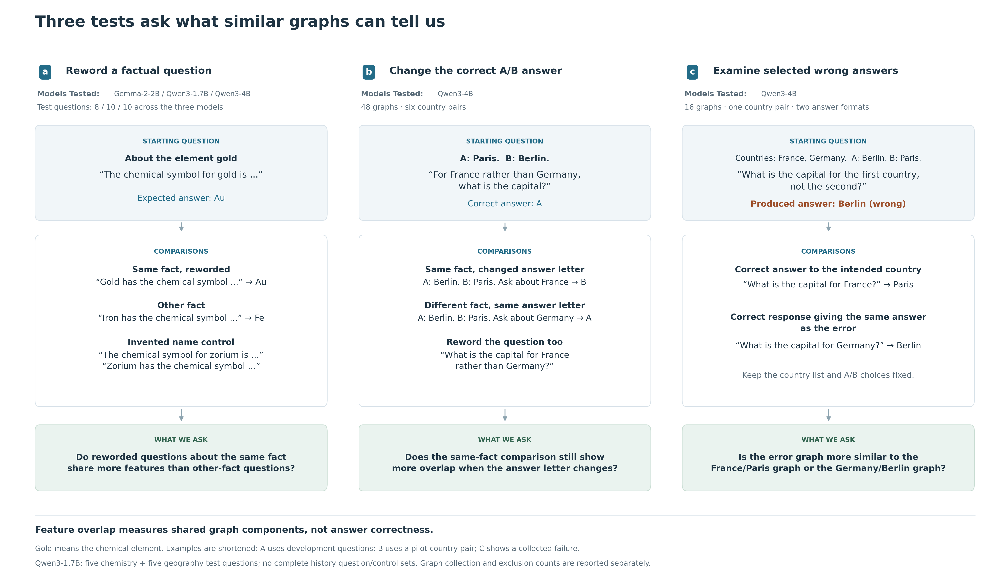

**Figure 1. Four comparisons connect feature sharing, responses, and correctness.** A, Comparisons of a starting factual question with its rewording, questions about other facts in the same subject, and invented name controls. Included evaluation facts: eight for Gemma-2-2B, ten for Qwen3-1.7B, and twelve for Qwen3-4B. B, Qwen3-4B comparisons varying the queried country, the A/B letter assigned to the correct capital, and question wording. Word and token counts are held constant within each country pair; six country pairs contribute 48 graphs. C, Each selected error graph is compared with two correct-answer graphs: one for the intended country and one producing the same response as the error. The Qwen3-4B dataset contains 16 graphs from one country pair, using A/B and capital-name responses; some comparisons share control graphs. D, Historical-date questions with swapped A/B date assignments or reversed question/context order. The Qwen3-4B dataset contains 16 graphs from two event pairs, including 11 correct and five incorrect predictions. Prompts are abridged. Panels A and B show development or pilot examples excluded from their evaluation sets; panels C and D show recorded predictions. “Zorium” is an invented name. Answers denote highest-probability next tokens, and arrows connect compared conditions.

### 2.1 Models, questions, and collected data

We analyzed attribution graphs from three language models: Gemma-2-2B, Qwen3-1.7B, and Qwen3-4B. Neuronpedia ran the models and generated the graphs remotely. We analyzed the saved graphs locally, without running the models on our own hardware. Within each model, we compared feature sharing between reworded questions about the same fact with feature sharing between questions about different facts. We used the same Jaccard similarity measure and feature-exclusion rules across all three models, providing a separate test of the same hypothesis in each model.

The question/control design included 30 facts, with ten each from chemistry, geography, and history. Each fact had a starting question, a reworded question asking for the same fact, and two invented name controls. These controls replaced the real name with an invented name while preserving either the starting or reworded sentence pattern. Within each subject, five facts were assigned to development and five to evaluation. All four question versions for a fact stayed in the same set. Development questions supported method development and diagnostic checks; evaluation questions provided the primary test of whether rewordings of the same fact shared more features than questions about different facts.

| Model | Question/control graphs collected / planned | Fact/wording graphs collected / planned | Evaluation facts and subjects |
|---|---:|---:|---|
| Gemma-2-2B | 120/120 | 27/27 | 8: chemistry 5, history 3 |
| Qwen3-1.7B | 91/120 | Not collected | 10: chemistry 5, geography 5 |
| Qwen3-4B | 120/120 | 27/27 | 12: chemistry 5, geography 5, history 2 |

For Qwen3-1.7B, the 91 collected graphs comprised 40 chemistry, 40 geography, and 11 history graphs. Chemistry and geography each had all four versions for ten facts. The service rejected 29 history requests that exceeded its 10-input-token limit, leaving no history fact with all four required versions. These are collection failures, not incorrect predictions. Applying the same inclusion rules across subject areas yielded five chemistry and five geography evaluation facts; development questions were analyzed separately.

Qwen3-4B supplied all 120 question/control graphs. The separate fact/wording experiment, described in Section 2.3, supplied 27 graphs each for Gemma-2-2B and Qwen3-4B. These two designs therefore contain 385 available graphs in total. The additional Qwen3-4B answer-letter and selected-error studies contributed 48 and 16 graphs, respectively, and are described separately in Sections 2.5–2.6.

Only these three models were tested. Section 2.8 describes the Qwen3-1.7B analysis and verification; the protocol and analysis-planning records are retained with the reproducibility materials.

Collection and inclusion counts are separated in the [sample-accounting table](SAMPLE_ACCOUNTING.md). All three models contribute chemistry comparisons; geography and history do not provide complete three-model comparisons. Unused questions are not automatically incorrect answers: missing controls, partial next tokens, and lack of a comparison partner are distinct exclusion reasons.

### 2.2 Measuring feature overlap

We measured feature sharing between questions using Jaccard similarity, our measure of feature overlap. This is the number of shared features divided by the total number of distinct features across both graphs. The score ranges from zero, when no features are shared, to one, when both graphs contain the same features. It compares the features present, not the connections between them.

For each graph, we identified distinct learned features using the tuple `(feature family, layer, feature ID)`. Matching numerical IDs in different layers or feature families remained distinct. A feature that appeared at multiple positions in the input was counted once. We excluded input representations (embeddings), output prediction scores (logits), and reconstruction-error nodes, which represent activity not captured by the learned features. We also excluded nodes with missing or duplicated graph-node identifiers. Features were compared only between graphs from the same model.

For each starting question, we calculated Jaccard overlap with its factual rewording. We then calculated its overlap with the reworded questions for every other included fact from the same model, subject, and development or evaluation set. Our primary outcome was the same-fact overlap minus the average of these other-fact overlaps. A positive difference therefore indicated greater feature sharing with the same-fact rewording. Figure S8 summarizes the workflow.

Let T_i and P_i denote the feature sets from the graphs for a starting question and its factual rewording, respectively. Their same-fact overlap minus the average other-fact overlap is:

`M_i = Jaccard(T_i, P_i) - mean_{j ≠ i} Jaccard(T_i, P_j)`,

where j includes every other included fact in the same model, subject area, and development or evaluation set.

A fact was included only when all four question and control graphs were available. For both factual prompts, the model's highest-probability next token had to give the complete accepted answer after removing leading and trailing whitespace, such as spaces or line breaks. Accepted answers included the registered spellings `Maria` and `María` for Columbus's flagship [8,9], with Unicode-equivalent forms treated identically. At least one other fact also had to meet these conditions within the same model, subject area, and development or evaluation set, providing the other-fact comparison. Partial answer tokens did not qualify.

The spelling rule corrected a literal-text scoring error identified during the audit. We applied it across all 170 available factual-prompt outputs, changing one answer classification, and used the corrected inclusion decisions throughout the reported analyses. The original scoring decisions remain in the audit record. Prompts, predicted tokens, graph features, and development/evaluation assignments were unchanged; other accents, synonyms, and partial answers were not accepted automatically.

Zero means equal overlap; negative values mean more shared features in the other-fact comparison. The outcome is a difference between Jaccard scores, not a percentage increase. Other designs below specify their own subtraction; weighted cosine comparisons are called differences in weighted similarity rather than feature overlap.

For each model, we summarized the evaluation-fact differences by their mean and a descriptive 95% percentile bootstrap interval, using 10,000 resamples of the calculated fact-level differences with replacement. Exact one-sided sign-flip tests assessed whether the mean difference was greater than zero. Complementary within-domain fact-label permutations assess matched assignment without treating graph pairs as independent samples. Facts reuse comparators, sign-flip assumptions require care, and the same facts recur across models: 8+10+12 represents 30 model-specific fact observations, not 30 unique independent facts. No pooled model-ranking test is performed.

### 2.3 Crossed design and controls

To examine how feature sharing varied with the requested fact and its wording, we analyzed three facts from each of three subject areas in Gemma-2-2B and Qwen3-4B. Each fact had an original question and two rewordings, giving 27 graphs per model. We labeled these versions “original,” “alternative 1,” and “alternative 2.” We compared questions about the same fact across different versions, and questions about different facts within the same labeled version. Both comparisons used questions differing in fact and version as their baseline. The version labels did not imply identical sentence patterns across facts. We calculated overlap differences within each subject area and then averaged across areas, using permutation tests that preserved these groupings. Their relative sizes were descriptive, not tests that wording mattered more than the fact being asked about or that the models differed.

We compared factual rewordings against invented name prompts, then checked whether the pattern persisted when their predicted outputs had the same general form. The controls used invented names, such as “zorium” instead of gold. One control was based on the starting sentence pattern; the other used a reworded version. For each control, we subtracted its feature overlap with the starting question from the overlap between the starting question and its factual rewording. Positive differences therefore favored the factual rewording. We repeated these comparisons using only controls whose highest-probability next token fell into the same broad category as the starting question’s: containing letters or numbers, whitespace only, or punctuation/symbols only. This matched output category, not the exact token, its meaning, or its probability.

### 2.4 Exploratory confound checks

We checked the integrity of the saved graphs and reproduced the recorded overlap calculations. File checksums covered all 385 graphs in the question/control and fact/wording datasets. We compared counts of distinct features with the saved audits and reproduced the recorded overlap differences for each fact to an absolute tolerance of 10⁻¹². Section 2.8 and the reproducibility records describe the Qwen3-1.7B verification.

**Feature counts.** We tested whether same-fact overlap remained higher when the graphs contained equal numbers of features. Within each model and subject area, we set K to the smallest feature count among the starting and reworded evaluation graphs. We randomly sampled K features from each graph without replacement, then repeated the analysis using half that number, rounded down. Across 200 repetitions with recorded fixed seeds, each sampled graph was reused in all its comparisons. We averaged the overlap differences for each fact across repetitions and calculated descriptive 95% bootstrap intervals using 10,000 fact-level resamples. Variation across sampling repetitions and the model-specific seeds are retained in the reproducibility tables. This check equalized feature counts but did not remove differences in how features entered the exported graphs or in shared wording.

**Shared words and answer identity.** We looked for questions about different facts that shared a comparable amount of wording with the starting question. We then applied a stricter check that also matched the number of graph features. We measured word sharing using Jaccard similarity between sets of unique words containing letters or numbers, ignoring capitalization and retaining common words. Within each model and evaluation subject area, we applied three alternative matching rules. The first retained other-fact questions whose word-overlap score with the starting question was at least as high as the same-fact pair's score. The second required those scores to differ by no more than 0.05. The third used the same 0.05 limit and also required the other-fact rewording's graph to contain between 80% and 125% as many features as the factual rewording's graph. These rules matched word-overlap scores and, in the third check, graph feature counts; they did not require identical words or features. We averaged all qualifying other-fact comparisons under each rule. When none qualified, we reported the comparison as not estimable, rather than zero. Matching thresholds were not relaxed after inspection. We separately recorded whether each comparison shared the expected answer; answer matching was not an inclusion requirement.

**Tokenizer audit.** We checked whether the predicted next token contained the expected answer or only a compatible beginning. We recorded the versions and file checksums of the official Qwen tokenizers, which convert text into model tokens. We checked their agreement with the saved prompt tokens and highest-probability predictions. We then encoded each prompt followed by its expected answer, allowing zero or one separating space and requiring the prompt’s token sequence to remain unchanged. We distinguished complete expected answers, compatible beginnings, whitespace-only matches, mismatches, and unresolved checks. A compatible beginning did not verify that the model would complete the answer correctly. These checks also could not establish the exact tokenizer version used during graph collection. Gemma’s official tokenizer download returned an authorization error (HTTP 401), leaving its tokenizer-based audit unavailable. No alternative download sources or model weights were used [3,4].

We also checked whether the fact-by-wording results persisted when every question in a group met the expected-next-token rule. Each group contained three facts from one subject area, each asked in three versions. A group qualified within a model only when all nine questions had highest-probability next tokens matching the expected text after removing leading and trailing whitespace. We recalculated overlap differences for these complete groups and reported them separately from the original analysis. We did not select individual passing questions from groups that failed the rule.

### 2.5 Matched-choice follow-up separating queried country and answer label

We tested whether questions about the same country still shared more features when the required answer letter changed. Using Qwen3-4B’s non-thinking chat format, we presented questions containing two countries and two capitals labeled A and B. For example, France’s capital required A when Paris was labeled A, but B when Paris was labeled B. We varied the country asked about, the word order, and the capital-to-letter assignment while keeping the words and token counts identical within each country pair. France/Germany illustrated the design in the preliminary check; six other country pairs formed the evaluation.

We measured same-country feature sharing separately when the answer letter stayed the same and when it changed. Each evaluation country pair contributed eight graphs, covering both countries, both A/B assignments, and two question wordings, for 48 graphs overall. Within each pair, we compared graphs across the two wordings and subtracted different-country overlap from same-country overlap in each answer-letter condition. We averaged these two differences within each pair, then averaged across pairs for the prespecified primary outcome. Uncertainty used the six country pairs, not 48 independent graphs, with a 95% bootstrap interval from 10,000 resamples. An exact conditional correspondence test evaluated 4,096 allowed assignments of country matches within answer-letter groups. Bonferroni correction accounted for three planned tests across models and prompt formats.

Earlier preliminary results informed this follow-up, but its rules were fixed before collecting the evaluation graphs. In the completed plain-completion checks, Qwen3-4B chose A on all eight questions, giving four correct labels. Gemma produced the correct capitals but none of the eight requested letters. The three planned tests therefore comprised the original Qwen and Gemma setups and the revised Qwen chat setup. Preliminary outcomes remained separate from the evaluation results. The revised experiment matched the available words and tokens, but differences in word order, answer-option assignments, and country roles remained part of the comparison.

### 2.6 Position pilot and exploratory failure-case diagnostic

Research on position-based retrieval has documented difficulties identifying items by list position, particularly when counting backward [7]. Our position-based analysis asked about a country's position in a list while varying the queried country, list order, answer mapping, and wording. Its prespecified accuracy requirement had to be met in a 16-item pilot before collecting evaluation graphs. After the pilot failed, we conducted an explicitly exploratory diagnostic of selected errors; this was not a replacement evaluation cohort.

We investigated selected cases by generating attribution graphs and checking that the incorrect predictions occurred again. For example, with France listed before Germany, asking for the first country’s capital incorrectly produced Berlin. Naming France directly produced Paris, whereas naming Germany produced Berlin. Both named-country predictions were correct for their respective questions. Comparing their graphs with the incorrect prediction’s graph let us ask whether feature sharing was greater with the intended fact (France’s capital is Paris) or with the answer the model actually predicted, Berlin.

The diagnostic contained 20 next-token previews: four literal/replay positive controls and four selected France/Germany cases varied by how the country was identified (its name or list position) and by response format (A/B letter or capital name). These cases were selected because the correct answer conflicted with choosing an answer option by its position. We fixed the 16 diagnostic prompts before generating their graphs. Each wrong-answer graph was compared with two correct-answer graphs: one for the intended country and one producing the same answer as the error. Both controls preserved the option layout and country-list order. The position-based and named-country prompts differ in wording, length, and repeated names; unlike the matched-choice experiment, their word and token inventories are not identical.

Graph settings were maxNLogits=10, desiredLogitProb=0.99, nodeThreshold=0.8, edgeThreshold=0.85, and maxFeatureNodes=5000, using hosted Qwen3-4B with the recorded transcoder source. Exact prompts and token sequences, source/settings, checksums, identifier integrity, and observed answers were audited. Wrong answers were deliberately retained. All comparisons report feature-set Jaccard, exported-influence-weighted cosine, and an equal-feature-count sensitivity using 200 repetitions with fixed seeds. Direct incoming edges to the observed answer logit were summarized by source type and token location, preserving signs and absolute weights. Display panels retain the ten largest absolute direct edges and the ten largest upstream edges into those displayed predecessors; full tables retain the remaining edges.

These selected cases concern two facts in one country pair, with reused controls. We report descriptive comparisons without confirmatory p-values or population confidence intervals. The country-location weight ratio discussed below was an additional descriptive inspection of the archived role tables, not a prespecified primary endpoint. All outcomes concern the top next token under the hosted non-thinking setup; they do not independently establish full generated-answer behavior [6]. Local provenance checks also do not independently certify hosted-weight identity.

### 2.7 Answer-label statistics and historical-date comparisons

After inspecting the matched-choice results, we directly compared the same-label and changed-label fact contrasts across the six country-pair blocks. We report the mean paired difference, a 20,000-resample block-bootstrap interval, a Student-t interval, and a two-sided exact block sign-flip test. These summaries assume independent blocks; the sign-flip null additionally assumes symmetric block contrasts. This added test is exploratory and is distinct from the original conditional correspondence test. The 4,096 correspondence assignments are null configurations within six blocks, not 4,096 independent observations.

The tests answer different questions:

| Test | Question | Reference distribution and interpretation |
|---|---|---|
| Prespecified conditional correspondence test | Is the average of the two fact contrasts greater than expected under reassigned fact correspondence? | Reassign queried-fact correspondence across wording versions within each answer-label group: four assignments per country pair and 4096 across six pairs. The reference null treats those assignments as exchangeable conditional on the label and word inventory. It tests correspondence under that null, not a causal effect isolated from word order or country roles. |
| Exploratory block sign-flip test | Is the same-letter fact contrast different from the changed-letter fact contrast? | Flip the sign of each of six country-pair differences, assuming independent blocks and symmetric differences under the null. The two-sided test concerns the difference between conditions, not their average. |

The conditional test's small p-value describes the specified reassignment null; it does not establish that the prompts are exchangeable for every substantive hypothesis. Residual order and role differences constrain interpretation. The question/control comparisons also reuse other-fact comparators, so their resampling results are reported alongside the within-domain correspondence tests rather than as independent replications.

As graph-location sensitivities, we removed feature nodes at the final prediction context position, in the last quarter of observed feature layers, or both, before collapsing feature identities. Empty representations are unavailable rather than assigned zero overlap. These filters test concentration of the measured association; they are not causal ablations, and retained graphs remain conditioned on the generated output. We applied the same filters to the selected failure comparisons without attaching population p-values to their dependent triples.

We also examined historical-date questions in Qwen3-4B using two event pairs: adoption of the US Declaration of Independence and signing of the Treaty of Paris, and the launches of Sputnik 1 and Explorer 1. Each pair had eight prompts combining the queried event, assignment of dates to A and B, and question/context order, with identical word and token inventories within the pair. We collected all 16 graphs and retained both correct and incorrect predictions. Each predicted letter was translated into the year assigned to it, separating agreement on the response letter from agreement on the selected date.

We calculated all 28 unordered graph comparisons within each event pair. Eight comparisons changed only the A/B date assignments, and eight changed only question/context order, across the two pairs. We grouped these comparisons by the letter actually predicted, separately from the letter required for a correct answer. Jaccard overlap used the feature identities in Section 2.2. Additional checks used influence-weighted cosine, the graph-location filters above, and 200 equal-feature-count subsamples at K and half K within each event pair. The analysis plan was recorded before graph collection but after the prompts' behavioral outcomes were known. With two selected event pairs and reused graphs, we report descriptive comparisons rather than population confidence intervals or significance tests. Supporting analysis A7 preserves the original stopped 160-graph study, which this additional analysis did not reopen.

### 2.8 Qwen3-1.7B analysis and verification

We analyzed the combined 91-graph Qwen3-1.7B dataset using the representation, inclusion rules, comparisons, and checks in Sections 2.2–2.4. Settings were recorded before calculating the estimates but after earlier findings were known. The analysis was therefore exploratory rather than an independent confirmatory replication.

Graph files retained their recorded transcoder and LoRSA feature sources. Desired cumulative output probability was 0.99 for the completion requests; some archived files used 0.95 output coverage. These differences were preserved, rather than assuming identical export settings or unchanged hosted model versions. Full graph settings and verification records are provided in Supporting methods A5.1.

Holm correction covered 15 secondary sign-flip tests across four similarity measures and four comparator types, excluding the primary Jaccard/average-other-fact comparison. The full test family is defined in A5.1. Output-type-matched subsets, reconstruction-error-inclusive and equal-feature-count checks, and subject-specific summaries were outside this correction family. Shared comparison questions limit the interpretation of bootstrap intervals and sign-flip tests; label permutations assume exchangeable factual pairings within each subject area. These analyses do not separate shared-word or expected-answer differences from fact identity.

## 3. Results

### 3.1 Reworded questions about the same fact share more features

Across all three models, every included evaluation question had greater Jaccard overlap with its own rewording than its average overlap with rewordings of other facts (Figure 2a). Mean differences in feature overlap were 0.170 for Gemma-2-2B (descriptive 95% interval [0.085, 0.276], n=8), 0.0894 for Qwen3-1.7B ([0.0820, 0.0976], n=10), and 0.218 for Qwen3-4B ([0.150, 0.307], n=12). Exact sign-flip p-values were 0.00390625, 0.0009765625, and 0.000244140625; fact-label permutation p-values were 0.00139, 0.0000694, and 0.0000347, respectively. The pattern was consistent within each model. Differences in subject coverage and reuse of facts across models prevent interpreting these effect sizes as a model ranking.

For Qwen3-1.7B, the pattern was present in both subjects available for evaluation. All five chemistry and all five geography evaluation facts had positive overlap differences, with subject means of 0.0854 and 0.0935 (Figure 2b). History could not be evaluated for this model because no history fact had a complete set of factual and control graphs (Supplementary Figure S7a). Detailed analyses are provided in Supporting analysis A5.

Qwen3-4B included five chemistry, five geography, and two history facts (Figure 2b). The history questions asked about Columbus's flagship and the assassinated Archduke Franz Ferdinand. Their same-fact minus other-fact overlap differences were 0.601 and 0.395, respectively, averaging 0.498 (Supplementary Figure S9a). Each used the other as its comparison partner, so this result describes the two questions rather than independent replications across history.

Higher overlap could reflect more than the fact being asked about: reworded questions may also share words and the expected answer. We therefore examined whether these similarities could explain the pattern.

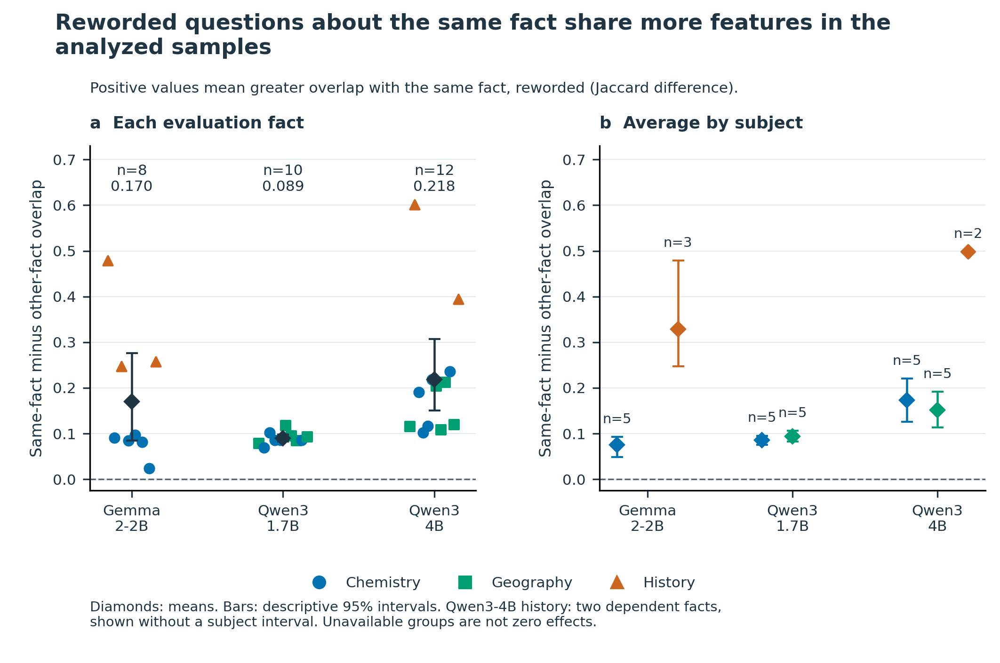

**Figure 2. Reworded questions about the same fact share more features in the analyzed samples.** A, Individual evaluation facts for Gemma-2-2B (n=8), Qwen3-1.7B (n=10), and Qwen3-4B (n=12). Each value is the starting question’s Jaccard overlap with its factual rewording minus its mean overlap with other-fact rewordings in the same model, subject, and evaluation set. Blue circles, green squares, and orange triangles denote chemistry, geography, and history, respectively; black diamonds show model means. B, Means within each model and subject, shown as diamonds using the same subject colors. Bars in both panels are descriptive 95% percentile bootstrap intervals from 10,000 fact-level resamples. The two Qwen3-4B history facts use each other as comparators; their subject mean is shown without an interval. n counts evaluation facts. Dashed lines mark zero difference. Model–subject groups without an estimate are not plotted.

### 3.2 Same-fact questions share words and expected answers

To separate factual identity from shared wording, we looked for other-fact questions that matched each same-fact pair's word overlap. None met any of the three word-matching or joint word/feature-count rules: 0/8 Gemma, 0/10 Qwen3-1.7B, and 0/12 Qwen3-4B. Even the most word-overlapping other-fact prompt scored at least 0.1806 below the same-fact rewording across these samples (Supplement Figure S4). The gap was not a borderline threshold result.

Answer identity was coupled to factual identity as well: none of the 108 directed other-fact comparisons shared the expected answer, whereas same-fact pairs did. This comparison changes the fact, word overlap, and expected answer together. It establishes their combined association with shared features, leaving their separate contributions unresolved.

When controls were matched only by broad next-token category, overlap differences relative to same-pattern invented name controls were -0.069 (Gemma, n=2), -0.0109 (Qwen3-1.7B, n=9), and +0.096 (Qwen3-4B, n=10). Differences relative to reworded invented name controls were positive in all three models (Figure 3). Qwen3-4B's history controls predicted commas instead of names, so ten of its twelve facts met this additional matching requirement. For Qwen3-1.7B, the mean was +0.1059 across ten reworded-control comparisons. Before output-type matching, eight of its ten evaluation questions shared more features with the same-pattern invented name control than with their factual rewording; seven of nine did so in the matched subset. All ten favored the factual rewording over the reworded invented name control. These contrasting results motivate a follow-up that preserves the available words while varying the requested country and the answer letter. The descriptive question-version comparison is reported in Supporting analysis A4 (Supplementary Figure S10).

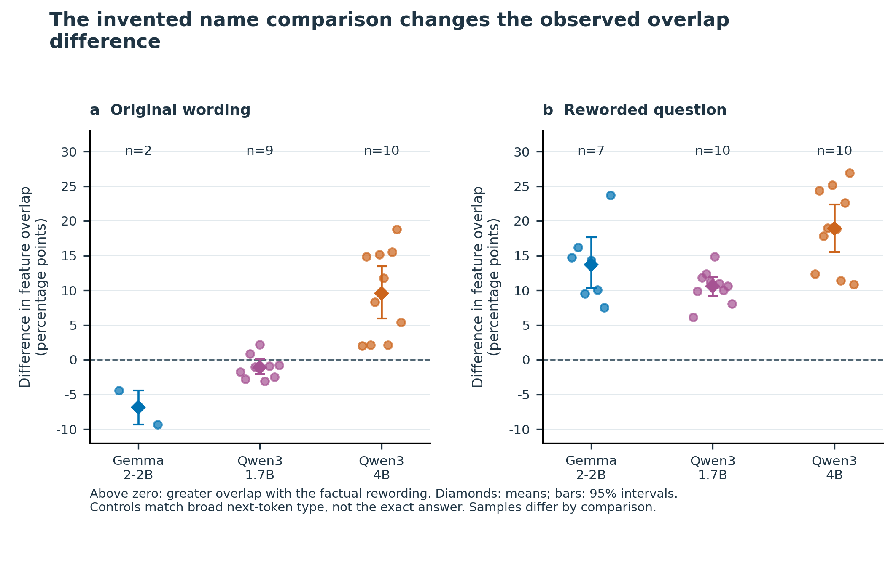

**Figure 3. The invented name comparison changes the observed overlap difference.** A, Invented name controls retaining the starting question’s wording. B, Reworded invented name controls. Each point is the starting question’s Jaccard overlap with its factual rewording minus its overlap with the indicated control. Controls are included when their predicted next token and the starting question’s predicted token share a broad category: letters/numbers, whitespace, or punctuation/symbols. Blue, purple, and orange denote Gemma-2-2B, Qwen3-1.7B, and Qwen3-4B, respectively. Circles represent evaluation facts, diamonds are means, and bars are descriptive 95% fact-bootstrap intervals. Sample sizes in model order are n=2, 9, and 10 in A and n=7, 10, and 10 in B. Dashed lines mark equal overlap with the factual rewording and control.

### 3.3 Same-fact overlap is higher when the answer letter stays the same

We next tested the same-country association with a shared answer and with a changed answer. In Qwen3-4B, we kept the available words and token counts identical within each of six country pairs while varying the country asked about, the wording, and the correct A/B answer. Comparing same-country with different-country overlap within each answer condition separated the two components of the average. All 48 predicted labels were correct, and all exports passed the recorded identifier and checksum checks.

The same-country minus different-country overlap was 0.0628 with the same answer letter and -0.0022 with a changed letter. Their average, the prespecified primary outcome, was 0.0303 (95% block-bootstrap interval 0.0265–0.0338), positive in each of six country-pair blocks. The exact conditional correspondence p-value was 0.000244141, or 0.000732422 after the prespecified three-opportunity adjustment. The positive average was concentrated in the same-letter component. The changed-letter estimate was near zero; this was not an equivalence test.

When the model had to answer with different letters, questions asking for the same capital had nearly the same average feature overlap as questions about different countries. The factual answer remained the same, but the greater feature overlap observed with a shared answer letter did not persist.

Attribution graphs shared substantially more features when the required answer letter matched. For questions about the same country, mean overlap across wordings was 0.8005 with the same answer letter and 0.4853 with different letters, a difference of 0.3152 (Figure 4a). Questions about different countries showed the same pattern, with overlaps of 0.7377 and 0.4874, respectively. Averaging across these comparisons gave a letter-associated difference of 0.2827, positive in all six country pairs. All 48 predictions were correct. Thus, substantial differences in graph feature overlap accompanied changes in the required response letter, even when the country and correct capital remained unchanged. This is a separate descriptive overlap contrast, not a fraction of variance or reasoning explained.

The exploratory direct paired difference between the same-letter and changed-letter fact components was 0.0650 Jaccard units across six blocks (95% block-bootstrap interval 0.0582–0.0715; Student-t interval 0.0553–0.0746; two-sided block sign-flip p=0.03125). All six differences were positive. The difference remained 0.0720 after excluding final-position feature nodes, 0.0688 after excluding the last quarter of observed feature layers, and 0.0732 after both filters (Supplement Figure S6). The association therefore extends beyond the removed node sets. These comparisons establish an answer-associated pattern in this task; word order, answer mapping, country roles, and output-conditioned graph construction remain possible contributors.

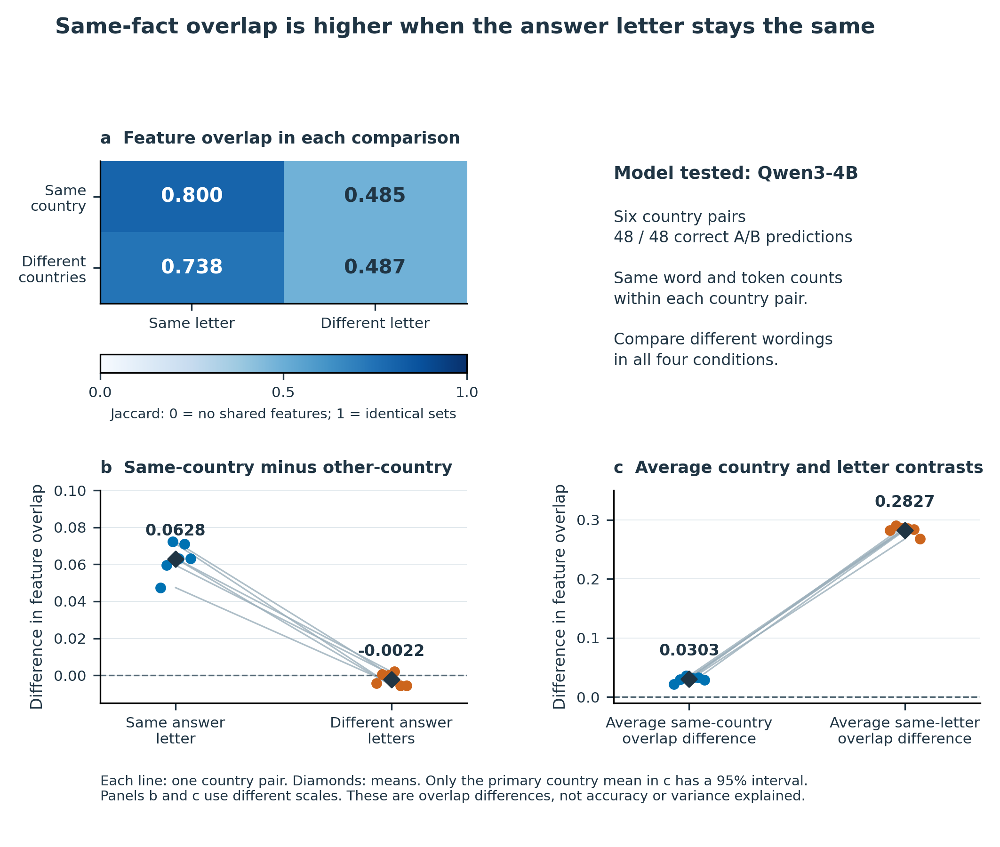

**Figure 4. Same-fact overlap is higher when the answer letter stays the same.** Qwen3-4B comparisons from six country pairs and 48 graphs. A, Mean Jaccard overlap for questions about the same or different countries with the same or different correct A/B answer letters. Numbers and color intensity give overlap on a 0–1 scale. B, Same-country minus different-country overlap, calculated separately for matching and changed answer letters. C, The average country contrast, obtained by averaging the two conditions in B, and the average letter contrast, obtained by averaging same-letter minus different-letter overlap across country relationships. In B and C, circles represent country pairs, lines connect estimates from the same pair, and black diamonds show means. Blue and orange identify the labeled conditions. The bar on the primary country contrast in C is a 95% block-bootstrap interval, resampling country pairs (n=6); no interval is plotted for the descriptive letter contrast. Dashed lines mark zero. Panels B and C have different vertical scales.

### 3.4 Error graphs show greater overlap with answer-matched controls

The matched-choice study used correct predictions. We next asked whether graph similarity also followed the predicted answer when that answer was wrong. With options “A: Berlin. B: Paris” and countries listed as “France, Germany,” the model incorrectly answered A when asked for the first country’s capital, or Berlin when asked to give the capital name. Naming France directly produced the correct B or Paris response; naming Germany produced the correct A or Berlin response. The error graph shared more features with the correct Germany prediction giving the same answer than with the correct France prediction for the intended country (Figure 5b,c).

These errors arose in a list-position task that produced 8/16 correct A/B predictions and stopped at its fixed accuracy requirement. Checks found no mismatch in the expected answers, submitted prompts, token sequences, or decoding of predicted tokens. A subsequent 20-question diagnostic passed all four checks using direct instructions or previously successful questions. All eight questions naming the country directly produced the intended next token, while all eight selected questions identifying the country by its list position reproduced errors across the letter and capital-name response formats (Figure 5a). The planned evaluation following the failed preliminary check was not conducted.

All 16 diagnostic graphs passed integrity checks and reproduced their archived preview answers. We compared each error graph with two correct-answer graphs: one for the intended country and one producing the same answer as the error. Every comparison favored the graph sharing the error’s answer (Figure 5b,c). The mean same-output minus same-country Jaccard difference was 0.1983 for A/B responses and 0.2649 for capital-name responses. Equalizing feature counts retained differences of 0.1851 and 0.2361, respectively, and influence-weighted cosine similarity preserved the direction in all eight comparisons. These comparisons shared control graphs and concerned only France and Germany, so they describe the selected cases rather than eight independent replications.

The greater overlap with the same-answer control remained in all eight selected comparisons after removing feature nodes at the final input-token position, in the last quarter of observed feature layers, or both. Removing both groups gave mean differences of 0.2053 for labels and 0.2608 for capital names (Supplementary Figure S6b). The pattern therefore extended beyond those positions and layers. These checks changed the graphs used for comparison, not the model itself; the retained graphs were still constructed to explain the predicted answer.

Across these selected cases, sharing the predicted answer corresponded to greater feature overlap than sharing the intended country. Because the errors were selected for inspection, these comparisons do not estimate how frequently the model makes this mistake. The layouts also leave two explanations unresolved: selecting answer options by position and misinterpreting phrases such as “first country, not the second.” Both explanations predict the same errors in these cases. Supporting analysis A3 provides the input-position and reconstruction-error analyses and documents the missing output nodes for the intended correct answers.

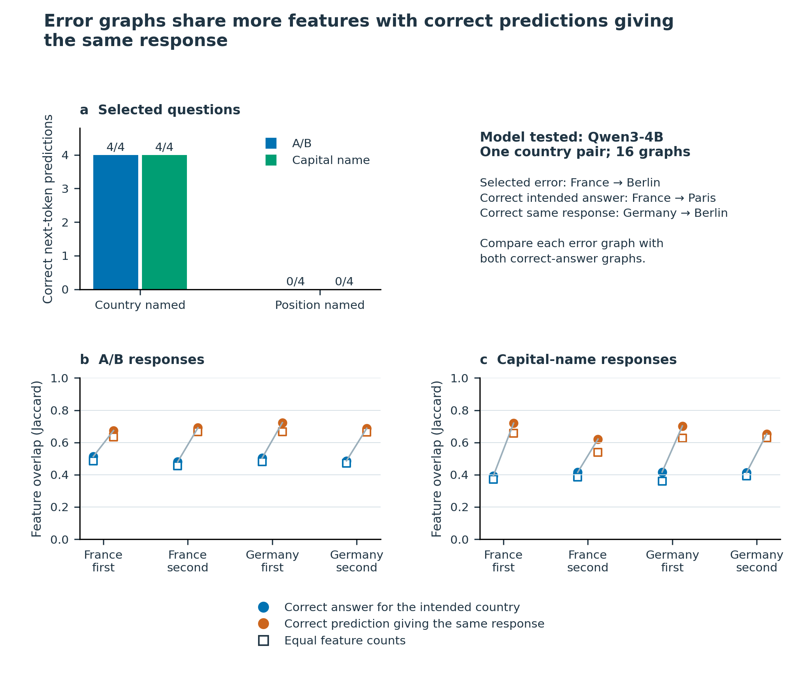

**Figure 5. Error graphs share more features with correct predictions giving the same response.** Qwen3-4B selected cases from one country pair, with 16 graphs and eight selected error cases using shared controls. A, Correct next-token counts for questions naming the country directly or referring to its list position. Blue and green bars denote A/B and capital-name responses; labels give correct predictions out of four prompts per condition. B–C, Jaccard overlap of each error graph with a correct-answer graph for the intended country (blue) or a correct-answer graph producing the same response as the error (orange), for A/B responses (B) and capital names (C). List order and answer mapping are held fixed within each comparison. Filled circles use all retained features; open squares average 200 equal-feature-count subsamples. Lines connect the two controls for the same error. The comparisons are descriptive; no confidence intervals or hypothesis tests are plotted.

### 3.5 Greater same-fact feature sharing persists after matching feature counts

We next asked whether the original three-model pattern could be explained by differences in graph size. Did same-fact questions share more features simply because their graphs contained more features? Within each model and subject area, we repeated the comparison after sampling equal numbers of features from the starting and reworded factual graphs, then repeated it with half as many. Mean same-fact-minus-other-fact overlap remained positive for all three models at both sample sizes (Supplementary Figure S3).

K is the smallest number of distinct features among the included starting and reworded factual graphs within each model and subject area. K/2 is half that number, rounded down. Table entries are mean same-fact-minus-other-fact Jaccard differences, not raw overlap scores.

| Model | All features | Equal counts, K (descriptive 95% interval) | Half counts, K/2 | Questions with positive averages at K |
|---|---:|---:|---:|---:|
| Gemma-2-2B | 0.170 | 0.149 [0.066, 0.257] | 0.058 | 7/8 |
| Qwen3-1.7B | 0.089 | 0.084 [0.076, 0.092] | 0.033 | 10/10 |
| Qwen3-4B | 0.218 | 0.181 [0.110, 0.267] | 0.072 | 12/12 |

The mean within each model remained positive in every one of the 200 sampling repetitions at both feature counts. After averaging across repetitions, seven of eight Gemma questions, all ten Qwen3-1.7B questions, and all twelve Qwen3-4B questions had positive differences at K. Gemma’s tungsten question reversed direction, with average differences of −0.0187 at K and −0.0080 at K/2. Thus, the positive model averages persisted after matching feature counts, although not every individual question retained a positive difference (Supplementary Figure S3). The intervals summarize uncertainty across questions; the 200 repetitions are not additional independent observations.

The two Qwen3-4B history facts also retained positive differences at both feature counts. Their averages were 0.543 and 0.370 at K, and 0.210 and 0.151 at K/2 (Supplementary Figure S9b).

Subsampling can retain a shared feature in one graph while removing it from another. Consequently, the reduction in Jaccard overlap cannot be interpreted as the percentage of the original association explained by graph size. Supporting analyses A1–A2 report the output and export-integrity checks (Supplementary Figures S5 and S1–S2). Supporting analysis A4 provides the feature-count analysis and explains why the earlier size-regression calculation was not an independent robustness check.

### 3.6 History graphs can remain similar when the selected year changes

Historical-date graphs could remain highly similar even when the model selected a different year. We analyzed all 16 Qwen3-4B graphs from two event pairs, including 11 correct and five incorrect predictions. In the Declaration of Independence example, swapping the dates assigned to A and B left the predicted letter unchanged at A but changed the selected year from 1776 to 1783. Jaccard overlap was 0.795. With the context placed before the question, the model instead changed from A to B and retained the correct year, 1776; overlap was 0.512 (Figure 6a).

Across all eight comparisons that swapped the A/B date assignments, the five pairs retaining the same predicted letter had Jaccard overlaps of 0.795–0.911. Each pair contained predictions for different years: one correct and one incorrect. In contrast, the three pairs that changed the predicted letter retained the same correct year and had overlaps of 0.512–0.532 (Figure 6b). Preserving the selected year therefore did not guarantee greater feature sharing than changing it.

Changing question/context order showed the same association with the predicted letter. With the event and A/B date assignments held fixed, the five comparisons retaining the same letter had overlaps of 0.766–0.808, whereas the three comparisons changing the letter had overlaps of 0.527–0.602 (Figure 6c). Feature overlap thus tracked the predicted letter without guaranteeing that the same year was selected or that the answer was correct. Supporting analysis A7 reports the event-pair summaries and required-letter contrasts.

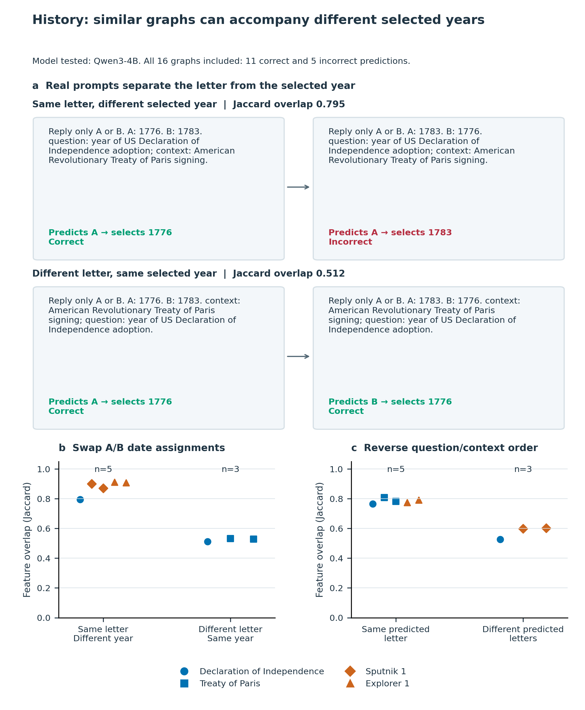

**Figure 6. History: similar graphs can accompany different selected years.** Qwen3-4B historical-date comparisons using 16 graphs from two event pairs, including 11 correct and five incorrect next-token predictions. A, Recorded prompts for the Declaration of Independence example, with the A/B date assignments swapped within each row. Displayed responses identify the predicted letter, selected year, and correctness; overlap is labeled above each pair. Prompt text is exact apart from added line breaks; the chat wrapper is omitted. B, Eight graph pairs differing in A/B date assignment while event and question/context order remain fixed. C, Eight graph pairs differing in question/context order while event and A/B date assignment remain fixed. Each point is one graph pair; n counts pairs in each response category. Blue circles and squares denote the Declaration of Independence and Treaty of Paris; orange diamonds and triangles denote Sputnik 1 and Explorer 1. Jaccard overlap ranges from 0 (no shared features) to 1 (identical feature sets). Panels B and C reuse the same 16 graphs; no inferential intervals or tests are plotted.

## 4. Discussion

### 4.1 What the comparisons establish

Rewordings of the same fact shared more attribution-graph features in all three analyzed model samples (Figure 2). The positive model averages persisted after equalizing feature counts, so differences in the number of retained features alone did not account for the observation (Supplementary Figure S3). Shared words and expected answers remained coupled to factual identity, however. The original comparison therefore establishes a combined association, rather than a measure specific to the requested fact.

The Qwen3-4B comparisons sharpen this interpretation. The same-country overlap advantage was concentrated in comparisons sharing an answer letter, and selected error graphs favored correct predictions giving the same response (Figures 4 and 5). Historical-date comparisons further separated agreement on the response letter from agreement on the selected year (Figure 6). Together, these comparisons show why the predicted response must be considered when interpreting feature overlap.

### 4.2 Graph similarity and factual correctness can diverge

In Qwen3-4B, changing which letter represented the correct capital was accompanied by lower graph overlap, even though every answer remained correct (Figure 4). Graph similarity therefore changed without a loss of factual accuracy. Conversely, selected incorrect answers shared more features with correct answers producing the same response than with correct answers for the intended country (Figure 5). The history comparisons reinforced this distinction: similar graphs could accompany an unchanged response letter selecting different years (Figure 6). Together, these findings show that feature overlap cannot be interpreted simply as a measure of correct factual processing.

This distinction matters when using attribution graphs to investigate how models answer factual questions. Jaccard overlap quantifies feature sharing, but does not establish whether those shared features contribute to retrieving a fact, producing a response, or both. Questions about the same fact often preserve the expected answer, making these interpretations difficult to separate. Comparing the same fact under different answer labels, and different facts under the same label, helps reveal which relationship the overlap follows. Our results therefore support evaluating the requested fact, predicted response, and answer correctness together when interpreting graph similarity.

The evidence has different breadth for these two conclusions. Greater feature sharing between same-fact questions appeared in all three analyzed model samples. The experiments separating fact identity from the answer letter were conducted in Qwen3-4B, so whether that answer-associated pattern extends to the other models remains an open question. The selected error and history comparisons show concrete ways that graph similarity and factual correctness can diverge. Their small samples and shared comparison graphs do not establish how frequently those patterns occur across questions.

The remaining question is why graph similarity tracks the predicted response. Producing the same response may involve shared model activity, while constructing graphs to explain that response may also favor the retention of similar features. Both could contribute. Distinguishing these explanations would clarify whether the observed pattern primarily reflects the model’s computation, the way that computation is measured, or their interaction.

### 4.3 Future research: separating model activity from graph construction

To test how graph construction affects feature sharing, the model’s activity could be held fixed while changing only the output being explained. From one recorded model run, one graph could explain the A token and another the B token, with the prompt, model activity, and graph settings unchanged. Differences between their retained features would reveal sensitivity to the choice of output being analyzed. This would test whether changing the explained token changes the graph, although it would not by itself establish how much of the similarity across questions comes from that choice.

A complementary test would ask whether questions producing the same answer already have similar feature activity before graph construction. Our same-fact and same-answer comparisons could be repeated using activity recorded before features are selected for a particular output, keeping feature definitions fixed and checking sensitivity to feature counts. Similarity present before this selection would support a contribution from shared model activity. A pattern that appears or becomes stronger after selection would indicate that graph construction also shapes the measured relationship.

Interventions would then test what the shared features contribute to the answer. Changing the activity of candidate features could reveal whether they influence a particular response token across different facts, or responses about a particular fact when its answer letter changes. These tests should use facts and wordings not used to select the features, an unchanged-model baseline, and randomly selected features matched in number, layer, and activation. Testing several intervention strengths would help distinguish selective effects from general disruption. A selective change in the predicted response would provide stronger evidence about feature function than an overall decline in accuracy.

These comparisons require access to feature activity before output-dependent selection and to alternative outputs being explained. Our saved exports contain only retained features and do not consistently include those alternative outputs, so they cannot provide the complete comparison on their own. Together, the proposed tests would move the investigation from observing feature sharing to identifying where it arises and what the shared features contribute to model behavior.

## 5. Conclusion

Reworded questions about the same fact shared more attribution-graph features across the three analyzed model samples. In Qwen3-4B, that advantage was concentrated in comparisons sharing the answer letter, while selected errors and historical-date comparisons showed that feature sharing could follow the response without agreement on the correct factual answer. Attribution-graph comparisons should therefore distinguish the fact being queried, the response produced, and whether that response is correct. This distinction is necessary for interpreting feature overlap as evidence about factual processing.

## Supporting analyses

### A1 Next-token matching and complete answers

We counted a factual prediction as complete only when the model’s highest-probability next token matched an accepted answer in full. Among 50 available Qwen3-1.7B factual prompt graphs, 42 predict a complete accepted answer in the next token, four predict only the beginning of an accepted answer, and four predict a different next token. Among 60 Qwen3-4B factual graphs, the corresponding counts are 50, five, and five (Supplementary Figure S5). These totals count individual prompts, not included evaluation facts. They include development and evaluation questions and incomplete Qwen3-1.7B history sets. Later generated tokens were not recorded, so partial beginnings were kept separate from verified complete answers.

Equivalent spellings counted as the same accepted answer. For the Qwen3-4B question about Columbus’s flagship, the starting question predicts `Maria` and its rewording predicts `María`; both names identify the same ship [8,9]. The Columbus and Franz Ferdinand questions each had all four required prompt graphs and met the accepted-answer criteria in Section 2.2, so both were included in the main analysis.

Both history questions shared more features with their own rewording than with the other history question. For Columbus, Jaccard overlap with the factual rewording was 0.624, compared with 0.023 for the Franz Ferdinand rewording. For Franz Ferdinand, the corresponding overlaps were 0.427 and 0.032 (Supplementary Figure S9a). The Columbus example therefore shows that high feature overlap does not require identical output-token text. The same-fact minus other-fact overlap remained positive after equalizing feature counts: 0.543 for Columbus and 0.370 for Franz Ferdinand. Using half as many features in each graph gave differences of 0.210 and 0.151, respectively (Supplementary Figure S9b). Each estimate averages 200 random subsamples of the existing graphs, not additional independent observations.

For both history questions, the starting prompt shared more features with its factual rewording than with either invented name control. The overlap differences were 0.537 and 0.556 for Columbus, and 0.384 and 0.385 for Franz Ferdinand, for the starting-pattern and reworded controls, respectively. All four controls predicted a comma, whereas the factual prompts predicted names. Because the controls predicted a different kind of output, neither fact entered the output-type-matched comparison in Figure 3, which uses ten Qwen3-4B facts. Both remained in the main comparison in Figure 2. These control comparisons do not separate factual content from differences in wording and predicted outputs.

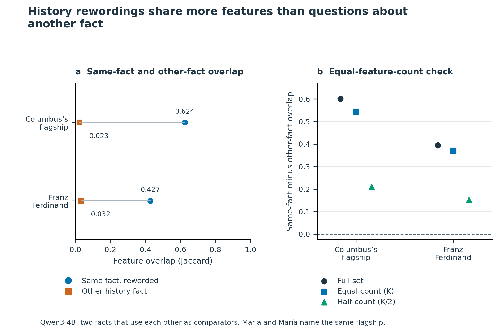

**Figure S9. History rewordings share more features than questions about another fact.** Qwen3-4B comparisons for the two history facts included in Figure 2. A, Jaccard overlap of each starting question with its own rewording (blue circles) or the other history fact’s rewording (orange squares). Lines connect the two comparisons for each fact, and labels give the overlap values. B, Same-fact minus other-fact overlap using all features (black circles), equal counts K (blue squares), or half counts K/2, rounded down (green triangles). K is the smallest feature count among the included history factual graphs. Subsampled values average 200 repetitions; the dashed line marks zero. The two facts use each other as comparators, and no confidence intervals are plotted. Maria and María are accepted spellings of the same ship name.

We checked the saved token IDs against the archived tokenizer, which converts token IDs into text. All 50 Qwen3-1.7B factual prompts matched in checks of both input-token text and predicted-token text. Its four partial-answer beginnings were the two mercury outputs (`H` for `Hg`), the Berlin Wall rewording (`G` for `Gorbachev`), and the French Revolution rewording (`Bast` for `Bastille`). Of ten available Qwen3-1.7B factual history graphs, four predicted complete accepted answers, two predicted partial beginnings, and four predicted other next tokens. The latter include `African` where the expected string is `ANC`, as well as `one`, `the`, and `first`. Qwen3-4B’s five partial predictions came from the starting and reworded mercury questions, the starting and reworded Berlin Wall questions, and the French Revolution rewording. These partial predictions remained excluded from the complete-answer comparison.

A different next token does not necessarily indicate an incorrect completed answer. For example, a response beginning `African` might continue with the full name corresponding to the expected acronym `ANC`. Because later tokens were not recorded, this possibility remains unverified. These outputs were excluded because the saved token did not establish a complete accepted answer, not because a full response had been verified as wrong.

We also checked predictions in the experiment that varied facts and question versions (Section 2.3). A match required the predicted next-token text to equal the expected text after removing leading and trailing whitespace. Matching counts were 7/9, 4/9, and 0/9 for Gemma chemistry, geography, and history; corresponding Qwen3-4B counts were 8/9, 9/9, and 0/9 (Supplementary Figure S5b). Eight Qwen3-4B predictions in this experiment contained only whitespace, such as spaces or line breaks, rather than answer text.

We then repeated the overlap analysis only for groups in which all nine questions passed this matching rule. Each group contained three facts asked in three versions; only Qwen3-4B geography qualified. In that group, the same-fact overlap difference was 0.1014, and the difference for questions sharing a version label was 0.1063. Version labels identified the original question or one of its two rewordings; they did not guarantee identical wording across facts. These similar estimates do not establish that fact identity or wording contributes more to feature overlap, and we did not formally test that comparison.

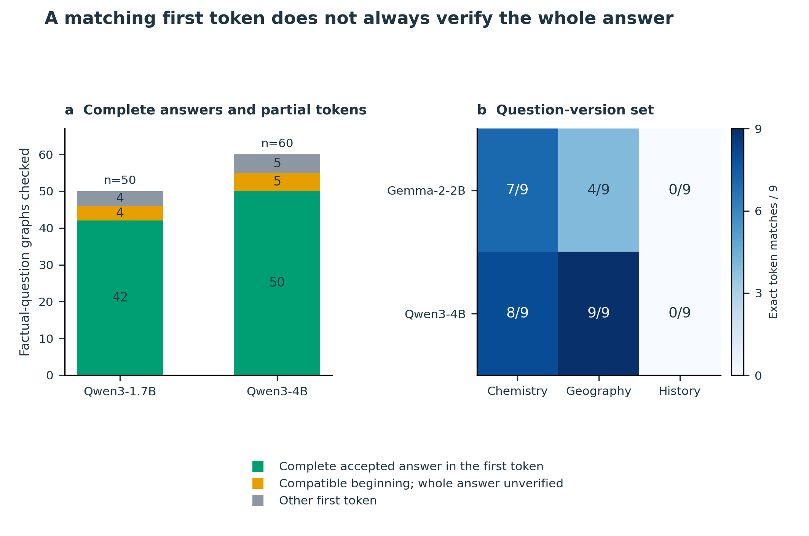

**Figure S5. A matching first token does not always verify the whole answer.** A, Counts of factual-prompt graphs classified by their predicted next token: complete accepted answer (green), partial beginning of an accepted answer (yellow), or another token (gray). Bar segments show counts; totals are n=50 for Qwen3-1.7B and n=60 for Qwen3-4B. These include development and evaluation prompts and incomplete Qwen3-1.7B history sets. Accepted spellings include Maria and María. B, Exact next-token matching in the fact/wording experiment. Each cell contains nine questions: three facts asked in three versions. Numbers show matches out of nine, and color intensity encodes the matching count from 0 to 9. Matching requires the predicted token text to equal the expected text after trimming leading and trailing whitespace. Panel A counts prompt graphs; panel B counts matches within model–subject groups.

### A2 Graph-file checks and reconstruction error

We checked whether the feature-sharing result depended on problems in the saved graph files or on activity not captured by the learned features. The first issue concerns node identifiers: when the same identifier labels more than one node, connections using that identifier become ambiguous. We detected repeated identifiers in 84/120 Gemma question/control exports and 13/27 Gemma fact/wording exports. None were detected in the 91 Qwen3-1.7B exports or the 147 Qwen3-4B exports, comprising 120 question/control and 27 fact/wording graphs (Supplementary Figure S1a). In the main analysis, we excluded nodes with missing or duplicated identifiers and compared the remaining features.

The second issue, reconstruction error, concerns the feature-based approximation rather than the file’s labels. The graph-building method approximates the model’s internal activity using learned features. Reconstruction-error nodes represent activity that this approximation does not capture. “Error” here therefore means a mismatch between the approximation and the activity being represented, not an incorrect model answer. A graph can have unambiguous node identifiers and still contain reconstruction error.

For each graph, we measured the share of recorded influence assigned to reconstruction-error nodes. We summed the magnitudes of their influence values and divided this by the total influence magnitude across uniquely identified internal nodes, excluding input embeddings and output logits. Using magnitudes prevents positive and negative influences from canceling each other. The median share across question/control graphs was 7.15% for Gemma, 6.06% for Qwen3-1.7B, and 14.57% for Qwen3-4B (Supplementary Figure S1b). These values describe the contribution of reconstruction-error nodes to the recorded influence, not answer-error rates or the percentage of the model’s reasoning that has been explained. No reconstruction-error threshold was used to exclude graphs.

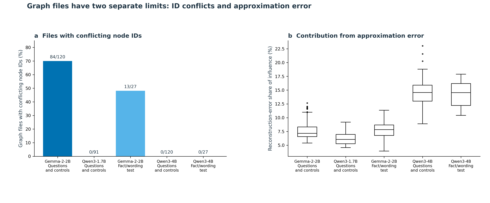

**Figure S1. Graph files have two separate limits: ID conflicts and approximation error.** A, Percentage of graph files containing a node ID assigned to conflicting node identities. Bar labels show affected files divided by files checked. “Controls” includes factual questions and invented name controls; “Versions” denotes the question-version experiment. B, Reconstruction-error influence as a percentage of absolute nonterminal-node influence in the same graph sets. Boxes span the 25th–75th percentiles; center lines are medians, whiskers extend to the most extreme values within 1.5 interquartile ranges, and dots show values beyond the whiskers. Each observation is a graph; sample sizes are 120, 91, 27, 120, and 27 from left to right in both panels. Gemma and Qwen3-1.7B values use raw-file audits; Qwen3-4B values use converted graphs. The plotted percentage measures reconstruction-error influence, not the frequency of incorrect answers.

We then tested whether the feature-sharing pattern persisted under stricter graph selection. The main analysis included eight Gemma evaluation facts after excluding ambiguous nodes. An additional check retained only facts whose starting-question and factual-rewording graph files had no detected identifier conflicts, then rebuilt the other-fact comparisons. Only two Gemma facts qualified, corresponding to four factual-question graphs: a starting question and a rewording for each fact. Their mean same-fact overlap difference remained positive at 0.086, compared with 0.170 in the eight-fact main analysis (Supplementary Figure S2). The two-fact subset was a supporting check, not a replacement for the main analysis. Because the facts being compared also changed, the smaller mean cannot be attributed solely to excluding files with identifier conflicts. The corresponding Qwen subsets retained all ten Qwen3-1.7B and twelve Qwen3-4B evaluation facts. The stricter identifier check required no detected conflicts in either factual-question graph; the two remaining Gemma facts were the outcome of that rule, not a selected sample-size cutoff.

Including reconstruction-error components in the overlap calculation also preserved the average pattern. These components were grouped by error type and layer rather than treated as learned features. Mean same-fact overlap differences changed only slightly: from 0.1704 to 0.1692 for Gemma, 0.0894 to 0.0887 for Qwen3-1.7B, and 0.2183 to 0.2153 for Qwen3-4B. Positive mean differences also remained when we compared each starting question with its most similar other-fact rewording instead of the average other-fact overlap (Supplementary Figure S2).

Together, these checks show that greater average feature sharing between same-fact questions persists under the tested analysis choices. The restricted Gemma comparison provides evidence from only two facts, however, so it does not establish the result for all eight facts using conflict-free graph files. Comparisons between models also combine differences in prompt coverage, exporting software, and feature approximations; they do not isolate model architecture or rank answer accuracy.

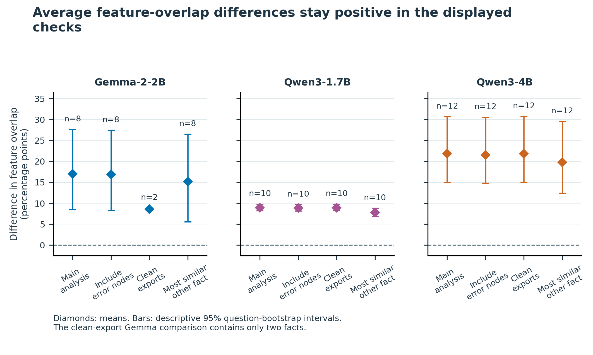

**Figure S2. Average feature-overlap differences stay positive in the displayed checks.** Mean same-fact minus other-fact Jaccard overlap under four analysis settings, shown separately for each model. The settings are the main analysis, inclusion of reconstruction-error nodes, restriction to starting-question and factual-rewording exports without detected node-ID conflicts, and replacement of the average other-fact overlap with the largest other-fact overlap. Diamonds are means; bars are descriptive 95% bootstrap intervals resampling evaluation facts. Labels give n, the number of included facts after rebuilding comparison groups for each setting. Gemma-2-2B uses eight facts except in the clean-export setting (n=2); Qwen3-1.7B and Qwen3-4B use ten and twelve facts, respectively, in every setting. Dashed lines mark zero difference.

### A3 Connections to the predicted answer in selected errors

We examined connections leading directly to the predicted answer in the 16 selected Qwen3-4B graphs described in Section 3.4: eight incorrect predictions and eight correct named-country controls (Figure 5). We grouped these connections by where their source nodes occurred in the input. For each country name in the country list, we summed the magnitudes of connections from learned-feature nodes at that position to the predicted answer’s output-score node, or logit. This allowed us to compare the recorded connections associated with the intended country and the other country.

In all four incorrect capital-name predictions, feature nodes at the other country’s name had 4.9–14.6 times the total connection-weight magnitude of those at the intended country’s name. In all four correct capital-name controls, which named the requested country directly, the intended country’s name had greater weight. The four incorrect A/B predictions did not show a consistent preference for the other country’s position. Thus, the country-position pattern appeared consistently in the selected capital-name errors, but not across both response formats.

One example illustrates why these observations do not identify a single cause. The recorded prompt was:

> Reply with only the capital name. A: Berlin. B: Paris. Countries: France, Germany. Question: what is the capital for the first country, not the second? Answer:

The model predicted Berlin rather than Paris. Berlin was both the first answer option and the capital of the second country. Matching “first” to the answer-option list instead of the country list would therefore produce Berlin. So would responding about Germany despite the instruction “not the second.” Both explanations predict the observed error, and the selected prompt layouts do not distinguish between them.

Reconstruction-error nodes also contributed to the connections entering the predicted answer. Across the 16 graphs, they accounted for a median 23.1% of the total incoming connection-weight magnitude, with a range of 17.2–31.4%. This differs from the measure in A2: here we considered only connections entering the predicted answer’s output node, whereas A2 summarized influence across internal graph nodes. The output node for the intended correct answer was absent from all eight error graphs. Its incoming connections therefore could not be examined; their absence from the export does not mean that their contribution in the model was zero.

Most nodes in the displayed local graphs occurred at late layers near the answer-generation position. Location labels such as “chat frame” identify positions in the formatted input, not what a learned feature represents. These observations describe where answer-linked features appeared in the saved graphs; they do not establish those features’ meaning or whether they were necessary for the incorrect prediction.

### A4 Checks on wording, feature counts, and graph locations

We used additional comparisons to examine three possible influences on feature overlap: similarities in question wording, the number of retained features, and where those features occurred in the graph. These checks address different questions and are interpreted separately.

The fact/wording experiment compared three versions of each question: the original and two rewordings. Each model contributed 27 graphs, covering three facts in each of three subjects. Within each subject, we compared pairs asking about the same fact in different versions and pairs asking about different facts with the same version label. Both comparisons used pairs differing in both fact and version as their baseline.

The average same-fact and same-version Jaccard differences were 0.074 and 0.118 for Gemma, respectively, and 0.101 and 0.064 for Qwen3-4B (Supplementary Figure S10). Weighting features by their exported influence gave the same ordering: corresponding cosine-similarity differences were 0.090 and 0.114 for Gemma, and 0.105 and 0.075 for Qwen3-4B. However, a shared version label did not guarantee identical wording across facts. The analysis also included questions whose predicted next tokens did not match the expected answers. Only Qwen3-4B geography met that matching rule for all nine questions; in that group, the same-fact and same-version Jaccard differences were similar, at 0.1014 and 0.1063 (Supporting analysis A1). These comparisons therefore do not establish that fact identity contributes more to feature overlap than wording, or vice versa.

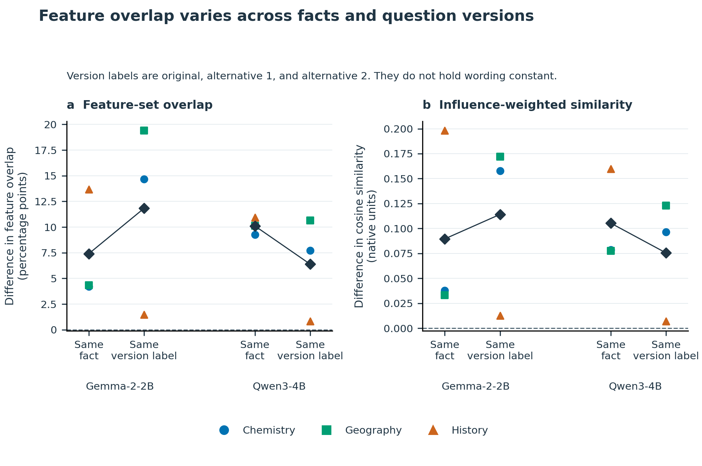

**Figure S10. Feature overlap varies across facts and question versions.** Question-version comparisons in Gemma-2-2B and Qwen3-4B, with 27 graphs per model: three facts, three versions per fact, and three subjects. A, Feature-set Jaccard overlap differences. B, Differences in cosine similarity between feature vectors weighted by exported influence. Each value subtracts mean similarity for pairs differing in both fact and version from mean similarity for pairs sharing the indicated factor, within a subject. Version labels are original, alternative 1, and alternative 2; they do not specify identical wording across facts. Blue circles, green squares, and orange triangles are chemistry, geography, and history estimates. Black diamonds average the three subject estimates equally; lines connect those means, not confidence limits. Dashed lines mark zero difference. No confidence intervals or hypothesis tests are plotted.

We next asked whether the available other-fact questions could provide comparisons with word overlap similar to that of the same-fact questions. None qualified under any of the three matching rules described in Methods: zero of eight Gemma evaluation facts, zero of ten Qwen3-1.7B facts, and zero of twelve Qwen3-4B facts had a qualifying comparator (Supplementary Figure S4). This is a gap in the available comparisons, not a measured zero effect after controlling for shared words. The main same-fact comparison therefore does not separate fact identity from word overlap.

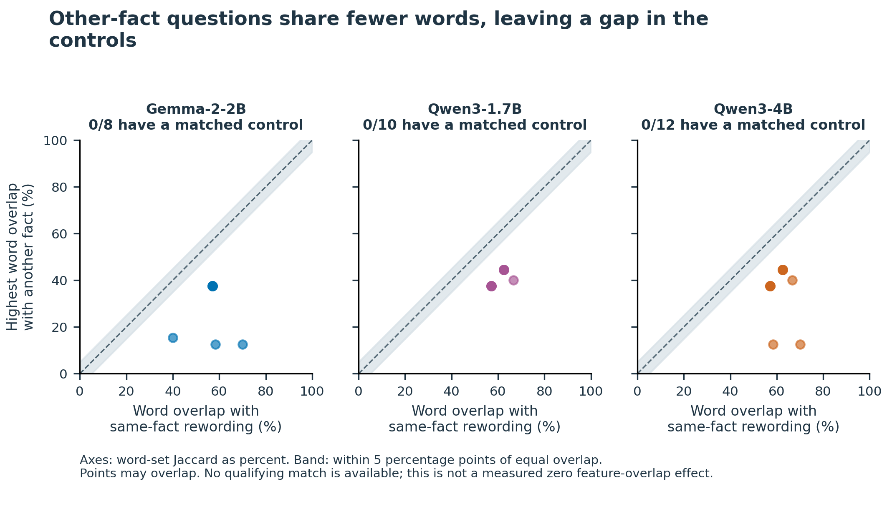

**Figure S4. Other-fact questions share fewer words, leaving a gap in the controls.** Each point represents an evaluation fact: n=8 for Gemma-2-2B, n=10 for Qwen3-1.7B, and n=12 for Qwen3-4B. The horizontal axis shows word overlap between the starting question and its factual rewording; the vertical axis shows the largest word overlap with an other-fact rewording in the same model, subject, and evaluation set. Overlap is Jaccard similarity between sets of letter/number words, ignoring case and retaining common words. The dashed diagonal marks equal overlap; the shaded band spans ±0.05 around it. Panel labels give the number of facts with a qualifying matched control under the predefined rules, divided by the number evaluated. Points may overlap.

To examine differences in representation size, we repeated the feature-overlap comparison after sampling equal numbers of features from each graph. Average same-fact overlap differences remained positive in all three models at both tested sample sizes, although one Gemma fact, tungsten, changed from a positive to a negative difference (Supplementary Figure S3; Section 3.5). Independent sampling can retain a shared feature in one graph but remove it from another. The resulting reduction in overlap therefore cannot be interpreted as the percentage of the original difference explained by graph size.

An earlier regression check did not provide independent evidence that graph size had been accounted for. Its predictors were centered by subtracting their sample means. The ordinary least-squares intercept with centered predictors equals the original sample mean by construction, so reproducing that mean was not evidence of robustness. The equal-feature-count comparison directly tests what happens when the retained feature counts are matched, while preserving the sampling limitation described above.

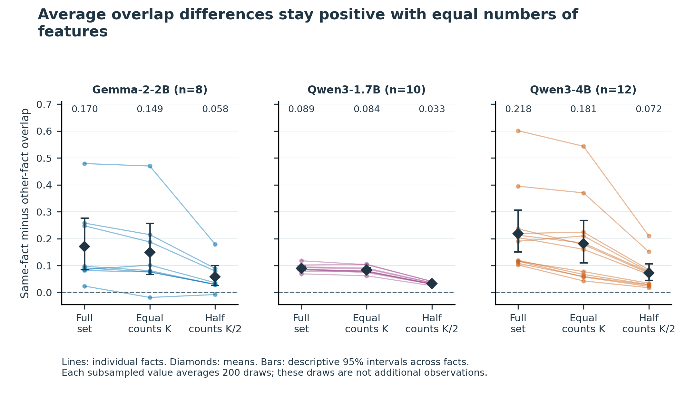

**Figure S3. Average overlap differences stay positive with equal numbers of features.** Same-fact minus average other-fact Jaccard overlap using all retained features, equal feature counts K, or half that count (K/2, rounded down). Within each model, subject, and evaluation set, K is the smallest feature count among the included factual graphs. Features are sampled independently from each graph without replacement, with each sampled graph reused across comparisons within a repetition. Subsampled values average 200 repetitions. Lines connect values for individual facts; black diamonds are model means. Bars are descriptive 95% bootstrap intervals resampling facts, not the 200 repetitions. Sample sizes are eight Gemma-2-2B, ten Qwen3-1.7B, and twelve Qwen3-4B evaluation facts. Dashed lines mark zero difference.

Finally, we asked whether the answer-related overlap patterns were confined to features at the final input-token position or in the last quarter of observed feature layers. We removed features in either location, or both, before repeating the comparisons. Across all six country pairs, the same-country overlap advantage remained greater when answer letters matched than when they differed (Supplementary Figure S6a). All eight selected error comparisons also continued to favor the correct-answer graph sharing the error’s response over the graph for the intended country (Supplementary Figure S6b). These patterns therefore extended beyond the removed positions and layers. The filters changed the saved graph representations, not the model’s activity or predictions, and the remaining features still came from graphs constructed to explain the predicted answer.

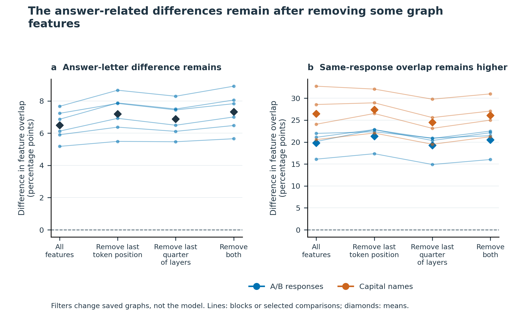

**Figure S6. The answer-related differences remain after removing some graph features.** Qwen3-4B comparisons using all retained features or removing features at the final input-token position, in the last quarter of observed feature layers, or both. Filtering precedes collapsing feature identities across positions. A, The same-country minus other-country overlap contrast with matching answer letters, minus the corresponding contrast with changed letters. Each line is one country pair (n=6); black diamonds show means. B, Error-graph overlap with a correct same-response graph minus overlap with a correct intended-country graph. Lines show selected errors, with four A/B cases (blue) and four capital-name cases (orange); colored diamonds show format means. Error comparisons share control graphs. All differences use Jaccard overlap. Dashed lines mark zero; no confidence intervals or hypothesis tests are plotted.

### A5 Qwen3-1.7B results in chemistry and geography

Qwen3-1.7B showed greater feature sharing between rewordings of the same fact in chemistry and geography. However, comparisons with invented name controls depended on which control wording was used.

The 91 available graphs provided 19 facts meeting the inclusion rules in Sections 2.1–2.2: nine chemistry and ten geography facts across the development and evaluation sets. Each included fact had all four required question/control graphs, complete accepted next-token answers for both factual questions, and an eligible other-fact comparator. The mercury development fact was excluded because both factual questions predicted `H`, only the beginning of the expected answer `Hg`. Four of the ten history facts had no returned graphs. No history fact had a complete question/control set for Qwen3-1.7B, so this model’s overlap analysis covers chemistry and geography. The completed Qwen3-4B history analyses are reported separately in Section 3.6 and Supporting analyses A1 and A7.

The evaluation sample contained five chemistry and five geography facts. All ten had positive same-fact minus average other-fact overlap differences, with subject means of 0.0854 and 0.0935, respectively (Supplementary Figure S7). Development results were kept separate: mean differences were 0.0723 for chemistry, based on four facts, and 0.0771 for geography, based on five.

Across the ten evaluation facts, the mean difference was 0.0894, with a descriptive 95% fact-bootstrap interval of [0.0820, 0.0976]. The one-sided sign-flip test gave p=0.0009766, and the fact-label permutation within each subject area gave p=0.0000694 across 14,400 assignments. These analyses are exploratory, as described in Section 2.8. Facts reuse comparison questions, so the bootstrap and sign-flip procedures do not eliminate dependence between their differences. The permutation test assumes exchangeable factual pairings within each subject; it does not control differences in shared words or expected answers. Supporting methods A5.1 specifies these procedures and the Holm correction applied to 15 secondary tests.

The table reports differences in Jaccard overlap. Positive values favor the factual rewording; negative values favor the comparator named in the row.

| Comparison or check in the evaluation sample | Mean difference | Descriptive 95% interval | Positive facts / included facts |
|---|---:|---:|---:|
| Same-fact minus average other-fact overlap | 0.0894 | [0.0820, 0.0976] | 10/10 |
| Same-fact minus most similar other-fact overlap | 0.0780 | [0.0686, 0.0879] | 10/10 |
| Same-fact minus average other-fact overlap, including reconstruction errors | 0.0887 | [0.0814, 0.0968] | 10/10 |
| Same-fact minus same-pattern invented name overlap | -0.0114 | [-0.0203, -0.0011] | 2/10 |
| Same-fact minus reworded invented name overlap | 0.1059 | [0.0917, 0.1200] | 10/10 |
| Same-pattern control, matched by broad output type | -0.0109 | [-0.0208, 0.0005] | 2/9 |
| Reworded control, matched by broad output type | 0.1059 | [0.0918, 0.1194] | 10/10 |
| Equal feature counts, at the subject minimum K | 0.0835 | [0.0759, 0.0916] | 10/10 |
| Equal feature counts, at half K | 0.0331 | [0.0303, 0.0361] | 10/10 |

The two invented name controls gave contrasting results. Factual rewordings shared more features with the starting question than reworded controls did for all ten facts. In contrast, the control retaining the starting sentence pattern shared more features than the factual rewording for eight of ten facts. Matching predictions by broad output type did not reverse this average ordering, although the same-pattern comparison’s interval then included zero. Output-type matching compared general categories of predicted tokens, not identical answers.

The equal-feature-count checks used K=1,768 features for chemistry and K=1,682 for geography, and then half those counts. Each fact’s reported difference averaged 200 subsamples. Every fact’s average difference and every repetition’s overall mean remained positive at both sizes; the 200 repetitions were not additional independent facts. Removing one already-calculated fact difference at a time left means between 0.0863 and 0.0917. This last check retained the original comparison pools rather than rebuilding them after each removal.

Weighting features by their exported influence also gave a positive same-fact minus other-fact cosine-similarity difference: 0.0741, with an interval of [0.0641, 0.0854] and all ten facts positive. The weighted comparisons again distinguished the two invented name controls. They favored the same-pattern control in all ten cases, with a mean difference of -0.0777, but favored the factual rewording over the reworded control in all ten, with a mean difference of 0.0960.

The pattern did not extend consistently to coarser graph summaries. Comparing how connection weights were distributed between layers gave a mean difference of 0.00016, with an interval spanning zero [-0.00106, 0.00119] and five of ten facts positive. Comparing influence distributions across layers also did not pass the Holm-adjusted secondary test (p=0.1934). The results therefore support an association in feature sharing, not a general distinction across every measure of graph structure.

The available comparisons also leave shared words and answers unresolved. None of the ten evaluation facts had a qualifying other-fact comparator under any of the three word-matching rules. Word overlap with the same-fact rewording exceeded the largest other-fact word overlap by 0.1806–0.2667. All ten same-fact pairs shared the expected answer, whereas none of the 40 directed other-fact comparisons did. These audits document gaps in the controls; they did not change inclusion decisions or the primary estimates.

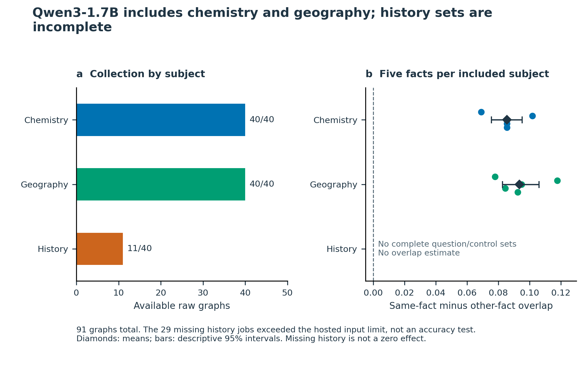

**Figure S7. Qwen3-1.7B includes chemistry and geography; history sets are incomplete.** Qwen3-1.7B graph availability and evaluation-fact overlap by subject. A, Available graph counts; labels give available/planned graphs, including development and evaluation prompts (91 available in total). Blue, green, and orange denote chemistry, geography, and history. B, Each circle represents one evaluation fact: five chemistry and five geography facts. Values are same-fact rewording overlap minus mean other-fact rewording overlap within the same subject and evaluation set. Diamonds show means; bars are descriptive 95% fact-bootstrap intervals. The dashed line marks zero difference. History has no complete four-prompt sets and therefore no overlap estimate in B; its 29 unavailable graph requests exceeded the hosted input limit.

#### A5.1 Additional methods and verification

This subsection records the graph-generation settings, statistical procedures, and verification checks for the Qwen3-1.7B analysis.

**Graph settings and export checks.** Graphs used the recorded `llamascope-2-transcoder-16k-k64` source and LoRSA feature family, with at most ten candidate next tokens (`maxNLogits=10`), node and edge thresholds of 0.8 and 0.85, and a 5,000-feature-node cap. LoRSA tracing settings were `qkTopFraction=0.5` and `qkTopk=5`. These are settings used to construct the exported graphs, distinct from the reconstruction-error diagnostic in A2, which imposed no percentage cutoff. Desired cumulative output probability was 0.99 for the completion requests; some archived files used 0.95 output coverage. Files and their source and exporter metadata were preserved rather than treated as products of identical hosted versions. Raw-file audits checked identifiers, edge endpoints, duplicate edges, and finite numerical values. No shorter prompts or replacement questions were introduced.

The recorded source families were consistent across the Qwen3-1.7B collection. The 41 completion exports identify version 2.0.0b34 and passed identifier, endpoint, duplicate-edge, and finite-value checks. Output-coverage settings differ across some files, as documented in Section 2.8; unchanged hosted weights cannot be independently verified. Shorter history prompts were not generated or substituted; the feasibility proposal is deferred from this paper.

**Statistical implementation and correction family.** The primary contrast was same-fact minus average other-fact Jaccard overlap. We used 10,000 fact-level bootstrap resamples, exact one-sided sign-flip tests, and exact fact-label permutations within each subject area, with main seed 20260714. The evaluation permutation enumerated 5! × 5! = 14,400 assignments. Bootstrap intervals and sign-flip tests describe fact-level differences that share comparison questions; the permutation assumes exchangeable factual pairings within each subject area.

Holm correction was applied to the 15 secondary evaluation-sample sign-flip p-values, excluding the primary comparison. This family crossed four metrics (feature Jaccard and cosine similarities of influence-weighted features, layer profiles, and layer-to-layer edge flow) with four comparators (average other fact, most similar other fact, same-pattern invented name, and reworded invented name), minus the primary Jaccard/average-other-fact test. The invented name comparisons in this family used the full eligible sample, not the subsets matched by output type. Output-type-matched subsets, error-inclusive and equal-count checks, and subject-specific summaries were outside this correction family. These exploratory summaries do not remove shared-word or expected-answer differences.

**Sensitivity calculations.** Sensitivity analyses retained both invented name controls, comparisons matched by broad next-token category, the most similar other-fact comparator, exported-influence-weighted cosine, reconstruction-error-inclusive representations, layer profiles, and layer-to-layer edge-flow summaries. Feature weights summed absolute exported influence across occurrences; layer profiles aggregated that influence by layer, and edge-flow profiles aggregated absolute edge weights between eligible feature nodes by source and target layer. Output-type matching required the control and starting question to have the same broad next-token category; the resulting sample sizes are reported in the A5 results table. Equal-feature-count checks reused Section 2.4's 200 subsamples at K and floor(K/2), with seed 20260905 and K defined separately within each subject's evaluation set. The subsamples were not treated as additional facts. Leave-one-fact-out summaries removed one already-calculated difference at a time without rebuilding its comparison pool.

**Audit scope and chronology.** Verification included raw-file hashes, agreement with archived feature representations, and reconstruction of previously calculated per-fact Jaccard and influence-weighted contrasts to absolute tolerance 1e-12. Earlier subset estimates remain in the archive and are not counted as additional evidence. The combined 91-graph dataset supplies ten evaluation facts; these are different units from the graph-file and token-audit denominators below.

Retrospective saved-data audits used the export, word-matching, and tokenizer procedures in Section 2.4. Export checks covered all 91 graphs; word-matching checks covered the ten included evaluation facts; token checks covered all 50 available factual starting/reworded prompts, including development questions and partial history sets. Reconstruction-error influence was summarized as absolute error-node influence divided by absolute nonterminal-node influence, using nodes with valid identifiers; it is not an answer-error rate or a causal contribution estimate. The archived tokenizer and unchanged word-matching rules were reused. Compatible answer beginnings remained distinct from complete expected next-token answers, and these audits did not alter inclusion or primary estimates. Audit plans were recorded before the audit calculations but after earlier overlap findings were known; the plans and timing are retained in the provenance records. Other models and the separate fact-by-wording experiment retain their own analysis samples.

### A6 Feature-overlap analysis workflow

Figure S8 shows how the primary analysis turns question graphs into a feature-overlap comparison. After applying the inclusion rules in Section 2.2, we represent each graph as a set of unique learned features. For each starting question, we calculate its Jaccard overlap with its own factual rewording, then subtract its average overlap with rewordings of other facts. Comparisons stay within the same model, subject area, and development or evaluation set, producing one difference per included fact. Invented name controls provide a separate comparison.

The diagram explains the calculation rather than presenting additional results. Gold refers to the chemical element, while zorium is an invented name used to illustrate a control. The feature letters and numerical scores are illustrative, not measured values. Figure 1 presents the wider study design; the fact/wording, answer-letter, selected-error, and historical-date analyses retain their own comparisons and inclusion rules.

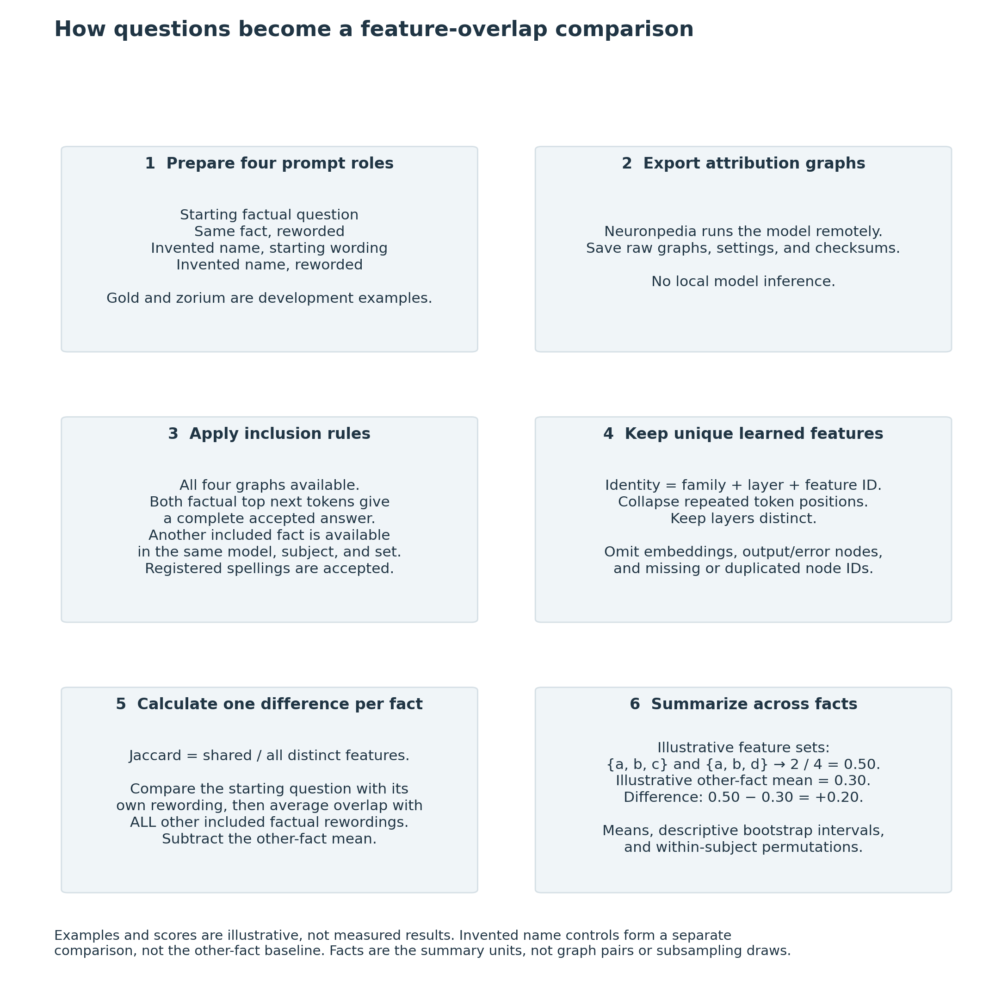

**Figure S8. How questions become a feature-overlap comparison.** Schematic of the primary feature-overlap analysis for Gemma-2-2B, Qwen3-1.7B, and Qwen3-4B. Numbered stages show prompt preparation, hosted graph export, inclusion checks, feature extraction, overlap calculation, and summary across facts. Features are identified by family, layer, and feature ID, with repeated token positions collapsed. For each starting question, Jaccard overlap with its factual rewording is compared with mean overlap across all other included factual rewordings in the same model, subject, and evaluation set. Invented name controls form a separate comparison. Gold and zorium are development examples; the feature letters and the scores 0.50, 0.30, and +0.20 are illustrative, not measured results. Facts, rather than graph pairs or subsampling repetitions, are the summary units.

### A7 Historical-date comparisons

We analyzed all 16 Qwen3-4B graphs for two event pairs: the adoption of the Declaration of Independence and signing of the Treaty of Paris, and the launches of Sputnik 1 and Explorer 1. Seven of eight predictions were correct for the document-history pair, and four of eight were correct for the spaceflight pair. All 11 correct and five incorrect predictions were retained. Figure 6 presents examples and comparisons that changed either the date-to-letter assignments or the question/context order.

We distinguished the required answer letter from the predicted answer letter. The required letter was the A or B assigned to the correct year in a prompt. The predicted letter was the response the model actually produced, whether correct or incorrect. This distinction allowed us to ask whether feature overlap followed the correct answer mapping or the model’s response.

For each event pair, four prompts placed the question before the context and four reversed that order. Comparing every question-first graph with every context-first graph produced 16 comparisons per event pair. Mean Jaccard overlap was higher when predicted letters matched: 0.7396 versus 0.5075 for the document-history pair, and 0.7758 versus 0.5614 for the spaceflight pair. Each mean summarized eight graph pairs. These comparisons reused the same graphs and were not eight independent facts.

We also grouped those comparisons by whether they asked about the same event and required the same correct answer letter. Each cell below averages four comparisons between the two question/context orders.

| Event pair | Same event, same required letter | Different event, same required letter | Same event, different required letter | Different event, different required letter |
|---|---:|---:|---:|---:|
| Declaration of Independence / Treaty of Paris | 0.7207 | 0.6533 | 0.5595 | 0.5608 |
| Sputnik 1 / Explorer 1 | 0.6915 | 0.6472 | 0.6795 | 0.6562 |

Grouping by the required letter did not produce the same consistent pattern as grouping by the predicted letter. Average overlap was 0.1268 higher for matching required letters in the document-history pair, but only 0.0015 higher in the spaceflight pair. In contrast, matching predicted letters accompanied higher overlap in both event pairs.

To compare these results with the geography analysis, we calculated same-event minus different-event overlap separately when required letters matched and when they differed. Subtracting the changed-letter contrast from the matching-letter contrast gave differences of 0.0686 for document history and 0.0210 for spaceflight. Both remained positive with influence-weighted cosine similarity, with each graph-location filter described in A4, and when averaging 200 equal-feature-count subsamples at K and half K. Here, K was the smallest feature count among the eight graphs in each event pair. These checks concern the required-letter contrasts; they are not additional filtered tests of the predicted-letter grouping. The subsampling result refers to the average across repetitions, not to every repetition being positive.

The source data retain all 56 unordered graph comparisons: 28 within each event pair, including comparisons within and across question/context orders. They also retain comparison categories with no observations and every subsampling result. With only two selected event pairs and reused graphs, these results are descriptive rather than population significance tests.

All 16 exports passed checks of prompts, token inventories, node identifiers, edge endpoints, duplicate edges, finite numerical values, and conversion. Their predictions matched all 16 saved preview responses. Collection used Qwen3-4B with `transcoder-hp`, node and edge thresholds of 0.8 and 0.85, at most ten output logits, desired cumulative output probability of 0.99, and a 5,000-feature-node cap. Prompts and the chat wrapper were unchanged.

These completed graphs should be distinguished from the larger historical-date evaluation originally planned. That evaluation would have collected 160 graphs from 20 event pairs, but collection required all 20 preliminary predictions to be correct. Only 15 were correct, so the larger evaluation did not proceed. Its planned primary estimate also required at least 16 complete, correct-answer event pairs, including at least six from each theme. That estimate was therefore not measured.

| Original preliminary component | Correct top labels | Fixed requirement | Outcome |
|---|---:|---:|---|
| Literal A/B instructions | 4/4 | 4/4 | Passed |
| Declaration of Independence and Treaty of Paris | 7/8 | 8/8 | Failed |
| Sputnik 1 and Explorer 1 launch years | 4/8 | 8/8 | Failed |
| Entire preliminary check | 15/20 | 20/20 | No evaluation graphs requested |

The completed 16-graph analysis examined every historical prompt from that preliminary check, excluding the four literal instruction checks. Its analysis plan was recorded before graph collection but after the preview answers were known. Correctness was measured rather than required for inclusion, allowing us to examine the wrong answers as well as the correct ones. This analysis provides the history findings reported here; it does not complete the uncollected 160-graph evaluation or add facts to the original three-model comparison.

### A8 Data, code, and reproducibility records

The study retains the prompts, graph-generation settings, raw and converted graphs, file checksums, analysis plans, derived tables, and code needed to trace the reported results. Earlier analyses and scoring decisions remain archived rather than being counted as additional observations. The records distinguish graph collection, analysis of saved graphs, figure generation, and editorial updates.

A curated working-paper review package is available on the [GitHub main branch](https://github.com/J-Lawrence10/autocircuit/tree/main/neuronpedia_pipeline/paper_share). It contains the manuscript, figures, derived tables, protocols, and code snapshots. Its manifest identifies the included edition and records file checksums. This is a review package, not a complete raw-data release or a peer-reviewed publication.

Raw Neuronpedia exports, full feature caches, tokenizer/model files, and downloaded reference PDFs are excluded from the public package. Redistribution permissions for the relevant third-party materials have not been established. Credentials and private API configuration are excluded for security and are not intended for release. The author archive retains the inputs required for analyses that cannot be reproduced from the public derived tables alone.

#### Figure generation and package verification

The current six main figures and ten supplements are generated by [build_reviewed_paper_figures.py](../code/scripts/build_reviewed_paper_figures.py) from saved result tables and diagnostic outputs. This step redraws the figures without requesting new graphs or re-estimating statistical results. Figure manifests retain the source-table and input hashes, and earlier figure editions remain archived.

The [caption-checking script](../code/scripts/sync_manuscript_figure_captions.py), run with `--reviewed`, checks that manuscript captions match the reviewed catalog. Adding `--write` updates manuscript captions; adding `--update-reviewed-manifest` also updates the reviewed legend metadata. These operations do not change numerical results or figure artwork. The [sharing-package builder](../code/scripts/build_paper_share_package.py) assembles the portable manuscript, figures, code, tables, and provenance records.

The package’s [verification script](../code/verify_package.py) checks included file hashes and reported values against the bundled tables. These checks establish consistency of the distributed package; they do not reproduce graph extraction from the excluded raw files or independently validate the scientific conclusions.

#### Saved-data reproduction

The archived October reproduction used an isolated Python environment on the same machine. It reconstructed 23 original fact-level overlap differences from 342 checksum-verified available raw graphs, matched the closeout audit, and passed 82 software tests. Those historical estimates comprised eight Gemma, five Qwen3-1.7B, and ten Qwen3-4B facts. They are not the final 8/10/12-fact sample. The dependency specification, resolved package versions, commands, logs, and verification results remain in the closeout reproduction records (author archive: `reproduction`; not included).

Subsequent checks covered the expanded datasets and corrected scoring. The Qwen3-1.7B verification checked hashes for all 91 raw inputs and reconstructed archived feature representations and overlap calculations. The historical-date validation checked all 16 graphs, recomputed the 56 pairwise Jaccard comparisons, and confirmed retention of all five incorrect predictions. The final scoring validation checked 147 Qwen3-4B raw-file hashes and recomputed 54 Jaccard comparisons from raw graphs, confirming the final model-specific evaluation counts of eight, ten, and twelve. These are documented checks with distinct scopes, not a single independent end-to-end reproduction of every current analysis.

A separate validator reconstructed the original history study’s 15/20 preliminary result from archived responses, checked the frozen hashes and request ledger, and confirmed that no graphs were generated for its planned 160-graph evaluation. The completed 16-graph history analysis retains its own collection and verification records, as described in A7.

#### Analysis records

The following archives retain the detailed inputs, plans, outputs, and execution records. Their folder names identify the archived analyses; they do not designate additional independent datasets.

| Analysis | Records and principal entry points |
|---|---|
| Exploratory wording and feature-count checks | Exploratory-analysis archive (author archive: `exploratory_20260905`; not included), with its [analysis plan](../methods/EXPLORATORY_CONFOUND_CHECKS_20260905.md), [analysis script](../code/scripts/exploratory_confound_checks.py), and [plotting script](../code/scripts/plot_exploratory_confound_checks.py). |
| Closeout audit and reproduction | Closeout archive (author archive: `final_closeout_20261005`; not included), [audit script](../code/scripts/audit_paper_closeout.py), and [reproduction script](../code/scripts/reproduce_closeout.py). |
| Matched-choice comparison and position-task diagnostic | Matched-choice records (author archive: `matched_choice_chat_v2`; not included), [matched-choice protocol](../methods/MATCHED_CHOICE_CHAT_V2_PROTOCOL.md), [position-task protocol](../methods/MATCHED_CHOICE_POSITION_V3_PROTOCOL.md), and diagnostic archive (author archive: `position_artifact_diagnostic_20261001`; not included). |
| Original stopped history evaluation | Original history archive (author archive: `history_choice_final_v1`; not included), [protocol](../methods/HISTORY_CHOICE_FINAL_PROTOCOL.md), [runner](../code/scripts/run_history_closeout.py), and [analyzer](../code/scripts/analyze_history_closeout.py). |
| Completed 16-graph history analysis | History graph archive (author archive: `history_pilot_graphs_20261110`; not included), [analysis plan](../methods/HISTORY_PILOT_GRAPH_FOLLOWUP.md), [analyzer](../code/scripts/analyze_history_pilot_graphs.py), [validator](../code/scripts/validate_history_pilot_graphs.py), and [saved-data reproduction script](../code/scripts/reproduce_history_pilot_graphs.py). |
| Expanded Qwen3-1.7B analysis | Qwen3-1.7B archive (author archive: `qwen17_completion_20261106`; not included), [collection record](../methods/QWEN17_COMPLETION_ATTEMPT_20261106.md), [audit script](../code/scripts/audit_qwen17_completion.py), and [analysis script](../code/scripts/analyze_qwen17_completion.py). |
| Selected error graphs | Failure-case archive (author archive: `failure_case_graphs_v1`; not included), [analysis plan](../methods/FAILURE_CASE_GRAPH_ANALYSIS_PLAN.md), [analyzer](../code/scripts/analyze_failure_case_graphs.py), and [validator](../code/scripts/validate_failure_case_graphs.py). |
| Corrected answer scoring and final results | [Accepted-spelling registry](../code/config/answer_spelling_aliases_20261111.json), scoring audit (author archive: `answer_spelling_20261111`; not included), final results archive (author archive: `final_corrected_scoring_20261111`; not included), and [finalization script](../code/scripts/finalize_corrected_scoring.py). |

The exploratory archives include input hashes, tokenizer revisions, graph- and fact-level tables, subsampling repetitions, logs, and figure files. The selected-error archive additionally retains node/edge tables and source-location summaries underlying A3. The history archive retains unchanged prompts, preview responses, and every pairwise comparison. Collection scripts are distinct from saved-data analysis scripts; regenerating results or figures does not require repeating hosted requests when the necessary archived inputs are available.

The corrected scoring records preserve the 170-output audit and earlier inclusion decisions. No new model calls or changes to raw graphs were used to correct scoring. Likewise, the earlier 50-graph Qwen3-1.7B subset and its five-fact evaluation remain archived for provenance; they are not pooled with the combined sample as additional evidence.

Protocols were locally frozen, not publicly preregistered. Analyses planned after relevant outcomes were known retain their exploratory status. Codex assisted with code, audits, analysis, figures, and drafting. Independent scientific review and reproduction remain outstanding, and the human authors remain responsible for reviewing the claims, references, and release permissions.

## Reproducibility and availability

The [review package on GitHub](https://github.com/J-Lawrence10/autocircuit/tree/main/neuronpedia_pipeline/paper_share) contains the manuscript, figures, derived source tables, protocols, code snapshots, and file checksums. The final saved-data analysis is assembled by `scripts/finalize_corrected_scoring.py`; the current figures are built by `scripts/build_reviewed_paper_figures.py`. Supporting analysis A8 documents input locations, dependency records, collection and scoring history, and reproduction commands. Earlier estimates remain archived rather than being counted as additional observations.

The package supports inspection of the reported results but is not a complete raw-data release. Raw Neuronpedia exports and tokenizer/model files are excluded while redistribution permissions remain unresolved. Recorded checks reconstructed results from saved data on the same machine; independent reproduction and an appropriately licensed raw-data deposit remain outstanding.

Codex assisted with code, audits, analysis, figures, and drafting. Human authors remain responsible for reviewing the scientific claims and references. The manuscript is a working paper and has not been peer reviewed.

## References

1. Ameisen, E., Lindsey, J., Pearce, A., et al. (2025). *Circuit Tracing: Revealing Computational Graphs in Language Models*. [Methods](https://transformer-circuits.pub/2025/attribution-graphs/methods.html).
2. Franco, G., Tassis, L. M., Rohr, A., and Crovella, M. (2026). *Finding Interpretable Prompt-Specific Circuits in Language Models*. [arXiv:2602.13483](https://arxiv.org/abs/2602.13483).
3. Qwen. Official [Qwen3-1.7B tokenizer configuration](https://huggingface.co/Qwen/Qwen3-1.7B/blob/main/tokenizer_config.json) and [Qwen3-4B tokenizer configuration](https://huggingface.co/Qwen/Qwen3-4B/blob/main/tokenizer_config.json). Actual downloaded revisions and file hashes are in the audit artifacts.
4. Hugging Face. [Tokenizer encoding and decoding API](https://huggingface.co/docs/tokenizers/api/tokenizer). Google. [Gemma-2-2B repository](https://huggingface.co/google/gemma-2-2b).

5. Zheng, C., Zhou, H., Meng, F., Zhou, J., and Huang, M. (2024). *Large Language Models Are Not Robust Multiple Choice Selectors*. ICLR. [arXiv:2309.03882](https://arxiv.org/abs/2309.03882).
6. Wang, X., Ma, B., Hu, C., et al. (2024). *“My Answer is C”: First-Token Probabilities Do Not Match Text Answers in Instruction-Tuned Language Models*. [arXiv:2402.14499](https://arxiv.org/abs/2402.14499).
7. Zhang, Z., Xiong, H.-D., Wilson, R. C., Aoi, M., Mattar, M. G., and Ji-An, L. (2026). *The Position Curse: LLMs Struggle to Locate the Last Few Items in a List*. [arXiv:2605.07127](https://arxiv.org/abs/2605.07127).
8. Royal Museums Greenwich. [The 'Santa Maria' at Anchor](https://www.rmg.co.uk/collections/objects/rmgc-object-12245). Collection record BHC0753, accessed 11 November 2026.
9. Fundación Nao Victoria. [History of the Nao Santa María](https://www.fundacionnaovictoria.org/history-nao-santa-maria/). Accessed 11 November 2026.

The references support the methods and comparisons discussed here; they do not constitute an exhaustive novelty review.
