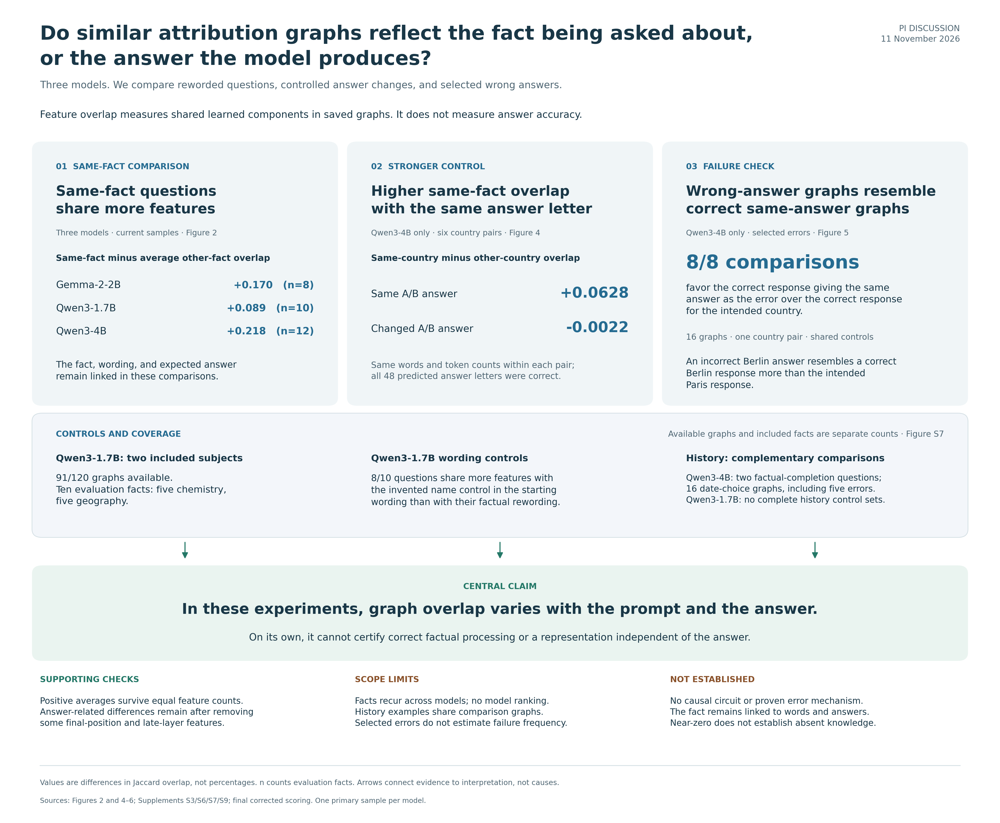

# Attribution graph paper review package

Review package updated 7 November 2026 with the current available datasets and approved manuscript revisions. This is a working paper for PI and collaborator review, not a peer-reviewed publication or a submission-ready release. The manuscript, figures, and summaries use one current dataset per model. See the [revision notes](manuscript/MANUSCRIPT_REVISION_NOTES.md).

## Research question

Do similar attribution graphs reflect the fact being asked about, or the answer the model produces?

Same-fact questions share more features across the three analyzed models. In the stronger Qwen3-4B comparison, the same-country overlap difference is larger when the answer letter stays the same. Selected wrong-answer graphs also favor correct predictions giving the same answer. These findings connect overlap to both the question relationship and predicted response, rather than correctness alone.

## Start here

1. [Claims map](claims/paper_claims_map.png): the current three-model findings, control results, and limits. [Editable SVG](claims/paper_claims_map.svg).
2. [Findings and interpretation](manuscript/FINAL_FINDINGS_SUMMARY.md): the results and what they support.
3. [Integrated outline](manuscript/INTEGRATED_PAPER_OUTLINE.md): the paper's logical argument and section structure.
4. [Figure guide](figures/LEGENDS.md): six main figures and eight supplements with self-contained captions. [Open the figure gallery](figures/index.html) locally in a browser. [Methods diagram (Figure S8)](figures/figureS8_feature_overlap_workflow.png) explains the primary feature-overlap calculation.
5. [Working manuscript](manuscript/ATTRIBUTION_GRAPH_THREE_MODEL_DRAFT.md): current methods, results, discussion, and supporting analyses. A [browser-readable copy](manuscript/ATTRIBUTION_GRAPH_THREE_MODEL_DRAFT.html) is included.
6. [Questions included and excluded](manuscript/SAMPLE_ACCOUNTING.md): current graph counts, evaluation facts, and exclusion reasons, distinct from accuracy.

GitHub renders Markdown and PNGs directly. Download the folder to view the HTML galleries locally; GitHub does not render these HTML files as a hosted website.

## Main findings and boundaries

- Mean same-fact minus other-fact overlap is 0.170 for Gemma-2-2B (8 evaluation facts), 0.089 for Qwen3-1.7B (10), and 0.162 for Qwen3-4B (10). All included facts have positive differences. Repeated facts and different subject coverage prevent a model ranking.
- In Qwen3-1.7B, eight of ten evaluation questions share more features with the same-pattern invented name control than with their factual rewording. All ten favor the factual rewording over the reworded control. Matching broad next-token categories gives differences of -0.0109 (n=9) and +0.1059 (n=10). The controls do not isolate factual meaning from wording and the expected answer.
- In the stronger Qwen3-4B study, the same-country overlap difference is 0.0628 with the same A/B answer and -0.0022 with a changed answer. All 48 predictions across six country pairs are correct. Near zero does not establish absent factual knowledge.
- All eight selected error comparisons favor the correct response giving the same answer over the correct response for the intended country. These dependent cases do not estimate general failure frequency or prove an error mechanism.
- Average feature-sharing differences remain positive after equalizing feature counts. The Qwen3-4B answer-related differences also remain after the specified graph-location filters. The coarser Qwen3-1.7B edge-flow comparison is inconclusive, so the result does not cover every graph property.

## Data coverage

The four-version question design contains 120/120 graphs for Gemma-2-2B, 91/120 for Qwen3-1.7B, and 118/120 for Qwen3-4B. Gemma and Qwen3-4B each have another 27 fact-by-wording graphs. The separate Qwen3-4B answer-letter and selected-error studies contain 48 and 16 graphs, respectively.

Qwen3-1.7B has all 40 chemistry and 40 geography graphs. Its 11/40 history graphs provide no complete four-version sets after 29 input-length rejections. These are collection failures, not wrong answers. Qwen3-4B is missing two Columbus graphs, leaving 145/147 graphs in its four-version and fact-by-wording collections. Its separate history pilot passes 15/20 checks against a 20/20 gate, so that study has no evaluation graphs. Gemma contributes three history facts to the primary comparison.

No shortened history prompts were generated or substituted. The proposal is deferred from this paper.

## Interpretation and future research

The observed answer-associated overlap could reflect shared model activity, answer-dependent selection of features into the exported graph, or both. Discussion Section 4.3 explains this unresolved distinction and proposes future fixed-activity attribution comparisons, activation-based measurements, and controlled interventions. Those studies have not been performed or initiated.

The main figures consistently use the current Qwen3-1.7B sample of 91 graphs and ten included evaluation facts, with comparison-specific subsets where required. The fact-by-wording, answer-letter, selected-error, and graph-location studies retain their own samples. Figure S7 distinguishes collection counts from included facts; missing groups are unavailable, not zero effects.

## What is in the folder

| Folder | Contents |
|---|---|
| `claims/` | Current claims map and a Figure 1 layout reference, PNG and editable SVG |
| `figures/` | Six main figures, eight supplements, captions, and local browser gallery |
| `tables/` | Current figure source tables and question-inclusion audit |
| `manuscript/` | Working draft, integrated outline, findings summary, and sample accounting |
| `methods/` | Relevant frozen protocols and supporting analysis notes |
| `code/` | Selected analysis, figure, validation, and test source snapshots; dependency pins |
| `provenance/` | File checksums, source mapping, analysis records, and archived verification evidence |

The [Figure 1 option C file](claims/figure1_option_c.png) is retained as a design reference, not as a substitute for the current Figure 1 in the figure gallery.

## Reproducibility and exclusions

The code snapshots preserve project-relative paths. They are for method inspection and use with the full authorized research archive; this compact folder does **not** reproduce the complete raw-data analysis by itself. The included CSV and derived JSON files support inspection of reported values, but do not replace raw-data access.

The current Qwen3-1.7B analysis was specified after earlier findings were known, using unchanged prompts, expected answers, and inclusion rules. Earlier subset results remain in the audit archive, not as extra observations or an independent replication. Methods Section 2.8 preserves the distinction between those analyses and later retrospective display audits. Input hashes, representation checks, and reconstruction of archived results are recorded alongside the current analysis.

Automated reproduction and review records are not independent scientific validation. The package manifest records the included file hashes, and the link audit checks local references. To verify the downloaded files and headline arithmetic without installing additional packages, run `python code/verify_package.py` from this folder. This checks hashes and included tables, not excluded raw graphs.

No hosted generation or local model inference is part of this presentation update. Excluded materials include raw Neuronpedia exports, tokenizer/model files, private API configuration, credentials, downloaded reference PDFs, environments, caches, unrelated changes, and the large local release archive. Their redistribution permissions are not established. The earlier compiled PDF is omitted because it predates the current figures and captions. Links to the writing-reference papers appear in [the reference guide](methods/WRITING_REFERENCES.md); their PDFs are not bundled.

Independent scientific review, author approval, reference verification, and venue formatting remain outstanding. This package makes no new license grant for third-party materials and does not authorize redistribution of the excluded archive.
