# Figures for the integrated paper outline

28 October 2026. Findings-led wording for all six main figures; six supplements retain their detailed definitions. Saved estimates, inclusion rules, and conclusions are unchanged; no new model runs or statistical tests.

## How to read these figures

A feature is a learned component represented in the exported graph, not a verified concept or a complete reasoning step. Feature overlap counts which components appear in both graphs; it does not compare all their connections. Jaccard overlap divides the number shared by the total number of distinct features across the two graphs: 0 means none shared, and 1 means identical sets. A difference in feature overlap subtracts one overlap score from another; each figure specifies the comparison. It can be positive, zero, or negative. Zero means equal overlap, not missing data.

A test question was reserved for evaluation rather than for developing the analysis. A token is one unit of predicted text; it may be a whole word, part of a word, or a symbol. A/B answer means the letter produced, not necessarily the same capital city. Category colors are explained by labels or legends; numerical colors have a scale. An asterisk on Qwen3-4B marks the incomplete original collection (145/147 graphs), not the separate completed follow-ups.

## Figure 1 Three tests ask what similar graphs can tell us

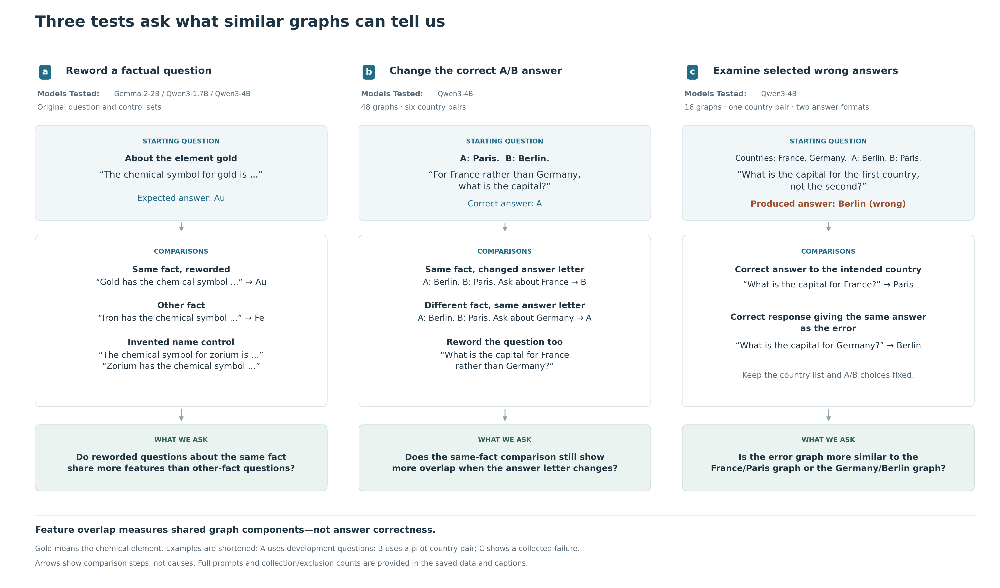

A, Compare rewordings of the same fact with other-fact questions in the same subject and evaluation group. Gold is the chemical element. The examples use development questions, not the test questions plotted in Figure 2; subject coverage differs across the three models. B, In Qwen3-4B, vary the queried country, capital-to-A/B mapping, and wording while preserving the words and token counts within each country pair. All 48 predicted letters were correct. France/Germany illustrates the design using a pilot pair excluded from that evaluation. Displayed prompts are shortened; full prompts retain both countries and the other words, while word order and country roles vary. C, Compare a selected wrong-answer graph with correct predictions for the intended country and for the answer actually produced. This Qwen3-4B diagnostic has 16 graphs from one country pair and two response formats, with shared controls. Answers refer to the highest-probability next token. Arrows indicate comparisons, not causes; box colors identify steps. Sample accounting reports collection counts, exclusions, and failed preliminary checks.

[Editable SVG](figure1_design_and_coverage.svg)

## Figure 2 Reworded questions about the same fact share more features in these samples

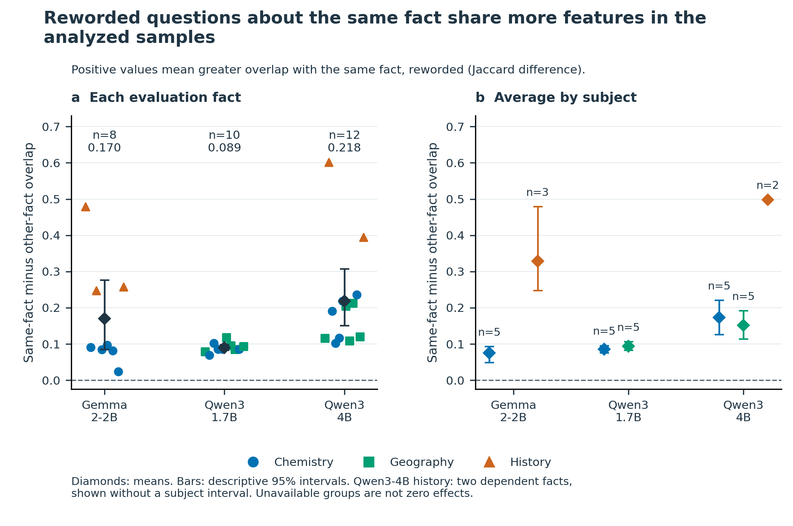

A, Points represent questions reserved for evaluation that passed the fixed inclusion rules. The difference in feature overlap is same-fact rewording overlap minus average other-fact rewording overlap within the same subject and test set. The displayed arithmetic, 0.50 − 0.30 = +0.20, illustrates this subtraction. These example numbers are not measured results. Positive, zero, and negative values indicate more, equal, and less overlap with the same fact; units are Jaccard differences, not percentage increases. B, Subject averages. Colors and shapes identify subjects; diamonds show model averages and bars show saved 95% intervals from 10,000 question-bootstrap resamples. n counts questions. Means are 0.170 for Gemma-2-2B (8 questions), 0.085 for Qwen3-1.7B (5), and 0.162 for Qwen3-4B (10). Repeated facts and different subject coverage preclude a model ranking; shared words and answers remain coupled to fact identity. Missing groups are unavailable, not zero. *The original Qwen3-4B collection contains 145/147 planned graphs.

[Editable SVG](figure2_fact_signal.svg)

## Figure 3 Both the fact and the wording are linked to shared features

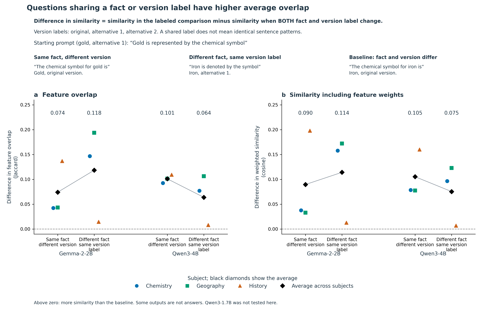

A, Feature-set overlap differences. B, Saved-influence-weighted cosine differences, comparing the direction of weighted feature vectors. The baseline changes both fact and wording. Each value is similarity in the labeled comparison minus similarity in that baseline, calculated within subject. The illustrated gold/iron prompts show the comparisons: retain gold and reword the question, replace gold with iron while retaining the pattern, or change both for the baseline. “Same wording” means the same sentence pattern, not an identical prompt. Each tested model has 27 graphs: three facts × three wordings × three subjects. Colored points are subject averages; black diamonds average subjects equally. Lines connect descriptive estimates, not intervals. Mean fact/wording differences in A are 0.074/0.118 for Gemma-2-2B and 0.101/0.064 for Qwen3-4B. Some predicted first tokens are incomplete answers or non-answers. Only Qwen3-4B geography passes all nine expected-token checks; its differences are 0.101/0.106. These similarity measures do not measure correctness or establish factor dominance or model superiority. Qwen3-1.7B was not tested here.

[Editable SVG](figure3_fact_and_wording.svg)

## Figure 4 Invented name controls give different results across models

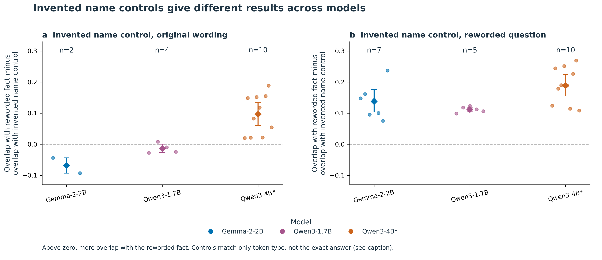

Replace the real name with an invented name, retaining the starting wording (A) or rewording it (B). For each test question, subtract overlap with the invented name prompt from overlap with the factual rewording. Positive values favor the factual rewording; negative values favor the invented name control. Colors identify models, points show questions, diamonds show means, and bars show saved 95% question-bootstrap intervals; n counts included questions. Panel A means are -0.069 (n=2), -0.014 (n=4), and +0.096 (n=10) for Gemma-2-2B, Qwen3-1.7B, and Qwen3-4B. Matching uses only broad first-token categories (letters/numbers, whitespace, or punctuation/symbols), leaving exact answer, meaning, confidence, and correctness unmatched. Small, differently composed samples support comparison-specific findings rather than a general explanation by wording. *The original Qwen3-4B collection is incomplete (145/147 graphs).

[Editable SVG](figure4_control_comparisons.svg)

## Figure 5 Same-fact overlap is higher when the answer letter stays the same

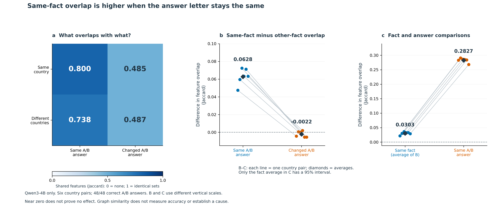

Qwen3-4B: six country pairs, 48 correct next-token A/B predictions, and identical word/token inventories within pairs. Rules were fixed before collection in this outcome-informed follow-up. A, Mean feature overlap in the four cross-wording comparisons: 0.8005, 0.4853, 0.7377, and 0.4874, read row by row. The scale runs from no shared features (0) to identical sets (1). B, Same-country minus different-country overlap is 0.0628 with the same letter and -0.0022 with a changed letter. Their paired difference is 0.0650 (exploratory Student-t 95% interval 0.0553–0.0746; two-sided sign-flip p=0.03125). C, Their average is the prespecified primary outcome: 0.0303 (95% block-bootstrap interval 0.0265–0.0338). The descriptive same-letter minus different-letter difference, averaged across country relationships, is 0.2827. Lines represent country pairs; diamonds show means. Only the primary mean in C has an interval drawn. Colors identify labeled categories; B and C use different vertical scales. Tests assume six independent country-pair blocks; the sign-flip test additionally assumes symmetric null differences. The 48 graphs and 4,096 conditional-null reassignments are not independent replicates. Near zero is not equivalence. Overlap differences are neither accuracy nor variance explained; query order, country roles, and output-conditioned graphs remain alternatives to a causal interpretation. Supplement S6 reports graph-location checks.

[Editable SVG](figure5_matched_choice.svg)

## Figure 6 Selected error graphs share more features with correct predictions giving the same answer

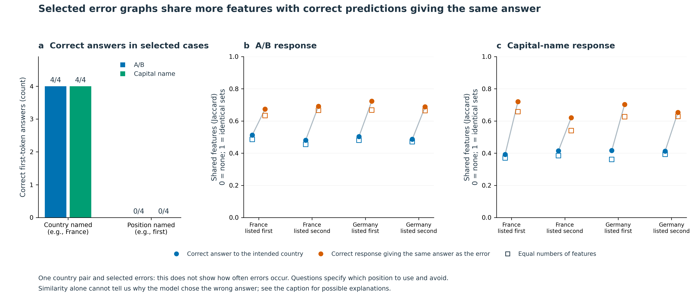

Qwen3-4B, one country pair and two response formats. A, All eight named-country prompts predict the correct first token; all eight selected position-based prompts reproduce the error (four of each per format). B–C, Compare error graphs with correct predictions for the intended country (blue) or giving the same answer (orange), holding list order and A/B mapping fixed. With France first and A: Berlin, B: Paris, the indirect France question predicts Berlin; naming France predicts Paris and naming Germany predicts Berlin. The error graph shares more features with Germany/Berlin. Circles use all retained features; open squares average 200 equal-feature-count samples. Lines connect comparisons for the same error. Same-answer minus intended-country overlap averages 0.1983 for letters and 0.2649 for capital names (0.1851 and 0.2361 with equal counts). All 16 exports and eight comparison triples pass integrity and output checks. The selected cases share controls, so they support descriptive comparisons, not error-frequency estimates or population tests. Words differ between prompt types; position matching, negation errors, and output-conditioned graph structure remain unresolved explanations. The intended correct-answer node is absent from each error graph, leaving its contribution unknown.

[Editable SVG](figure6_failure_cases.svg)

## Supplement S1 Graph files have two separate limits: ID conflicts and approximation error

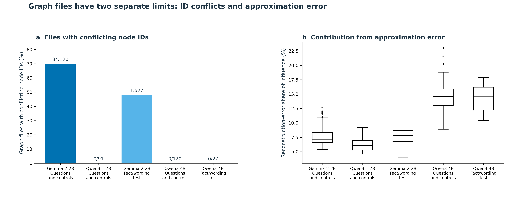

A, The percentage of saved raw graph files in which the same node ID refers to conflicting node identities. Labels show affected files over files checked. Zero means no conflict was detected, not no graphs or no model errors. The original question sets include factual questions and controls; the fact/wording sets vary both factors. B, Reconstruction-error nodes record part of the model computation not captured by the feature approximation. The axis gives their share of absolute nonterminal-node influence, using the saved audit definitions. This is not the percentage of wrong answers or of reasoning explained. Box centers mark medians; boxes span the middle 50%, whiskers extend to values within 1.5 box lengths, and dots show values beyond the whiskers. Original distributions use raw-file audits; Qwen3-4B uses converted graphs with no ambiguous IDs removed. Differences combine model, exporter, and approximation choices; they do not isolate model size or architecture.

[Editable SVG](figureS1_export_and_error.svg)

## Supplement S2 Average overlap differences stay positive under alternative graph comparisons

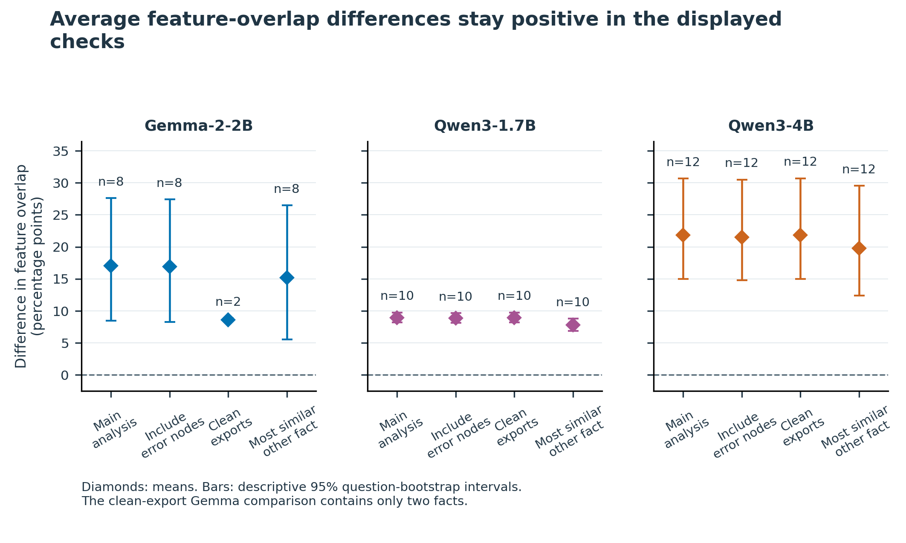

The difference in feature overlap is same-fact overlap minus other-fact overlap, using the comparison specified for each check. Compare the original analysis with three alternatives: include reconstruction-error nodes; use only files without detected node-ID conflicts; or compare with the most similar other-fact question rather than the average other-fact question. Reconstruction-error nodes represent approximation error, not wrong model answers. Points are saved averages; bars are 95% bootstrap intervals from resampling test questions. n counts questions. Restricting files requires rebuilding the comparison groups and leaves only two Gemma questions, so that positive result is weak evidence on its own. The size-regression intercept is not plotted: with centered predictors it equals the unadjusted mean and is not an independent check. *Qwen3-4B remains incomplete (145/147 graphs).

[Editable SVG](figureS2_robustness.svg)

## Supplement S3 Average overlap differences stay positive with equal numbers of features

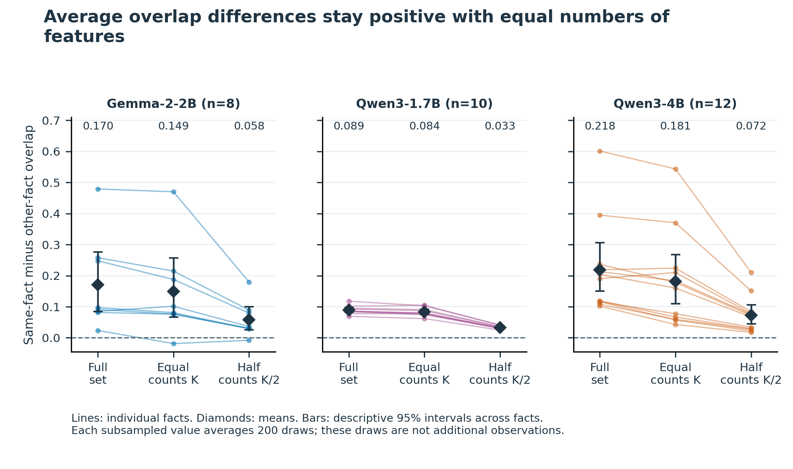

The difference in feature overlap is same-fact overlap minus average other-fact overlap within the same subject and test set. Within each model, subject, and test set, randomly sample the same number of features from every graph. K is the number of features in the smallest graph in that group; the second check uses half that number, rounded down. Repeat 200 times, reusing each sampled graph across comparisons within a repetition. Lines show individual test questions; diamonds show averages. Bars are descriptive 95% bootstrap intervals from resampling questions, not from the 200 feature samples. Seven of eight Gemma questions and all included Qwen questions retain positive average differences. Equalizing counts does not remove differences in shared words, answers, or which features the exporter retains. A smaller overlap score after sampling is not a percentage of signal explained. *Qwen3-4B remains incomplete (145/147 graphs).

[Editable SVG](figureS3_equal_feature_counts.svg)

## Supplement S4 Other-fact questions share fewer words, leaving a gap in the controls

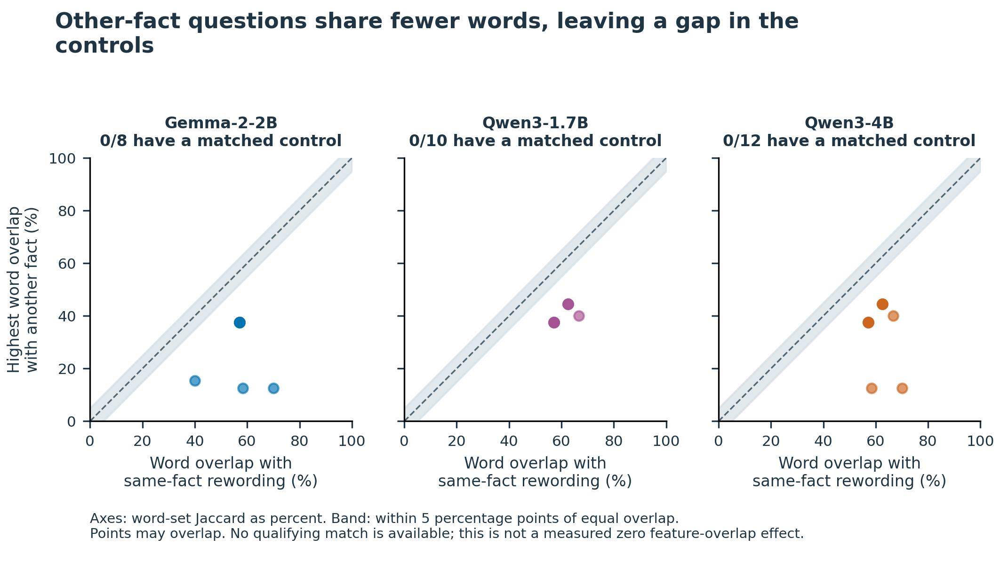

For each test question, compare word overlap with its same-fact rewording (horizontal axis) against the highest word overlap with any other-fact rewording (vertical axis). Word overlap uses unique letter/number words, ignores letter case, and keeps common words. Both axes use Jaccard overlap: shared words divided by all distinct words across the pair. The dashed line means equal overlap; the shaded band allows a difference of 0.05 in either direction. Every other-fact comparison falls below that band. Thus 0/8 Gemma, 0/5 Qwen3-1.7B, and 0/10 Qwen3-4B questions have a comparison meeting the specified word-matching rule. None qualifies under the alternative at-least-as-much-word-overlap rule or the joint word/feature-count rule either. This is a missing comparison, not a measured zero effect or proof that words explain all feature overlap. Same-fact questions also share their expected answer, so the data do not isolate meaning from words or answers. *Qwen3-4B remains incomplete (145/147 graphs).

[Editable SVG](figureS4_lexical_support.svg)

## Supplement S5 A matching first token does not always verify the whole answer

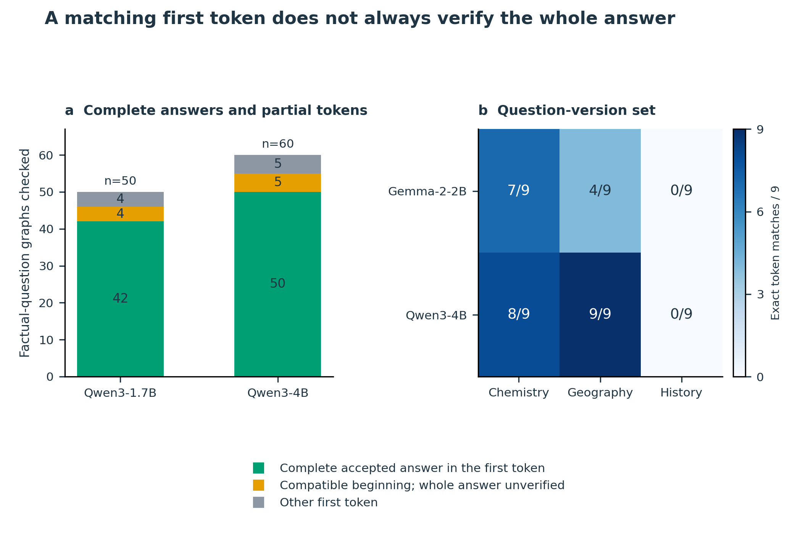

A, Audit the first predicted text unit, or token, using the Qwen tokenizers. Green means the whole expected answer fits in that token; yellow means it is only a compatible beginning, so the completed answer is unverified; gray means a different token. Seven apparent mismatches across the two Qwen models are compatible beginnings of multi-token answers. Counts include development and test factual questions, including Qwen3-1.7B geography questions without complete controls; they are not the question counts in Figure 2. Qwen3-4B is missing one factual graph and one invented name control graph. Official Qwen tokenizer versions agree with all saved prompt pieces and decoded top tokens, but the exact versions used at the time of graph collection cannot be fully recovered. Gemma tokenizer access was denied, leaving that audit unresolved. B, In the fact/wording experiment, counts use the original exact first-token matching rule after trimming whitespace; that rule is unchanged. Only Qwen3-4B geography matches in all nine questions. Its fact/wording differences are 0.101/0.106, which do not establish that either factor dominates. A zero in history means zero matches under this rule, not zero history knowledge. *The original Qwen3-4B collection is incomplete.

[Editable SVG](figureS5_answer_audit.svg)

## Supplement S6 The answer-related differences remain after removing some graph features

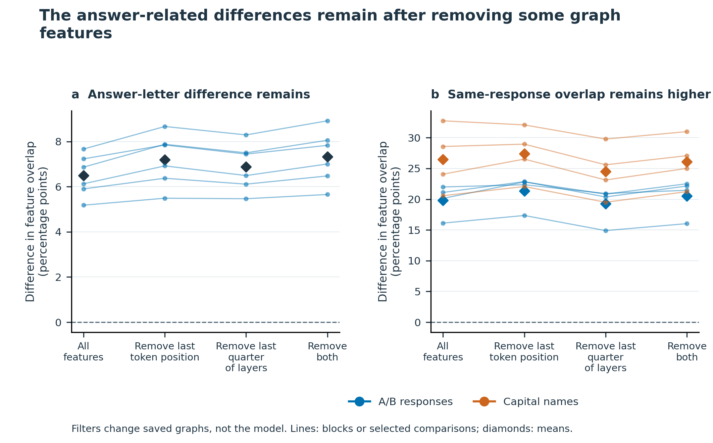

Qwen3-4B only. Repeat the saved comparisons after removing features at the last token position, in the last quarter of observed feature layers, or both. Removal happens before combining feature identities across positions. A, Plot the difference between the same-letter and changed-letter fact comparisons in Figure 5B. Each line represents one of six country pairs; black diamonds show averages. B, Plot overlap with the correct same-answer response minus overlap with the correct intended-country response in the selected errors from Figure 6. Lines show the individual comparisons; colored diamonds show format averages. All filtered feature sets are nonempty. Zero means equal overlap, not missing data. These checks were chosen after seeing earlier results. No confidence intervals or new population tests are attached. Removing features from saved graphs is not an intervention on the model and does not establish a cause. The remaining graphs are still constructed around the answer being produced.

[Editable SVG](figureS6_graph_location_sensitivity.svg)

## Final history pilot

| Checks | Correct | Required |
|---|---:|---:|
| Literal A/B instructions | 4/4 | 4/4 |
| Document-history pilot | 7/8 | 8/8 |
| Spaceflight pilot | 4/8 | 8/8 |
| Overall | 15/20 | 20/20 |

The fixed pilot failed. No evaluation graphs were requested, so no history graph-overlap effect was measured. This is not a history-accuracy benchmark. The original history exclusions remain unchanged.

## Reproduction and source data

Run `.venv-final-reproduction/Scripts/python.exe scripts/build_outline_figures_v2.py`. All 12 figures are rebuilt from saved data as 300-dpi PNGs and editable SVGs. The wording is maintained in `scripts/figure_plain_language.py`; the label review is recorded in `wording_audit.json`.

The manifest records input, builder, helper, and output hashes; plotted source tables are in `tables`. Figure 5 shows six blocks, not 48 independent observations. Category colors are directly labeled or keyed in legends; the numerical heatmap has a 0–1 color scale. Missing groups are unavailable, never effect-size zeros.

Earlier figures, the compiled manuscript, and the sealed release archive remain unchanged. This is a figure revision for author review, not a new scientific analysis.
