**Working manuscript — not peer reviewed.** Editorial revision: 28 October 2026; review package updated 3 November 2026.

## Abstract

Comparing attribution graphs offers a way to ask whether differently worded questions recruit shared model features. We tested how this overlap relates to the requested fact and the predicted answer in Gemma-2-2B, Qwen3-1.7B, and Qwen3-4B. Reworded questions about the same fact had higher mean feature overlap than questions about other facts in all three analyzed samples, including after equalizing feature counts. Because those comparisons also shared words and expected answers, we tested Qwen3-4B with identical word and token inventories within each of six country pairs while varying the queried country, wording, and correct A/B answer. All 48 predicted letters were correct. The same-country minus different-country overlap was 0.0628 when the answer letter stayed the same and -0.0022 when it changed. Their average, the prespecified primary outcome, was 0.0303 (95% block-bootstrap interval 0.0265–0.0338). In a separate exploratory diagnostic using one country pair, all eight selected wrong-answer graphs shared more features with a correct prediction giving the same answer than with a correct prediction for the intended country. Together, the experiments identify an answer-associated pattern in feature overlap that persists in selected errors. This supports interpreting overlap jointly with the prompt comparison and predicted answer, rather than as a standalone marker of correct factual processing. The stronger comparisons concern Qwen3-4B geography; a failed history pilot prevented the planned historical graph evaluation.

## 1. Introduction

Two differently worded questions about the capital of France ask for the same fact and expect the same answer, Paris. If their attribution graphs share features, that resemblance could be associated with the requested fact, the shared words, or the answer. Distinguishing these relationships is necessary to interpret what a graph comparison tells us about factual processing.

Attribution graphs describe learned features and their attributed influence for a particular prompt and output [1]. Here we compare which features occur in each graph. Feature overlap is the number shared by two graphs divided by the number of distinct features across both. This gives us a common measurement for comparing prompts; it measures feature composition rather than the connections forming a reasoning pathway.

We ask: **Do similar attribution graphs reflect the fact being asked about—or the answer the model produces?** Both can contribute. We first establish the same-fact association in three model samples. We then hold word inventories constant and vary the requested country and answer letter in Qwen3-4B. Finally, we ask whether a wrong-answer graph resembles a correct prediction for the intended country or a correct prediction giving the same answer as the error. Each comparison addresses an ambiguity left by the preceding one.

The experiments show a positive same-fact association in the original samples, a larger same-fact overlap difference when the answer letter is unchanged in the stronger comparison, and same-answer resemblance in selected errors. Our contribution is an empirical evaluation of how to interpret feature overlap. Prior studies investigate prompt-specific circuits [2], multiple-choice selection [5], and positional retrieval [7]; we examine how prompt and answer relationships appear in the graph measurement. Identifying the causal computations behind these associations would require interventions [1].

## 2. Methods

Figure 1 summarizes the three comparisons: establish shared features across rewordings, compare the same fact with and without a shared answer letter, and examine resemblance when the answer is wrong. The follow-ups are separate studies, not replacements for the original cohorts.

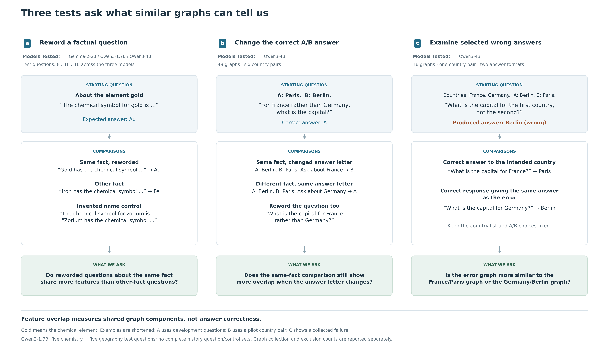

**Figure 1. Three tests ask what similar graphs can tell us.** A, Compare rewordings of the same fact with other-fact questions in the same subject and evaluation group. Gold is the chemical element. The examples use development questions, not the test questions plotted in Figure 2; subject coverage differs across the three models. B, In Qwen3-4B, vary the queried country, capital-to-A/B mapping, and wording while preserving the words and token counts within each country pair. All 48 predicted letters were correct. France/Germany illustrates the design using a pilot pair excluded from that evaluation. Displayed prompts are shortened; full prompts retain both countries and the other words, while word order and country roles vary. C, Compare a selected wrong-answer graph with correct predictions for the intended country and for the answer actually produced. This Qwen3-4B diagnostic has 16 graphs from one country pair and two response formats, with shared controls. Answers refer to the highest-probability next token. Arrows indicate comparisons, not causes; box colors identify steps. Sample accounting reports collection counts, exclusions, and failed preliminary checks.

### 2.1 Cohorts, provenance, and completion

Three models from two families are represented: Gemma-2-2B, Qwen3-1.7B, and Qwen3-4B. All graphs were generated remotely through Neuronpedia; the present analyses use archived inputs and CPU computation only. No local model inference was performed. Model, exporter, decomposition, pruning, and available prompt coverage vary together, so cross-model differences are pipeline comparisons rather than isolated architecture or scaling effects.

| Pipeline | Controlled graphs | Crossed graphs | Evaluation questions used and subjects |
|---|---:|---:|---|
| Gemma-2-2B, original | 120 | 27 | 8: chemistry 5, history 3 |
| Qwen3-1.7B, original replication | 50 | Not collected | 5: chemistry |
| Qwen3-4B, prospective extension | 118/120 | 27/27 | 10: chemistry 5, geography 5 |

The original design contains 30 facts, each with a starting question, a factual rewording, and two invented name controls, divided into development and evaluation sets. Qwen3-1.7B has ten complete chemistry sets and ten geography starting questions without complete controls. Qwen3-4B lacks two Columbus variants after repeated server failures: the factual rewording and the reworded invented name control. Its 145/147 available graphs remain an incomplete extension, and the original requirement for support across all three subjects remains unmet. Llama was deferred for resource reasons before extension outcomes and was not generated.

The original and extension protocols were prospectively frozen locally. The September confound plan was written after observing those results and is explicitly exploratory. No public preregistration is asserted. Original prompts, splits, exclusions, expected tokens, and gates were not changed.

Collection and inclusion counts are separated in the [sample-accounting table](SAMPLE_ACCOUNTING.md). All three models contribute chemistry comparisons; geography and history do not provide complete three-model comparisons. Unused questions are not automatically incorrect answers: missing controls, partial next tokens, and lack of a comparison partner are distinct exclusion reasons.

### 2.2 Representation and controlled outcome

For each graph, we collect the unique `(feature family, layer, feature id)` identities. Repeated occurrences of a feature at different token positions count once. Reconstruction errors, embeddings, logits, and ambiguous identifiers are excluded from the primary representation, and feature identities are compared only within a model. For feature sets A and B, Jaccard overlap is `|A intersection B| / |A union B|`: shared features divided by all distinct features. It ranges from 0 for disjoint sets to 1 for identical sets. This measures feature composition, not recovery of graph topology or complete input-to-output pathways.

For a starting question T_i and its factual rewording P_i, the primary difference in feature overlap is:

`M_i = Jaccard(T_i, P_i) - mean_j Jaccard(T_i, P_j)`,

where j includes every other included fact in the same model, subject, and development or evaluation set. Inclusion requires all four prompt/control graphs, both factual prompts matching the expected highest-probability next token after trimming whitespace, and another qualifying fact for comparison. This is a next-token matching rule, not verification of a complete generated answer.

In plain language, this subtracts average overlap with reworded questions about other facts from overlap with a reworded question about the same fact. Positive values mean more shared features in the same-fact comparison; zero means equal overlap; negative values mean more shared features in the other-fact comparison. It is a difference between Jaccard scores, not a percentage increase. Other designs below specify their own subtraction; weighted cosine comparisons are called differences in weighted similarity rather than feature overlap.

The original uncertainty estimates use 10,000 fact-bootstrap resamples and exact one-sided sign flips. Complementary within-domain fact-label permutations assess matched assignment without treating graph pairs as independent samples. Facts reuse comparators, sign-flip assumptions require care, and the same facts recur across models: 8+5+10 is not 23 unique independent facts. No pooled model-ranking test is performed.

### 2.3 Crossed design and controls

Gemma and Qwen3-4B each have three subjects, three facts per subject, and three formulations per fact in the fact-by-wording experiment. We compare questions sharing a fact but not the sentence pattern, or sharing the pattern but not the fact, against questions differing in both. Differences are calculated within subjects and averaged across subjects. Permutations preserve this crossed design. The relative ordering of the differences is descriptive, not a test that one factor dominates or that models differ.

Invented name controls replace a real entity name with an invented name—for example, replacing “gold” with “zorium”—while retaining either the starting sentence pattern or its reworded version. A separate sensitivity check compares outputs only within broad next-token categories: letters/numbers, whitespace, or punctuation/symbols. This does not match the exact answer, its meaning, or its probability.

### 2.4 Exploratory confound checks

All 342 available raw graph files were hash-verified during the new extraction. Collision-safe feature counts agreed with the archived audits, and the 23 primary fact margins were reconstructed to absolute tolerance 1e-12.

**Feature counts.** Within each model/domain/held-out block, K is the smallest target or positive-paraphrase feature count. Each graph is independently subsampled without replacement to K or floor(K/2). Across 200 repetitions (seed 20260905), a sampled graph is reused in all its comparisons. We report per-fact averaged margins, descriptive 10,000-resample fact-bootstrap intervals, and separately the variability across subsampling repetitions. Equal cardinality does not equalize feature-selection bias or remove lexical confounding.

**Shared words and answer identity.** Word overlap is case-folded alphanumeric word-set Jaccard, without stopword removal. Other-fact comparators must either equal or exceed own-paraphrase word overlap, fall within an absolute 0.05 caliper, or satisfy that caliper plus a feature-count ratio within 1.25 of the own paraphrase. All qualifying comparators are averaged. No support is reported as not estimable, not zero. Calipers were not widened after inspection. Expected-answer identity is separately tabulated.

**Tokenizer audit.** Official Qwen tokenizer revisions were pinned and their files hashed. Their single-token decodings were checked against archived prompt pieces and top logit IDs. Expected continuations were encoded against each stored prompt with zero or one separating space, requiring prefix stability. Whole-answer next-token matches, substantive multi-token prefixes, whitespace-only compatibility, and mismatches under those conventions remain distinct. Historical tokenizer revision identity is not fully recoverable, and current-tokenizer compatibility is not proof of a completed answer. Gemma's official tokenizer download returned HTTP 401; its tokenizer-aware classification remains unavailable. No mirror or local weights were used [3,4].

For crossed output sensitivity, a domain must retain all nine cells under the original strict string rule. We do not select individual favorable cells or replace the original cohort.

### 2.5 Matched-choice follow-up separating queried country and answer label

To separate the requested fact from the answer label more directly, we tested Qwen3-4B using its non-thinking chat format. Within each of six country pairs, we varied the country asked about, the assignment of capitals to A/B, and the wording, producing eight graphs per pair. Each prompt contained the same words and the same counts of tokenizer IDs within its pair, although order and country roles changed. France/Germany was used only in the preliminary behavioral check for this experiment. We measured same-country minus different-country overlap separately for comparisons with the same and different answer letters. The prespecified primary outcome was the average of these two differences. Uncertainty used six country pairs, not 48 independent graphs. The exact conditional fact-correspondence test contained 4096 assignments; its locally frozen multiple-testing adjustment covered three model/version opportunities.

The follow-up design was informed by earlier results, but its rules were fixed before collecting its evaluation graphs. Earlier plain-completion pilots had failed: Qwen3-4B chose A on all eight items, giving 4/8 correct labels, while Gemma produced the correct capitals but none of the eight requested letters. These failed pilots remain separate from the original cohorts. The revised Qwen study controls word and token inventories and varies answer labels, but does not remove differences in query order or how country names are assigned roles.

### 2.6 Position pilot and exploratory failure-case diagnostic

A separate follow-up asked about a country's position in a list while varying the queried country, list order, answer mapping, and wording. Its prespecified accuracy requirement had to be met in a 16-item pilot before collecting evaluation graphs. After the pilot failed, we conducted an explicitly exploratory diagnostic of selected errors; this was not a replacement evaluation cohort.

The diagnostic contained 20 next-token previews: four literal/replay positive controls and four selected France/Germany cases varied by how the country was identified (its name or list position) and by response format (A/B letter or capital name). These cases were selected because the correct answer conflicted with choosing an answer option by its position. We fixed the 16 diagnostic prompts before generating their graphs. Each wrong-answer graph was compared with two correct-answer graphs: one for the intended country and one producing the same answer as the error. Both controls preserved the option layout and country-list order. The position-based and named-country prompts differ in wording, length, and repeated names; unlike the matched-choice experiment, their word and token inventories are not identical.

Graph settings were maxNLogits=10, desiredLogitProb=0.99, nodeThreshold=0.8, edgeThreshold=0.85, and maxFeatureNodes=5000, using hosted Qwen3-4B with the recorded transcoder source. Exact prompts and token sequences, source/settings, checksums, identifier integrity, and observed answers were audited. Wrong answers were deliberately retained. All comparisons report feature-set Jaccard, exported-influence-weighted cosine, and an equal-feature-count sensitivity using 200 repetitions with fixed seeds. Direct incoming edges to the observed answer logit were summarized by source type and token location, preserving signs and absolute weights. Display panels retain the ten largest absolute direct edges and the ten largest upstream edges into those displayed predecessors; full tables retain the remaining edges.

These selected cases concern two facts in one country pair, with reused controls. We report descriptive comparisons without confirmatory p-values or population confidence intervals. The country-location weight ratio discussed below was an additional descriptive inspection of the archived role tables, not a prespecified primary endpoint. All outcomes concern the top next token under the hosted non-thinking setup; they do not independently establish full generated-answer behavior [6]. Local provenance checks also do not independently certify hosted-weight identity.

### 2.7 Final saved-data audit and separate history follow-up

After inspecting the matched-choice results, we directly compared the same-label and changed-label fact contrasts across the six country-pair blocks. We report the mean paired difference, a 20,000-resample block-bootstrap interval, a Student-t interval, and a two-sided exact block sign-flip test. These summaries assume independent blocks; the sign-flip null additionally assumes symmetric block contrasts. This added test is exploratory and is distinct from the original conditional correspondence test. The 4,096 correspondence assignments are null configurations within six blocks, not 4,096 independent observations.

The tests answer different questions:

| Test | Question and outcome | Reference distribution and interpretation |
|---|---|---|
| Prespecified conditional correspondence test | Is the average of the two fact contrasts greater than expected under reassigned fact correspondence? Primary mean: 0.0303. | Reassign queried-fact correspondence across wording versions within each answer-label group: four assignments per country pair and 4096 across six pairs. The reference null treats those assignments as exchangeable conditional on the label and word inventory. It tests correspondence under that null, not a causal effect isolated from word order or country roles. |
| Exploratory block sign-flip test | Is the same-letter fact contrast different from the changed-letter fact contrast? Paired mean difference: 0.0650. | Flip the sign of each of six country-pair differences, assuming independent blocks and symmetric differences under the null. The two-sided test concerns the difference between conditions, not their average. |

The conditional test's small p-value describes the specified reassignment null; it does not establish that the prompts are exchangeable for every substantive hypothesis. Residual order and role differences constrain interpretation. The earlier original-cohort tests also reuse other-fact comparators, so their resampling results are reported alongside the within-domain correspondence tests rather than as independent replications.

As graph-location sensitivities, we removed feature nodes at the final prediction context position, in the last quarter of observed feature layers, or both, before collapsing feature identities. Empty representations are unavailable rather than assigned zero overlap. These filters test concentration of the measured association; they are not causal ablations, and retained graphs remain conditioned on the generated output. We applied the same filters to the selected failure comparisons without attaching population p-values to their dependent triples.

A final historical-date study was locally frozen on 5 October before its hosted outcomes. It used Qwen3-4B only, two separate pilot event pairs plus four literal-label checks, and a planned evaluation of 20 event pairs spanning US documentary history and spaceflight chronology. All eight prompts per pair had identical token inventories; queried event, year-to-label mapping, and question/context order varied. The protocol required all 20 pilot checks to pass before any of the 160 evaluation graphs could be requested. Its planned primary endpoint was the mean same-label minus changed-label fact contrast, conditional on complete correct-answer blocks, with at least 16 supported blocks including six per theme. The failed pilot stopped collection, so this endpoint was not measured. This prospective, outcome-informed follow-up does not change original history inclusion.

## 3. Results

### 3.1 Reworded questions about the same fact share more features

For every included evaluation question, overlap with its same-fact rewording exceeded its average overlap with rewordings of other facts. Mean differences in feature overlap were 0.170 for Gemma (95% interval [0.085, 0.276], n=8), 0.085 for Qwen3-1.7B ([0.076, 0.095], n=5), and 0.162 for available Qwen3-4B cases ([0.131, 0.194], n=10). Exact sign-flip p-values were 0.00390625, 0.03125, and 0.0009765625; fact-label permutation p-values were 0.00139, 0.00833, and 0.0000694. The association is consistent across these samples; their differing subject coverage and repeated facts make this a within-model result, not a model ranking.

The next question is what the association distinguishes. A same-fact rewording can preserve both words and the expected answer. We therefore examined whether the original controls could separate those relationships.

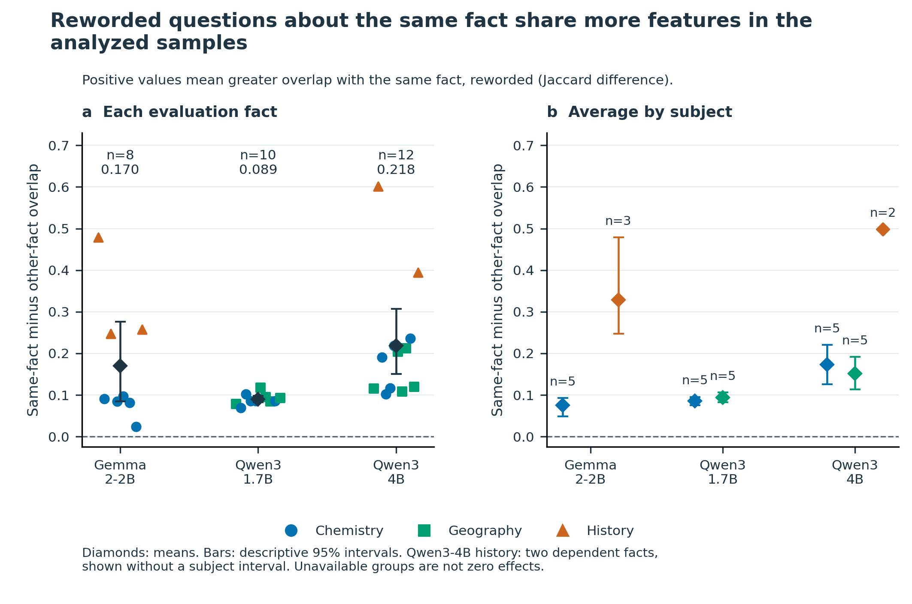

**Figure 2. Reworded questions about the same fact share more features in these samples.** A, Points represent questions reserved for evaluation that passed the fixed inclusion rules. The difference in feature overlap is same-fact rewording overlap minus average other-fact rewording overlap within the same subject and test set. The displayed arithmetic, 0.50 − 0.30 = +0.20, illustrates this subtraction. These example numbers are not measured results. Positive, zero, and negative values indicate more, equal, and less overlap with the same fact; units are Jaccard differences, not percentage increases. B, Subject averages. Colors and shapes identify subjects; diamonds show model averages and bars show saved 95% intervals from 10,000 question-bootstrap resamples. n counts questions. Means are 0.170 for Gemma-2-2B (8 questions), 0.085 for Qwen3-1.7B (5), and 0.162 for Qwen3-4B (10). Repeated facts and different subject coverage preclude a model ranking; shared words and answers remain coupled to fact identity. Missing groups are unavailable, not zero. *The original Qwen3-4B collection contains 145/147 planned graphs.

### 3.2 Same-fact questions share words and expected answers

To separate factual identity from shared wording, we looked for other-fact questions that matched each same-fact pair's word overlap. None met any of the three word-matching or joint word/feature-count rules: 0/8 Gemma, 0/5 Qwen3-1.7B, and 0/10 Qwen3-4B. Even the most word-overlapping other-fact prompt scored at least 0.196 below the same-fact rewording in Gemma and Qwen3-1.7B, and at least 0.181 below it in Qwen3-4B (Supplement Figure S4). The gap was not a borderline threshold result.

Answer identity was coupled to factual identity as well: none of the 86 directed other-fact comparisons shared the expected answer, whereas same-fact pairs did. The original comparison changes the fact, word overlap, and expected answer together. It establishes their combined association with shared features, leaving their separate contributions unresolved.

The fact-by-wording experiment varied factual content and sentence pattern separately. Both shared facts and shared patterns had positive average overlap differences relative to pairs sharing neither: 0.074/0.118 in Gemma and 0.101/0.064 in Qwen3-4B (Figure 3). Influence-weighted similarity had the same ordering within each pipeline (0.090/0.114 and 0.105/0.075). This ordering is descriptive because output quality and subject coverage vary: only Qwen3-4B geography passed the strict expected-token rule in all nine questions (Supporting analysis A1).

When controls were matched only by broad next-token category, overlap differences relative to same-pattern invented name controls were -0.069 (Gemma, n=2), -0.014 (Qwen3-1.7B, n=4), and +0.096 (Qwen3-4B, n=10). Differences relative to reworded invented name controls were positive in all three cohorts. Thus retaining the sentence pattern did not consistently remove the higher overlap with the factual rewording. Together, these controls motivate a follow-up that preserves the available words while varying the requested country and the answer letter.

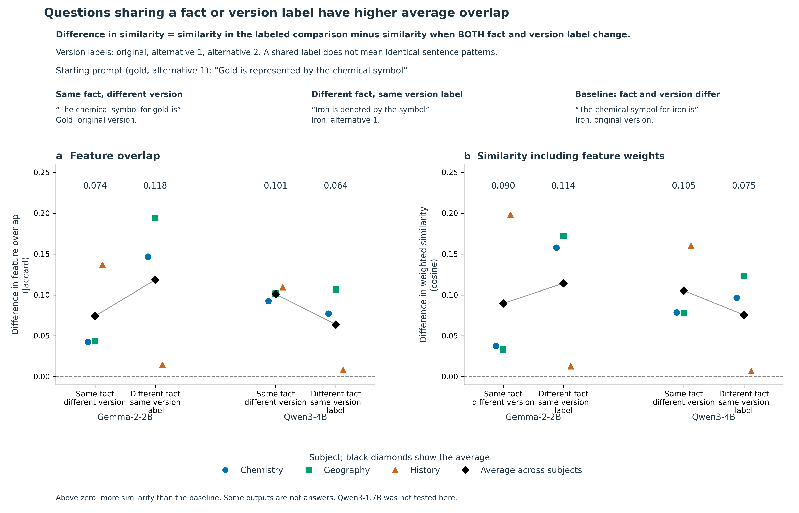

**Figure 3. Both the fact and the wording are linked to shared features.** A, Feature-set overlap differences. B, Saved-influence-weighted cosine differences, comparing the direction of weighted feature vectors. The baseline changes both fact and wording. Each value is similarity in the labeled comparison minus similarity in that baseline, calculated within subject. The illustrated gold/iron prompts show the comparisons: retain gold and reword the question, replace gold with iron while retaining the pattern, or change both for the baseline. “Same wording” means the same sentence pattern, not an identical prompt. Each tested model has 27 graphs: three facts × three wordings × three subjects. Colored points are subject averages; black diamonds average subjects equally. Lines connect descriptive estimates, not intervals. Mean fact/wording differences in A are 0.074/0.118 for Gemma-2-2B and 0.101/0.064 for Qwen3-4B. Some predicted first tokens are incomplete answers or non-answers. Only Qwen3-4B geography passes all nine expected-token checks; its differences are 0.101/0.106. These similarity measures do not measure correctness or establish factor dominance or model superiority. Qwen3-1.7B was not tested here.

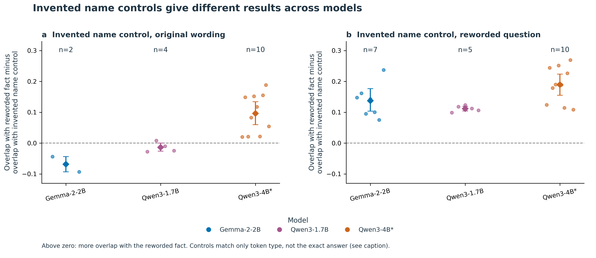

**Figure 4. Invented name controls give different results across models.** Replace the real name with an invented name, retaining the starting wording (A) or rewording it (B). For each test question, subtract overlap with the invented name prompt from overlap with the factual rewording. Positive values favor the factual rewording; negative values favor the invented name control. Colors identify models, points show questions, diamonds show means, and bars show saved 95% question-bootstrap intervals; n counts included questions. Panel A means are -0.069 (n=2), -0.014 (n=4), and +0.096 (n=10) for Gemma-2-2B, Qwen3-1.7B, and Qwen3-4B. Matching uses only broad first-token categories (letters/numbers, whitespace, or punctuation/symbols), leaving exact answer, meaning, confidence, and correctness unmatched. Small, differently composed samples support comparison-specific findings rather than a general explanation by wording. *The original Qwen3-4B collection is incomplete (145/147 graphs).

### 3.3 Same-fact overlap is higher when the answer letter stays the same

We next tested the same-country association with a shared answer and with a changed answer. In Qwen3-4B, we kept the available words and token counts identical within each of six country pairs while varying the country asked about, the wording, and the correct A/B answer. Comparing same-country with different-country overlap within each answer condition separated the two components of the average. All 48 predicted labels were correct, and all exports passed the recorded identifier and checksum checks.

The same-country minus different-country overlap was 0.0628 with the same answer letter and -0.0022 with a changed letter. Their average, the prespecified primary outcome, was 0.0303 (95% block-bootstrap interval 0.0265–0.0338), positive in each of six country-pair blocks. The exact conditional correspondence p-value was 0.000244141, or 0.000732422 after the prespecified three-opportunity adjustment. The positive average was concentrated in the same-letter component. The changed-letter estimate was near zero; this was not an equivalence test.

Across country relationships, overlap was also higher for the same answer letter than for different letters: the descriptive difference was 0.2827. This is a separate overlap contrast, not a fraction of variance or reasoning explained.

The exploratory direct paired difference between the same-letter and changed-letter fact components was 0.0650 Jaccard units across six blocks (95% block-bootstrap interval 0.0582–0.0715; Student-t interval 0.0553–0.0746; two-sided block sign-flip p=0.03125). All six differences were positive. The difference remained 0.0720 after excluding final-position feature nodes, 0.0688 after excluding the last quarter of observed feature layers, and 0.0732 after both filters (Supplement Figure S6). The association therefore extends beyond the removed node sets. These comparisons establish an answer-associated pattern in this task; word order, answer mapping, country roles, and output-conditioned graph construction remain possible contributors.

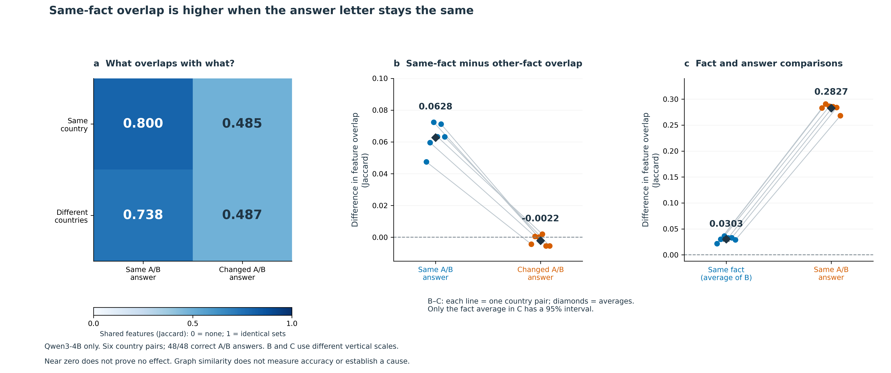

**Figure 5. Same-fact overlap is higher when the answer letter stays the same.** Qwen3-4B: six country pairs, 48 correct next-token A/B predictions, and identical word/token inventories within pairs. Rules were fixed before collection in this outcome-informed follow-up. A, Mean feature overlap in the four cross-wording comparisons: 0.8005, 0.4853, 0.7377, and 0.4874, read row by row. The scale runs from no shared features (0) to identical sets (1). B, Same-country minus different-country overlap is 0.0628 with the same letter and -0.0022 with a changed letter. Their paired difference is 0.0650 (exploratory Student-t 95% interval 0.0553–0.0746; two-sided sign-flip p=0.03125). C, Their average is the prespecified primary outcome: 0.0303 (95% block-bootstrap interval 0.0265–0.0338). The descriptive same-letter minus different-letter difference, averaged across country relationships, is 0.2827. Lines represent country pairs; diamonds show means. Only the primary mean in C has an interval drawn. Colors identify labeled categories; B and C use different vertical scales. Tests assume six independent country-pair blocks; the sign-flip test additionally assumes symmetric null differences. The 48 graphs and 4,096 conditional-null reassignments are not independent replicates. Near zero is not equivalence. Overlap differences are neither accuracy nor variance explained; query order, country roles, and output-conditioned graphs remain alternatives to a causal interpretation. Supplement S6 reports graph-location checks.

### 3.4 Error graphs show greater overlap with answer-matched controls

The matched-choice study used correct predictions. We next asked what graph overlap indicates when the predicted answer is wrong. With options “A: Berlin. B: Paris” and countries “France, Germany,” asking for the first country's capital produced A or Berlin, depending on the response format. Naming France instead produced B or Paris; naming Germany produced A or Berlin. The wrong-answer graph shared more features with the correct Germany prediction giving the same answer than with the correct France prediction.

These cases came from a separate list-position pilot that produced 8/16 correct A/B decisions and stopped at its prespecified accuracy gate. A local audit found no mismatch in expected answers, submitted prompts, token sequences, or top-token decoding. The later exploratory 20-preview diagnostic passed all four literal/replay checks. Its eight named-country prompts produced the intended next token; its eight selected position-based prompts reproduced errors across both response formats. The failed pilot's evaluation cohort remained uncollected.

All 16 diagnostic graphs passed integrity checks and reproduced their archived preview answers. Thus all eight ordinal errors persisted, all eight named-country controls remained correct, and all eight comparison triples met the clean-export and output-matching requirements. In every triple, the failure graph shared more features with the correct same-output response than with the correct intended-country response (Figure 6). The mean same-output minus same-country Jaccard difference was 0.1983 for A/B responses and 0.2649 for capital-name responses. Equal-feature-count sensitivities retained differences of 0.1851 and 0.2361, respectively; influence-weighted cosine preserved the direction in all eight triples. These are dependent descriptive comparisons, not eight independent replications.

The same-output advantage persisted in every selected comparison under all three graph-location filters. Removing both final-position nodes and the last quarter of observed feature layers gave mean differences of 0.2053 for labels and 0.2608 for capital names (Supplement Figure S6). The resemblance was therefore present beyond the removed node sets, even though the remaining graphs were still conditioned on the predicted output.

Across these selected cases, sharing the predicted answer corresponded to greater feature overlap than sharing the intended country. The cases use one country pair and overlapping controls, so they illustrate this relationship rather than estimate an error rate. Their layouts leave position matching and mishandled negation unresolved; Supporting analysis A3 reports the source-location observations, approximation error, and missing correct-answer logits.

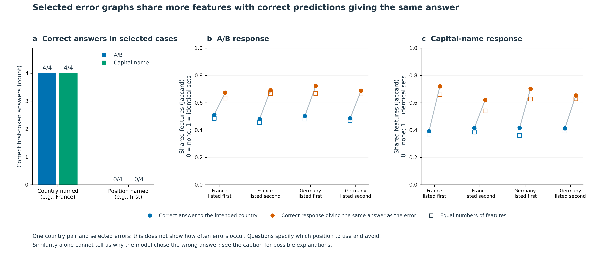

**Figure 6. Selected error graphs share more features with correct predictions giving the same answer.** Qwen3-4B, one country pair and two response formats. A, All eight named-country prompts predict the correct first token; all eight selected position-based prompts reproduce the error (four of each per format). B–C, Compare error graphs with correct predictions for the intended country (blue) or giving the same answer (orange), holding list order and A/B mapping fixed. With France first and A: Berlin, B: Paris, the indirect France question predicts Berlin; naming France predicts Paris and naming Germany predicts Berlin. The error graph shares more features with Germany/Berlin. Circles use all retained features; open squares average 200 equal-feature-count samples. Lines connect comparisons for the same error. Same-answer minus intended-country overlap averages 0.1983 for letters and 0.2649 for capital names (0.1851 and 0.2361 with equal counts). All 16 exports and eight comparison triples pass integrity and output checks. The selected cases share controls, so they support descriptive comparisons, not error-frequency estimates or population tests. Words differ between prompt types; position matching, negation errors, and output-conditioned graph structure remain unresolved explanations. The intended correct-answer node is absent from each error graph, leaving its contribution unknown.

### 3.5 Greater feature sharing between same-fact questions

The preceding comparisons establish the relationship between overlap and answer agreement. We also tested a simpler measurement explanation for the original three-model association: whether it disappears when every graph contributes the same number of features. Mean differences remained positive at both sampling sizes (Supplement Figure S3).

| Pipeline | Original mean | Equal K mean (descriptive 95% interval) | Equal K/2 mean | Positive averaged facts at K |
|---|---:|---:|---:|---:|
| Gemma-2-2B | 0.170 | 0.149 [0.066, 0.257] | 0.058 | 7/8 |
| Qwen3-1.7B | 0.085 | 0.081 [0.069, 0.094] | 0.032 | 5/5 |
| Qwen3-4B, incomplete | 0.162 | 0.126 [0.084, 0.168] | 0.051 | 10/10 |

The mean within each model remained positive in every one of the 200 repetitions of each sampling variant. Gemma's tungsten question reversed to an average overlap difference of -0.0187 at K and -0.0080 at K/2, leaving 7/8 positive averaged Gemma questions. The positive averages therefore survive equal feature counts without requiring every question to remain positive. Sampling changes the scale of Jaccard, so the reductions are not percentages of the original difference explained by graph size. Supporting analyses A1–A2 retain the output and export-integrity audits; A4 records the feature-count check and earlier regression correction.

### 3.6 The history pilot yields 15 of 20 correct predictions

To test the answer comparison in a second subject, we prepared a historical-date study with a fixed behavioral gate before graph collection.

The fixed 20-preview pilot finished with 15 correct top-label decisions: 4/4 literal A/B instruction checks, 7/8 document-history cells, and 4/8 spaceflight-history cells. All normalized returned prompts matched the submitted prompts, and server token inventories matched within each historical block. The protocol required 20/20 correct decisions, so no evaluation graphs were requested and the planned historical graph-overlap contrast was not measured.

The document-history error occurred when A represented 1783 and B represented 1776: the question asked for the year of adoption of the US Declaration of Independence, with the Treaty of Paris as context, but the top label was A. Reversing question/context order in that mapping returned B. The two pilot pairs document behavior under these prompts, not general history accuracy or a causal failure mechanism. The outcome leaves the stronger graph comparison confined to geography, with the original history exclusions unchanged.

| Pilot component | Correct top labels | Fixed requirement | Outcome |
|---|---:|---:|---|
| Literal A/B instructions | 4/4 | 4/4 | Passed |
| Declaration of Independence and Treaty of Paris | 7/8 | 8/8 | Failed |
| Sputnik 1 and Explorer 1 launch years | 4/8 | 8/8 | Failed |
| Entire pilot | 15/20 | 20/20 | No evaluation graphs requested |

## 4. Discussion

### 4.1 What the comparisons establish

The experiments connect three observations. Reworded questions about the same fact share more features in the original three-model samples. With matched word and token inventories in Qwen3-4B, the same-country overlap difference is larger when the answer letter stays the same. In selected errors, a wrong prediction shares more features with a correct prediction giving that same answer than with a correct prediction for the intended country. The progression shows why an average same-fact association must be interpreted together with answer agreement.

The contribution is more specific than the general warning that similarity is not causality. We identify which comparison changes the interpretation: separating same-answer from changed-answer pairs exposes a pattern that the positive average conceals. The selected-error comparison then demonstrates that this resemblance can coexist with an incorrect next-token decision. Equal-feature-count sampling and graph-location filters preserve the reported average patterns, so the observations persist under these checks of representation size and location.

For analyses using feature overlap, the practical implication is to report same-answer and changed-answer comparisons separately, state what behavior was verified, and distinguish overlap with the intended fact from overlap with the predicted answer. In this study those distinctions reveal a consistent answer-associated pattern. They preserve the positive original finding while specifying what it measures.

### 4.2 Scope and remaining questions

Three models from two families contribute to the original comparison; Qwen3-4B alone contributes to the stronger controls and selected-error diagnostic. The matched-choice estimates use six country pairs. The selected errors share one pair and overlapping controls. Subject coverage differs, the original Qwen3-4B collection is incomplete, and the failed history pilot provides no historical graph-overlap estimate. The results concern top-next-token decisions under the recorded hosted setup, not independently verified full generated answers or replication across deployments.

These comparisons establish associations in saved feature representations, not the cause of those associations. Word order, answer mapping, country roles, decomposition, pruning, and output-conditioned graph construction remain potential contributors. Removing nodes from an already output-conditioned graph does not remove that conditioning. In the selected capital-name errors, source-location weights favor the other country, whereas named-country controls favor the intended one; the A/B format does not show the same consistent pattern. Incorrect reference selection, option-position matching, and mishandled negation therefore remain alternative hypotheses. Fixed-attention attribution graphs also need not explain how the attention pattern arose [1]. This diagnostic complements earlier work on selection and positional retrieval [5,7] without establishing a new error mechanism.

Independent statistical review should assess the exchangeability and dependence assumptions described in Methods. A causal account would require interventions, and distinguishing position matching from negation errors would require varying those factors separately. Neither unresolved question changes the observed comparisons. The evidence supports an answer-associated interpretation of feature overlap in these tasks, not an absence of factual knowledge or a recovered answer-independent circuit.

## 5. Conclusion

Reworded questions about the same fact share more graph features in all three analyzed model samples. In the stronger Qwen3-4B comparison, that advantage is concentrated in pairs sharing the answer letter, and selected error graphs share more features with correct predictions giving the same answer. Feature overlap therefore captures answer-associated structure as well as the original same-fact association in these tasks. Interpreting it as evidence of factual processing requires accounting for the prompt comparison and predicted answer; overlap alone does not establish correctness.

## Supporting analyses

### A1 Next-token matching and complete answers

Among 30 available original Qwen3-1.7B factual prompt graphs, 28 had whole expected-answer next-token matches; the two mercury outputs were compatible `H` prefixes of `Hg`. Among 59 available Qwen3-4B factual graphs, 49 had whole-answer next-token matches, five were compatible substantive prefixes, and five produced a different next token under the audited expected-string conventions. The five prefixes were mercury target/paraphrase (`H`), Berlin Wall target/paraphrase (`G` for `Gorbachev`), and the French Revolution paraphrase (`Bast` for `Bastille`). No subsequent-token generation is archived to verify their completed answers.

These classifications do not establish semantic error for every different token: for example, a continuation beginning `African` could require full-answer adjudication against an expected acronym. Primary eligibility is unchanged, and these graphs are not added to the confirmatory sample.

Strict crossed expected-token agreement was 7/9, 4/9, and 0/9 for Gemma chemistry, geography, and history; corresponding Qwen3-4B counts were 8/9, 9/9, and 0/9. Eight Qwen3-4B crossed outputs were whitespace-only compatible continuations, not substantive answer retrieval. Only Qwen3-4B geography qualified as a fully balanced strict-output subset. There, binary fact and wording effects were 0.1014 and 0.1063: close point estimates from one small domain, without a formal dominance test.

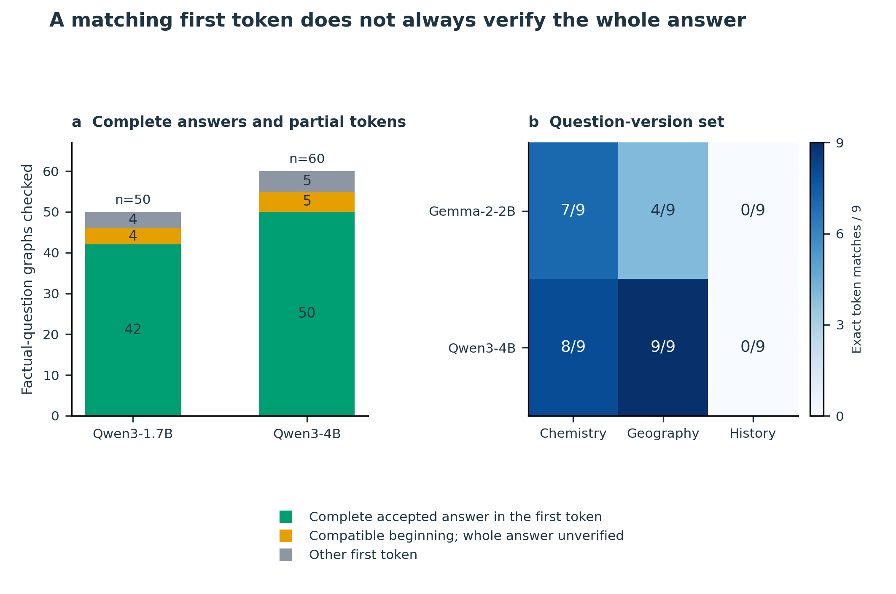

**Figure S5. A matching first token does not always verify the whole answer.** A, Audit the first predicted text unit, or token, using the Qwen tokenizers. Green means the whole expected answer fits in that token; yellow means it is only a compatible beginning, so the completed answer is unverified; gray means a different token. Seven apparent mismatches across the two Qwen models are compatible beginnings of multi-token answers. Counts include development and test factual questions, including Qwen3-1.7B geography questions without complete controls; they are not the question counts in Figure 2. Qwen3-4B is missing one factual graph and one invented name control graph. Official Qwen tokenizer versions agree with all saved prompt pieces and decoded top tokens, but the exact versions used at the time of graph collection cannot be fully recovered. Gemma tokenizer access was denied, leaving that audit unresolved. B, In the fact/wording experiment, counts use the original exact first-token matching rule after trimming whitespace; that rule is unchanged. Only Qwen3-4B geography matches in all nine questions. Its fact/wording differences are 0.101/0.106, which do not establish that either factor dominates. A zero in history means zero matches under this rule, not zero history knowledge. *The original Qwen3-4B collection is incomplete.

### A2 Export integrity and approximation error

Ambiguous IDs occurred in 84/120 original Gemma controlled exports and 13/27 Gemma crossed exports; none were detected in 50 original Qwen or 145 available Qwen3-4B exports. Reconstruction-error node influence remains nonzero: median fractions were approximately 7.15%, 5.76%, and 14.52% in the respective controlled cohorts. These are audit-defined fractions of absolute nonterminal influence, not causal percentages of an answer explained. The clean-export Gemma held-out sensitivity has only two facts.

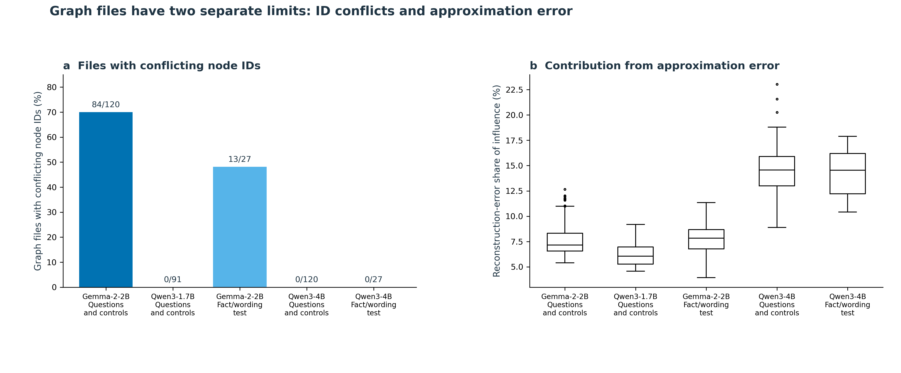

**Figure S1. Graph files have two separate limits: ID conflicts and approximation error.** A, The percentage of saved raw graph files in which the same node ID refers to conflicting node identities. Labels show affected files over files checked. Zero means no conflict was detected, not no graphs or no model errors. The original question sets include factual questions and controls; the fact/wording sets vary both factors. B, Reconstruction-error nodes record part of the model computation not captured by the feature approximation. The axis gives their share of absolute nonterminal-node influence, using the saved audit definitions. This is not the percentage of wrong answers or of reasoning explained. Box centers mark medians; boxes span the middle 50%, whiskers extend to values within 1.5 box lengths, and dots show values beyond the whiskers. Original distributions use raw-file audits; Qwen3-4B uses converted graphs with no ambiguous IDs removed. Differences combine model, exporter, and approximation choices; they do not isolate model size or architecture.

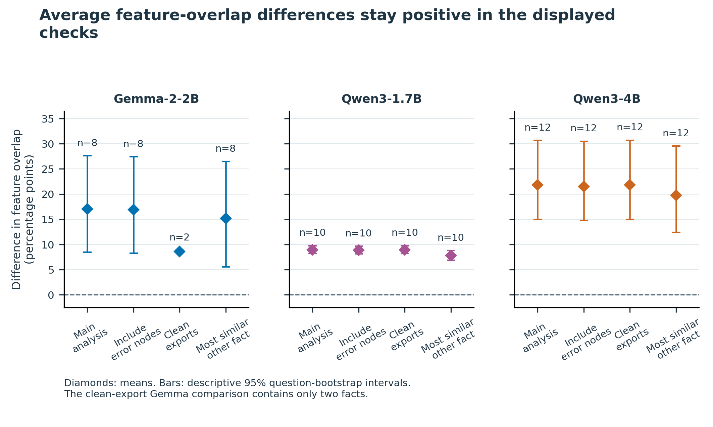

**Figure S2. Average overlap differences stay positive under alternative graph comparisons.** The difference in feature overlap is same-fact overlap minus other-fact overlap, using the comparison specified for each check. Compare the original analysis with three alternatives: include reconstruction-error nodes; use only files without detected node-ID conflicts; or compare with the most similar other-fact question rather than the average other-fact question. Reconstruction-error nodes represent approximation error, not wrong model answers. Points are saved averages; bars are 95% bootstrap intervals from resampling test questions. n counts questions. Restricting files requires rebuilding the comparison groups and leaves only two Gemma questions, so that positive result is weak evidence on its own. The size-regression intercept is not plotted: with centered predictors it equals the unadjusted mean and is not an independent check. *Qwen3-4B remains incomplete (145/147 graphs).

### A3 Source-location observations in selected errors

An additional inspection of token-location summaries provided a narrower clue. In all four capital-name failures, feature sources at the wrong country's name in the list had 4.9–14.6 times the absolute direct incoming weight of sources at the intended country's name. In all four named-country capital controls, the intended country's name had greater weight. The corresponding A/B summaries did not exhibit a consistent wrong-country dominance. This format-dependent observation is compatible with incorrect reference selection, but token location does not establish feature semantics or causal necessity.

The graphs also leave substantial uncertainty. Reconstruction-error sources accounted for a median 23.1% of absolute direct incoming weight to the observed logit across the 16 graphs (range 17.2–31.4%). The intended correct logit was absent from all eight failure exports, so its attribution is unavailable rather than zero. Most displayed nodes occur at late layers near the answer-generation position; a “chat frame” location label does not imply a formatting mechanism. Crucially, these selected layouts confound choosing the answer option at the requested position with choosing the country named by the excluded ordinal in phrases such as “first country, not the second.” Position matching and mishandled negation therefore remain observationally indistinguishable in this batch.

### A4 Comparison and sensitivity figures

The word-matching audit, equal-feature-count sampling, and graph-location filters support the comparisons in Results §§3.2–3.5. They test different aspects of the measurement: available comparison support, representation size, and retained node locations.

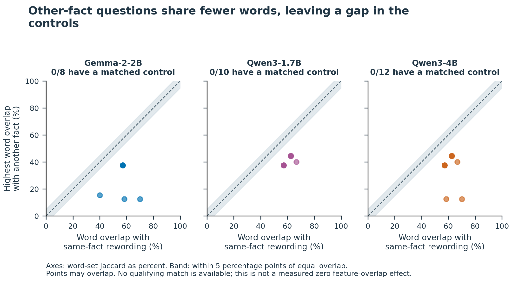

**Figure S4. Other-fact questions share fewer words, leaving a gap in the controls.** For each test question, compare word overlap with its same-fact rewording (horizontal axis) against the highest word overlap with any other-fact rewording (vertical axis). Word overlap uses unique letter/number words, ignores letter case, and keeps common words. Both axes use Jaccard overlap: shared words divided by all distinct words across the pair. The dashed line means equal overlap; the shaded band allows a difference of 0.05 in either direction. Every other-fact comparison falls below that band. Thus 0/8 Gemma, 0/5 Qwen3-1.7B, and 0/10 Qwen3-4B questions have a comparison meeting the specified word-matching rule. None qualifies under the alternative at-least-as-much-word-overlap rule or the joint word/feature-count rule either. This is a missing comparison, not a measured zero effect or proof that words explain all feature overlap. Same-fact questions also share their expected answer, so the data do not isolate meaning from words or answers. *Qwen3-4B remains incomplete (145/147 graphs).

An earlier regression check does not supply independent evidence against graph-size confounding: the ordinary least-squares intercept with centered predictors equals the original sample mean by construction. Sampling equal numbers of features provides a more direct but still limited check.

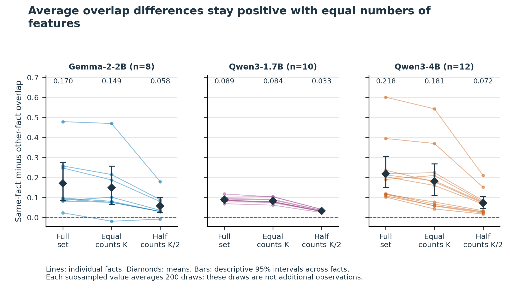

**Figure S3. Average overlap differences stay positive with equal numbers of features.** The difference in feature overlap is same-fact overlap minus average other-fact overlap within the same subject and test set. Within each model, subject, and test set, randomly sample the same number of features from every graph. K is the number of features in the smallest graph in that group; the second check uses half that number, rounded down. Repeat 200 times, reusing each sampled graph across comparisons within a repetition. Lines show individual test questions; diamonds show averages. Bars are descriptive 95% bootstrap intervals from resampling questions, not from the 200 feature samples. Seven of eight Gemma questions and all included Qwen questions retain positive average differences. Equalizing counts does not remove differences in shared words, answers, or which features the exporter retains. A smaller overlap score after sampling is not a percentage of signal explained. *Qwen3-4B remains incomplete (145/147 graphs).

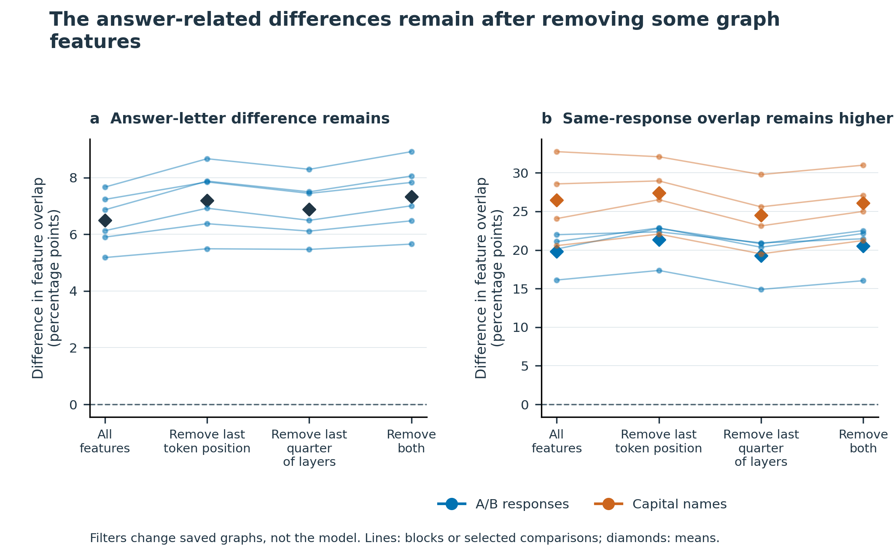

**Figure S6. The answer-related differences remain after removing some graph features.** Qwen3-4B only. Repeat the saved comparisons after removing features at the last token position, in the last quarter of observed feature layers, or both. Removal happens before combining feature identities across positions. A, Plot the difference between the same-letter and changed-letter fact comparisons in Figure 5B. Each line represents one of six country pairs; black diamonds show averages. B, Plot overlap with the correct same-answer response minus overlap with the correct intended-country response in the selected errors from Figure 6. Lines show the individual comparisons; colored diamonds show format averages. All filtered feature sets are nonempty. Zero means equal overlap, not missing data. These checks were chosen after seeing earlier results. No confidence intervals or new population tests are attached. Removing features from saved graphs is not an intervention on the model and does not establish a cause. The remaining graphs are still constructed around the answer being produced.

## Reproducibility and availability

The September plan is `EXPLORATORY_CONFOUND_CHECKS_20260905.md`. The CPU-only analysis and plotting scripts are `scripts/exploratory_confound_checks.py` and `scripts/plot_exploratory_confound_checks.py`. Their results, input hashes, tokenizer revisions, per-graph/pair/fact tables, subsampling repetitions, logs, and SVG/PNG figures are saved under `data/model_extension/exploratory_20260905`. The original primary files and earlier six-figure package are preserved. The new analyses do not constitute a clean-room rerun of every original estimator.

A curated working-paper review package is publicly available on the [GitHub submission branch](https://github.com/J-Lawrence10/autocircuit/tree/submission/neuronpedia_pipeline/paper_share). It contains the draft, figures, summary tables, protocols, and code snapshots; it is not a peer-reviewed publication or a complete raw-data release. Raw Neuronpedia exports, tokenizer/model files, credentials, and downloaded reference PDFs are excluded. Their redistribution permissions remain unresolved, and a complete appropriately licensed deposit and independent reproduction remain outstanding. The checks described below were performed on the same machine, not by an independent reviewer or a fresh hosted-model run. Human authors must review scientific claims and references. Codex assisted with code, audit, analysis, figures, and drafting; that assistance does not substitute for independent validation.

The October closeout audit is generated by `scripts/audit_paper_closeout.py` under `data/model_extension/final_closeout_20261005`; it reconstructs the archived matched-choice and failure contrasts from hash-verified saved graphs. The final history protocol is `HISTORY_CHOICE_FINAL_PROTOCOL.md`, with fixed design, runner, and analyzer in `scripts/history_choice_closeout.py`, `scripts/run_history_closeout.py`, and `scripts/analyze_history_closeout.py`. Its prompts, local freeze, request records, checksums, and outcomes are maintained separately under `data/model_extension/history_choice_final_v1`. `requirements-closeout.txt` specifies direct dependencies; the resolved package versions, test logs, and `verification.json` are saved under the closeout `reproduction` directory by `scripts/reproduce_closeout.py`. The isolated same-machine reproduction reconstructed all 23 original primary margins from 342 checksum-verified available raw graphs, matched the closeout audit, and passed 82 software tests. A separate terminal-pilot validator reconstructed the 15/20 gate from archived responses, checked frozen hashes and the shared request ledger, and confirmed that no evaluation graphs were generated. These checks are not independent human review or a fresh reproduction of hosted model outputs.

The matched-choice follow-up is documented in `MATCHED_CHOICE_CHAT_V2_PROTOCOL.md` and `MATCHED_CHOICE_RESULTS_FOR_MANUSCRIPT.md`; its archived inputs, block-level results, and figures are under `data/model_extension/matched_choice_chat_v2`. The failed position pilot is documented in `MATCHED_CHOICE_POSITION_V3_PROTOCOL.md`. Its diagnostic audit remains under `data/model_extension/position_artifact_diagnostic_20261001`.

The failure graph protocol is `FAILURE_CASE_GRAPH_ANALYSIS_PLAN.md`. All 16 raw exports, metadata, code snapshots, hashes, audits, converted node/edge tables, role summaries, comparison values, and PNG/SVG figures are under `data/model_extension/failure_case_graphs_v1`. The saved-data analysis, figure, and validation entry points are `scripts/analyze_failure_case_graphs.py`, `scripts/plot_failure_case_graphs.py`, and `scripts/validate_failure_case_graphs.py`. The descriptive country-location ratio divides `absolute_weight` for feature sources at the other country's list occurrence by the corresponding weight at the intended country's occurrence in each capital-name graph's `source_role_totals.csv`. The four failure ratios are 4.919, 8.773, 13.567, and 14.630 approximately; the unrounded tables are authoritative. This manuscript integration changes no frozen estimates or analysis files.

## References

1. Ameisen, E., Lindsey, J., Pearce, A., et al. (2025). *Circuit Tracing: Revealing Computational Graphs in Language Models*. [Methods](https://transformer-circuits.pub/2025/attribution-graphs/methods.html).
2. Franco, G., Tassis, L. M., Rohr, A., and Crovella, M. (2026). *Finding Interpretable Prompt-Specific Circuits in Language Models*. [arXiv:2602.13483](https://arxiv.org/abs/2602.13483).
3. Qwen. Official [Qwen3-1.7B tokenizer configuration](https://huggingface.co/Qwen/Qwen3-1.7B/blob/main/tokenizer_config.json) and [Qwen3-4B tokenizer configuration](https://huggingface.co/Qwen/Qwen3-4B/blob/main/tokenizer_config.json). Actual downloaded revisions and file hashes are in the audit artifacts.
4. Hugging Face. [Tokenizer encoding and decoding API](https://huggingface.co/docs/tokenizers/api/tokenizer). Google. [Gemma-2-2B repository](https://huggingface.co/google/gemma-2-2b).

5. Zheng, C., Zhou, H., Meng, F., Zhou, J., and Huang, M. (2024). *Large Language Models Are Not Robust Multiple Choice Selectors*. ICLR. [arXiv:2309.03882](https://arxiv.org/abs/2309.03882).
6. Wang, X., Ma, B., Hu, C., et al. (2024). *“My Answer is C”: First-Token Probabilities Do Not Match Text Answers in Instruction-Tuned Language Models*. [arXiv:2402.14499](https://arxiv.org/abs/2402.14499).
7. Zhang, Z., Xiong, H.-D., Wilson, R. C., Aoi, M., Mattar, M. G., and Ji-An, L. (2026). *The Position Curse: LLMs Struggle to Locate the Last Few Items in a List*. [arXiv:2605.07127](https://arxiv.org/abs/2605.07127).

The references support the methods and comparisons discussed here; they do not constitute an exhaustive novelty review.
